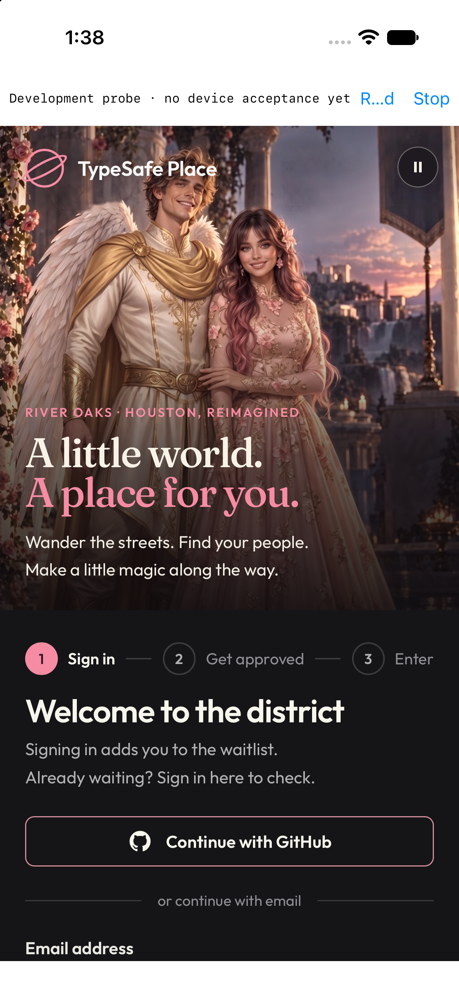
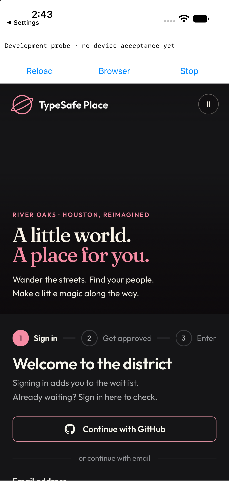
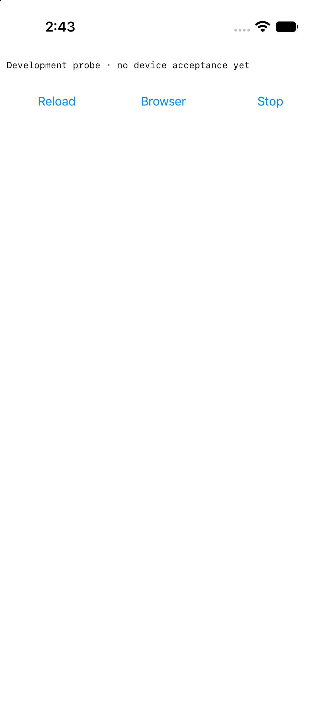
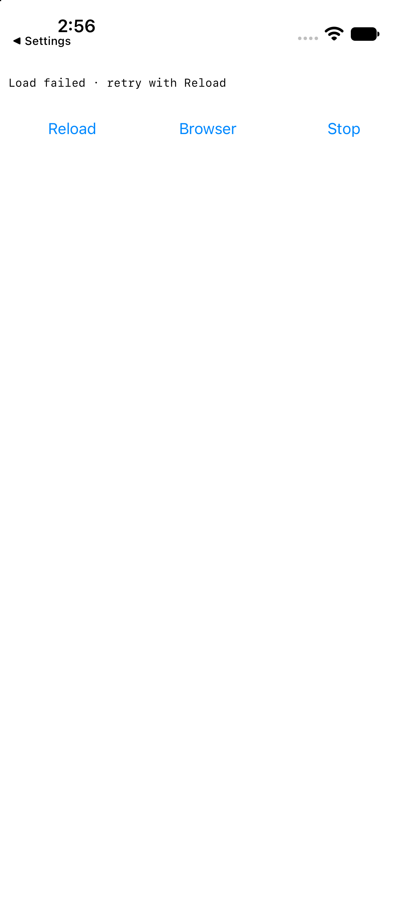

# Diagnostic host simulator evidence, 1 November 2026

These are actual unsigned Release iPhone 17 / iOS 27.2 simulator captures from native base `decb4e9ac8ee86ab0ed04fb97600550f96e502d5` plus the dirty source changes pinned by [summary.json](summary.json). They are not concept images, a production scaffold, physical-device evidence or full host acceptance. Hosted content revision is unknown.

The unchanged main probe exited immediately because the current SDK requires a scene lifecycle. The scene repair restored launch. Its first rendered toolbar hid Browser and truncated Reload; the final toolbar separates status from equal-width existing actions. The app stays alive and returns from Settings as the same process with one recording containing background/foreground notifications. The input app metadata, package-file hashes, native source-file hashes and raw native-only events are retained here. The pre-toolbar binary was not retained; its screenshot remains a visual baseline.

The initial final-build capture below shows blank page content while the diagnostic banner remains visible. This is an observed loading-presentation gap, not qualified loading UX. The page had rendered by the foreground capture above. No cold-ready or gameplay performance result is inferred.

A configuration-only copy of the same unsigned app changed only ProbeEntry to `https://unavailable.invalid/play`; every other package file compared byte-identical. It records navigation failure `-1003` and visibly retains `Load failed · retry with Reload` plus all three actions after foreground. This exercises the existing provisional failure path without changing trust, origins in source, bridge methods or authentication.

## Reproduce and limitations

Build with the [probe README](../../../experiments/ios-probe/README.md), then run `node scripts/browser-lock.mjs 'probe launch smoke' -- node scripts/ios-probe-launch-smoke.mjs --app <unsigned simulator app> --output <new evidence directory>`. The simulator is created and removed by the runner. The recorded native-only events are unfinalized at deliberate teardown and are not performance evidence.

`swift scripts/ios-probe-controls-smoke.swift <screenshot>` checks expected action-label words in the top quarter using local Vision OCR; [controls-ocr.json](controls-ocr.json) records the check against the committed after-foreground image. Manual screenshot inspection confirms these labels belong to the native action row. OCR alone cannot prove UI ownership, hit targets, keyboard focus, VoiceOver, Dynamic Type or accessibility acceptance.

Both final core attempts timed out in preview tests after ten minutes, at reduced and normal CPU priority, and did not run subsequent stages. Both failures are preserved in the [audit ledger](../../superpowers/plans/2026-11-01-host-isolation-286-audit.md). A separate `pnpm run build` and source/evidence secrets check passed; the aggregate core gate remains failed. Simulator/native passes do not replace that gate, hosted CI, production origin/auth/private-resource checks, selected-host packaging/version/cache/update work or the missing physical-device evidence. Host selection and production scaffold permission remain pending under #286.
