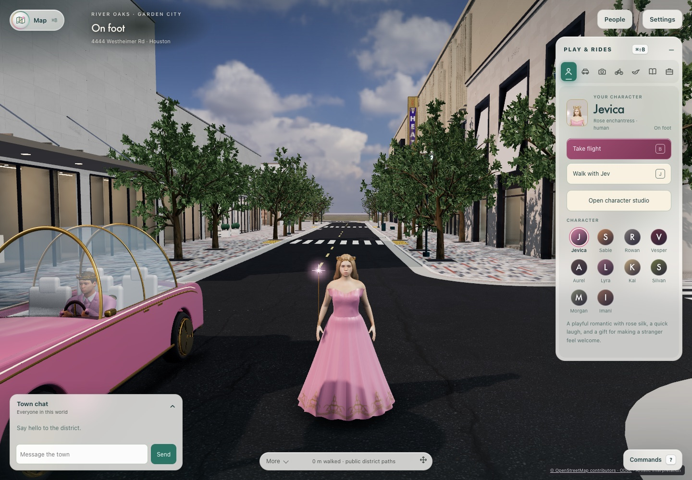
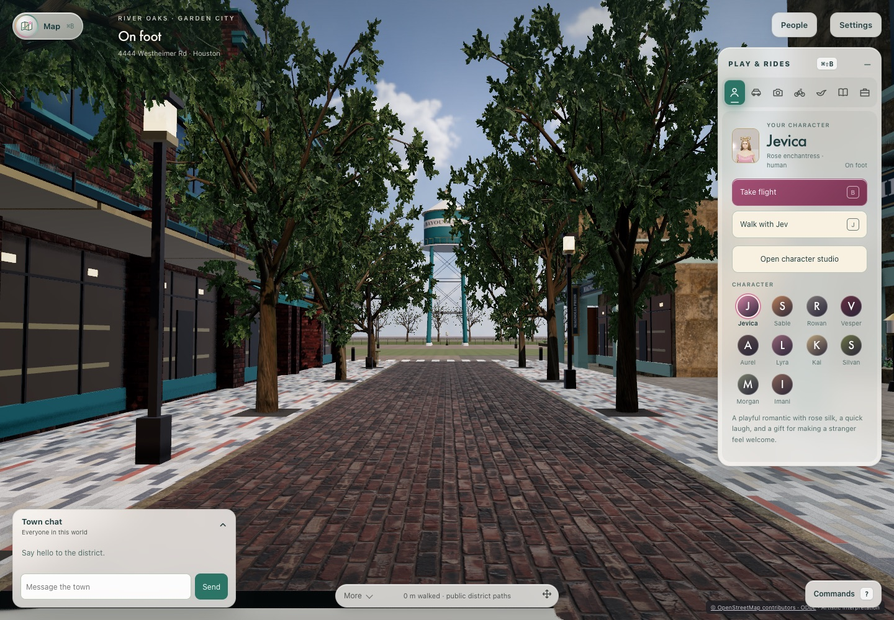
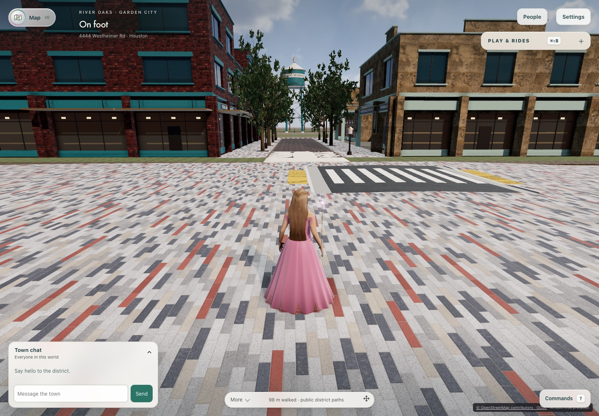
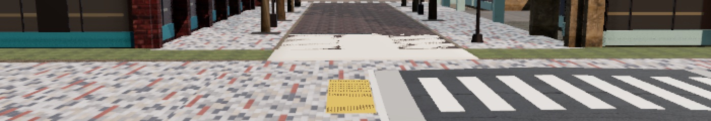
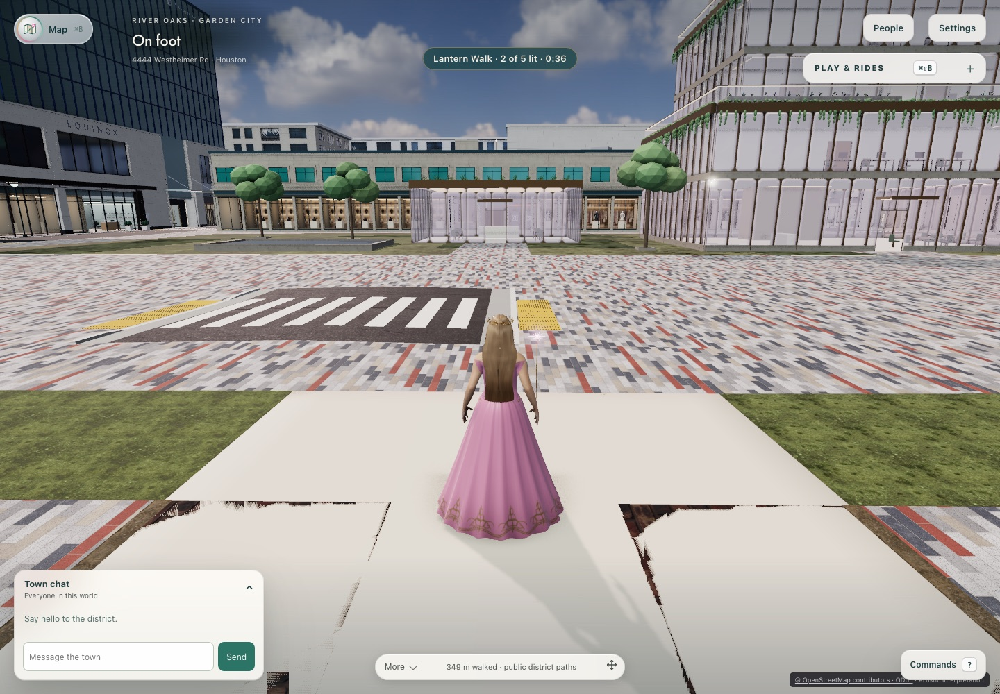
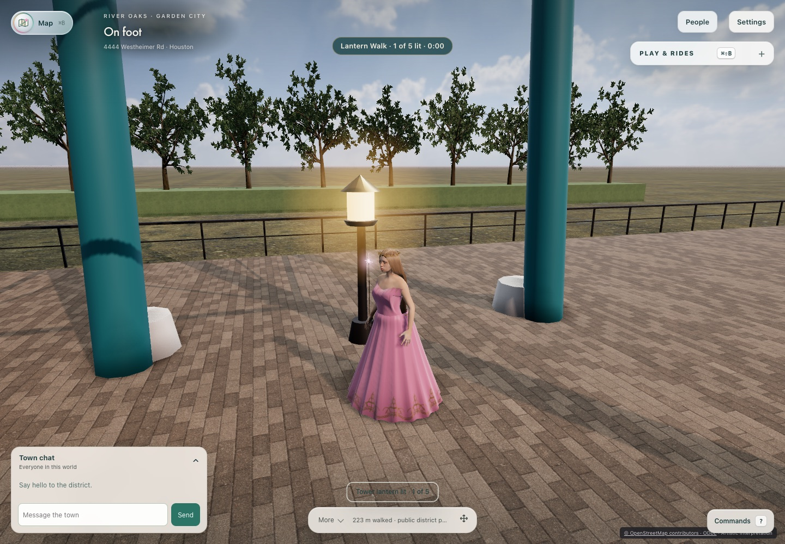
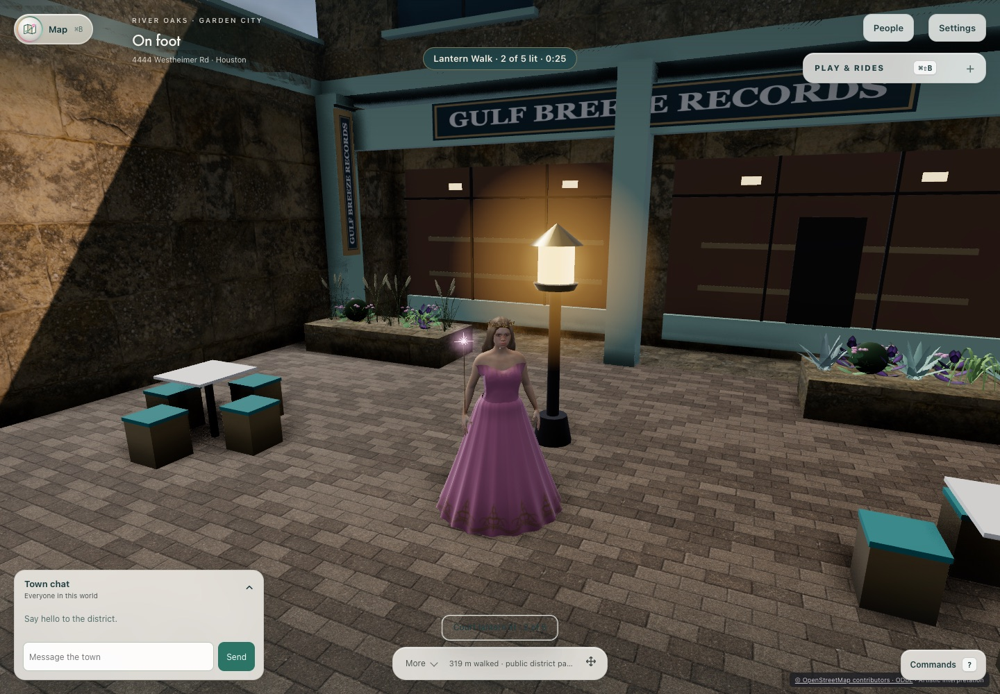
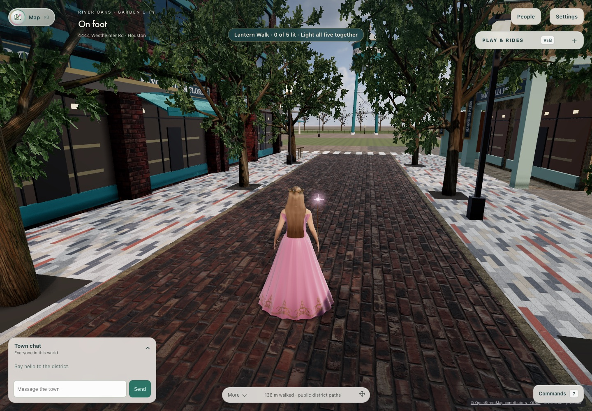

# World expansion MVP: release readiness

**Decision (2026-10-24, main `2cbc4dc4`): NO-GO for player-facing activation of Bayou Market Commons. GO for continued opt-in, internal play.**

The destination on main is functionally sound, and it does not regress the District:

- Two players can travel there and back.
- They can play shared chess and the Lantern Walk, and reconnect.
- With the Commons composed, CPU, mean frame time and reconnect at the District arrival stay within budget under the paired continuous-metric protocol Val adopted on 2026-10-24 (#626), and the arrival looks unchanged.
- Production JavaScript grows by under 1%.

Activation is still blocked by four things:

1. Main's required hosted check failed 6 of 13 times on the Commons journey itself. PR #639 fixes the two causes found: a test-driver overshoot at CI's 9 fps, and a pre-existing server corner-slide refusal (D14). Hosted Commons then passed 5 of 5 runs, and Val approved landing. **#639 merged on 2026-10-24 at 17:26 UTC as `98c7dd74`.** The rarer post-chess stand-up stall is instrumented but not explained (D1).
2. The MVP's streaming and accessibility gate work (#582/#583/#587) is not on main. It lives in PR #623, which conflicts with main.
3. A light-theme contrast failure on the walking controls is being fixed by its owner.
4. Human visual approval, human keyboard/screen-reader acceptance and agreed target-device budgets do not exist yet.

Val accepted the first destination's 1.12× reachable ground for this MVP on 2026-10-24. The 3–5× target remains a multi-destination program goal.

## Candidate and scope

| Item | Value |
| --- | --- |
| Candidate | origin/main `2cbc4dc470897bd8ee4da059ac8795885ee594c1` (#621), which includes the destination slice #611 |
| Destination | Bayou Market Commons, opt-in revision `east-garden-commons-market-1`. Production defaults are unchanged |
| Not included | Streaming #582/#583, #587 gate fixes and authoring preservation (PR #623, draft, CONFLICTING in 9 files); activation runbook #630; perf protocol #626 |
| Host | Apple M5 Max, 18 logical CPUs, macOS, Chromium 156 (Playwright), ANGLE Metal unless noted |
| Authority | Local fixture identities over loopback HTTP/WebSocket. Redis tests use an owned disposable `redis-server` on 127.0.0.1:16521 with persistence off |
| Not measured | Physical phones (the user deferred iPhone testing), hosted/production performance, live WorkOS, GPU memory bytes, thermal behavior, human perception |

## Reproducible release checklist

Run every step on one pinned commit, keep first failures, and record the head plus a clean `git status`. Commands run from the repository root.

| # | Gate | Command / action | Pass rule | Result on `2cbc4dc4` |
| --- | --- | --- | --- | --- |
| 1 | Locked setup | `pnpm install --frozen-lockfile && uv sync --locked && pnpm run agent:doctor full` | Doctor passes with `REDIS_URL` set to an owned loopback test Redis | Passed |
| 2 | Core + Redis + browser | `REDIS_URL=redis://127.0.0.1:<port>/0 pnpm run verify full` (Python ≥3.11 on PATH) | All 18 stages pass; skips only documented platform skips | **full-001 failed at experience.** 15 stages passed: the 13 non-browser stages (tooling 218/218, preview 3,902 + 1 known skip, server 1,128/1,128 on Redis, desktop 115 + 3 Windows-only skips, Python 156), security-browser 2/2 and reflections. Experience hit its 20-min aggregate deadline during the Commons return, after a `garden-campus-traversal` failure, at host load 24–44: 15 of its 17 journeys passed. **Completing lock turn, same head and Redis:** the `garden-campus-traversal` retry passed; `east-garden-commons` passed (with the driver patch); shared passed 27/27 (load 52–57); IPIC passed. Every full-profile stage has a pass on this head, but not in one uninterrupted run |
| 3 | Hosted Verify | `gh run list --branch main --workflow Verify` | Aggregate `preview` green on the release commit and stable across reruns | **Main fails.** `preview experience (commons)` failed 6 of 13 runs since #611. **With #639:** Commons passed 4/4 on `d6000b84` (run 40099339261) and passed on the merged head `44e51601` (run 40114160932). Merged as `98c7dd74`. **First main run after the merge (40116152217): Commons passed.** The aggregate failed only on `worlds-and-creator` (`creator-approved-cafe`, the #489 flake, moved to on-demand in #644). A Studio flake from #504 is fixed separately in #642 (D9) |
| 4 | Two-player journey | `pnpm run test:experience east-garden-commons` | Arrival → Market Street → chess → reconnect → Lantern Walk → return, no reload, no page errors | Local Metal run in full-001 passed every check through the owner's return, then was killed by the stage deadline. Standalone reruns with the driver fix passed on Metal and at 9 fps. Hosted is flaky until #639 (row 3) |
| 5 | Keyboard-only traversal | `node .runtime/release-readiness/keyboard-hands-on.mjs <out>` (task-local; the keyboard gate journey lives in #623) | Arrow keys/W/Z only; one announcement per crossing; named Tab stops | **Passed 16/17.** The failure is the HUD location label (D7). [Report](mvp-release-readiness-20261024/keyboard-hands-on-report.json) |
| 6 | District parity performance | ABBA: `RIVER_OAKS_BASELINE_REVISION={river-oaks-gardens-3,east-garden-commons-market-1} node preview/audit/world-expansion-baseline.js` in A/B/B/A order under one lock, then `RIVER_OAKS_BASELINE_VIEW=market-street` | Paired continuous metrics (#626 protocol, adopted by Val 2026-10-24): mean frame and CPU p95 ≤1.10, reconnect ≤1.20, drift ≤0.5 m | **Passed** on all four workloads. Phone two-client frame p95 is 1.249× on a refresh step; recorded, but not a gate metric under the adopted protocol (D11) |
| 7 | District visual parity | Pixel diff of matched spawn captures, Gardens vs Market | Difference within run-to-run noise; human review of destination captures | Arrival parity passed. Destination human review open |
| 8 | Production download | `vite build --config preview/vite.config.js` for the pre- and post-destination commits; gzip JS/CSS | ≤10% growth | **Passed** (+0.86% JS) |
| 9 | Reachable area | `node preview/audit/world-expansion-footprint.js --reachable` | MVP: first destination measured. Program: 3–5× Gardens | **Accepted for MVP** (Val, 2026-10-24): 1.119× (52,030.75 vs 46,477.75 m² at 0.5 m). The program target remains open |
| 10 | Streaming / chunk unloading | #583 twenty-loop journey (in #623) | No growth after eviction | **Not on main**; main loads the Commons eagerly |
| 11 | Activation rehearsal | `node --test server/tests/commons-activation-rehearsal.test.js` against isolated Redis (#630) | Both directions, stale-epoch refusal | Not on main (#630 draft) |
| 12 | Human acceptance | Val: visual approval, keyboard + screen-reader round trip, target devices and budgets | Recorded on the release commit | Open |

## Evidence

### Matched performance against the District baseline

The protocol is three warmed 30-second samples per workload, Sharp quality and reduced motion, using the fixed District spawn camera except in C. A is Gardens (two runs), B is Market revision at the same spawn (two runs), and C is Market Street (one run). All runs passed with zero page errors, asset failures and reconnect drift. Raw data: [perf-abba-comparison.json](mvp-release-readiness-20261024/perf-abba-comparison.json).

| Workload | B/A CPU p95 | B/A mean frame | B/A frame p95 | B/A reconnect | C/A CPU p95 | C/A draw calls |
| --- | ---: | ---: | ---: | ---: | ---: | ---: |
| Desktop 1440×1000, 1 client | 1.073 | 1.006 | 1.000 | – | 0.879 | 0.558 |
| Desktop, 2 clients | 0.957 | 0.894 | 0.999 | 0.994 | 0.809 | 0.538 |
| Phone viewport 390×844 DPR 2, 1 client | 0.946 | 1.000 | 0.997 | – | 0.996 | 0.608 |
| Phone viewport, 2 clients | 0.942 | 1.001 | 1.249* | 0.734 | 0.790 | 0.589 |

\* The pooled median went from 33.4 to 41.7 ms. The per-run medians were A1/A2 33.4/33.4 ms and B1/B2 50/33.4 ms. Every sample sits on a 60 Hz refresh multiple, while the continuous metrics did not move (mean frame interval 1.001×, CPU p95 0.942×). This is the vsync quantization #626 documents. It exceeded the provisional p95 wording; Val's adoption of #626's paired continuous-metric protocol on 2026-10-24 resolved it (D11).

Retained cost of the eager destination at the District arrival:
- renderer geometries +16% and textures +5–6%;
- heap about +3%;
- desktop first-player readiness +16% and asset readiness +20% (phone viewport −6% and −3%).

These should fall once #583 streaming lands.

### Visuals

| District arrival, Gardens (A1) | District arrival, Market revision (B1) | Market Street (C1) |
| --- | --- | --- |
|  |  |  |

At the arrival, pixel difference between A and B (0.04–0.38% of pixels changed by more than 24 levels) matches A-vs-A run noise (0.04–0.24%). Animated birds and figures account for it.

On Market Street I observed:
- a brick lane, tree rows, frontage and lamp posts, with the Bayou Lantern as the landmark;
- glazing that reads as flat dark panels;
- empty ground visible on the horizon past the tower;
- a HUD that still shows the District street address and "public district paths".

[Capture provenance](mvp-release-readiness-20261024/captures-provenance.json).

### Keyboard-only hands-on traversal

One rendered player used only the keyboard on `2cbc4dc4` (Metal, reduced motion): arrow keys to turn, W/Shift to walk, Z to interact. The route went from District arrival to the eastern gateway, Market Street, the Bayou Lantern, the court, and back to the arrival. Total 115 s across seven legs.

- Tab from the top of the page reaches the 3D street view at stop 6. All 60 recorded Tab stops have accessible names and are visible. The order runs Town chat → message → send → map → street view → attribution → commands → people → settings → more → movement controls → play & rides.
- The polite live region announced exactly one entry ("Bayou Market Commons · Market Street, the Bayou Green and the Bayou Lantern") and one return ("Back in River Oaks District"). Lantern progress was announced ("Tower lantern lit · 1 of 5", "Lantern Walk · 2 of 5 lit").
- Z lit the tower and court lanterns, and the authoritative snapshot confirmed both.
- No page errors.
- **Failed:** the HUD location text stays "public district paths" throughout the Commons (D7).

This is automated evidence. It does not replace a human keyboard and screen-reader review.

| Gateway looking east | Seam close-up (z-fighting, D10) | Seam looking west |
| --- | --- | --- |
|  |  |  |

| Bayou Lantern | Court | Market Street |
| --- | --- | --- |
|  |  |  |

What the inspected captures show:

- **Gateway (looking east):** the framing reads as an intended entry, with District paving and a crosswalk leading into the Market Street frontage and the tower centered.
- **Gateway slab (seam):** the 3 m ivory slab shimmers with dark streaks, and up close (looking west) its edges show torn dark shards. This is z-fighting between coplanar seam surfaces, and every crossing player sees it (D10).
- **Bayou Lantern:** empty flat ground runs to the horizon past the railing and hedge (D8).
- **Court:** the floating lantern notice is nearly unreadable, dark text in a transparent pill over the paving. This is the contrast defect D3 in gameplay. The storefront glazing reads as flat brown panels (D8).

### Production download

Gzipped production JS: 1,949,772 bytes before the destination merge (`827886fd`) and 1,966,546 after (`00a36290`), +0.86%. The merge added no binary assets.

## Prioritized defect list

| ID | Priority | Defect | Evidence | Owner / status |
| --- | --- | --- | --- | --- |
| D1 | **P1 → fixed on main (`98c7dd74`); post-merge observation open** | Hosted `preview experience (commons)` failed 6/13 runs, which makes the required check unreliable for every PR. There were three modes:

**A (harness):** the driver held W across slow round trips at 9 fps and circled waypoints.

**C (authority, D14):** stalls at a District corner.

**B (not reproduced locally in 4 tries):** a player stays on the stand spot after chess. | Hosted logs; 9 fps diag-004 red → diag-005/006 green; the combined fix's local Metal Commons and spatial-streets runs passed, and its 9 fps journey passed (1,127 s); hosted Commons 4/4 on `d6000b84` | **PR #639** fixes A and C:

- driver settle-near-waypoint;
- server elbow acceptance;
- refusal diagnostics.

Commits `407328e7`, `84bde258` and `d6000b84` are signed. Reviews: ready. Val approved landing. **Merged 2026-10-24 as `98c7dd74`** (reviewed head `44e51601`); the local branch and worktree are retired with a verified archive. B remains instrumented; a recurrence will report the town's refusals and corrections |
| D2 | **P1 blocker** | MVP streaming (#582/#583), #587 gate fixes (keyboard reload from load error, HUD location label) and authoring preservation are not on main. PR #623 is draft and conflicts in 9 files | `git merge-tree origin/main origin/integration/expansion-mvp-20261023` | `integrated-expansion-mvp-20261023` (codex), active |
| D3 | **P1 blocker** (accessibility) | Light-theme walking movement controls and floating notices measure about 1.05–1.11:1 contrast | Owner's regression failed before the fix (`contrast-red-002`) | `movement-pad-contrast-20261024` (codex), fix in verification |
| D4 | **P1 blocker** (product) | No agreed target hardware or budgets; no human visual, keyboard or screen-reader acceptance | – | Val |
| D5 | Resolved (decision) | Reachable ground is 1.119× Gardens against the original 3–5× target. Projected capacity at District density is 2.99× | Footprint receipt | **Val accepted 1.12× for the MVP (2026-10-24).** 3–5× stays a program target for later destinations |
| D6 | P2 | Main loads the Commons eagerly: +16% geometries, +20% desktop asset readiness at the District | ABBA table | Expected to be resolved by #583 streaming in #623; remeasure there |
| D7 | P3 | The HUD shows "public district paths" and the District street address inside the Commons | Market Street capture | Fixed in #623 (gate fix 1) |
| D8 | P3 (visual) | Storefront glazing reads flat and dark; bare ground on the horizon past the tower | Market Street capture | Bayou luxe polish task (claude, active) |
| D9 | P3 (CI, non-expansion) | Non-expansion hosted flakes on main:

- email-access settings tab not visible (`2cbc4dc4`);
- Redis Studio rollout budget (`c786ce1d`);
- `character-studio-shared` since #504 (`55b88b31`): a Studio preview shadow pass starves the CPU acceptance profile. | Hosted logs; reported by the PR-sweep session | The Studio flake is fixed in #642 (sweep session). The others are unowned; record any recurrence |
| D10 | P2 (visual, seam) | Z-fighting on the 3 m ivory gateway slab at the District↔Commons seam: shimmering dark streaks, and torn edges up close | Keyboard captures 02/06 and the seam crop | Fits Bayou luxe polish ("road cohesion with the District"). That owner session is not live; recorded here |
| D11 | Resolved (decision) | Phone two-client frame p95 at the District arrival is 1.249× the Gardens baseline (33.4 → 41.7 ms pooled median, on 60 Hz steps), against a provisional 1.10 budget. Continuous metrics are unchanged | ABBA comparison | **Resolved:** Val adopted #626's paired continuous-metric protocol (2026-10-24); mean frame 1.001× and CPU p95 0.942× pass. Target-device measurement (D4) still supersedes this host-only result |
| D12 | P2 (verification infra) | The local `experience` stage (17 journeys) can exceed its 20-minute aggregate deadline under host load. This happened in full-001 (1,200,064 ms) and earlier in the streaming owner's full attempt (1,200,026 ms). The Commons journey is last in the list, so it is the one killed | full-001 receipt; `world-streaming-582-583` register verification | Unowned. Keep the deadline; consider moving the long Commons journey to its own stage or measuring per-journey durations. Do not just raise the limit |
| D13 | P3 (non-expansion) | `garden-campus-traversal` failed locally ("could not walk to under B12", Floor 2) at host load 24–44; it passed in hosted CI on the same head | full-001 log | **Standalone retry passed** (09:00–09:03 UTC, same head). The first failure is preserved; treated as load-related, cause unproven |
| D14 | Fixed (movement authority, pre-existing) | Walking round two District building corners on the arrival→gateway route (near (−2714.9, −1321.9) and (−2726.7, −1302.5)) rubber-bands. The client slides along a wall one axis at a time, so its path round a convex corner is an elbow, and every point it visits is free. The server checks the straight chord between consecutive 200 ms poses, which clips the corner's collision margin, so it answers `blocked` and snaps the player back. Under fine frame steps the Node reproduction never gets past (1,482 refusals). The Gardens revision is identical, so this is pre-existing and not caused by the expansion. **On hosted CI, both attempts on #639 stalled alice exactly at (−2726.5, −1302.6)**: the precise-arrival driver makes the trap deterministic there | `probe-chord.mjs`, `probe-home-blocked.mjs`; diag-005/006 and journey-report refusals; #639 hosted run 40092445030 attempts 1–2 | This task: the server accepts a clear axis-aligned elbow when the chord is `blocked` on foot, with the same 0.15 m collision, private-home and suite checks, and charges the budget for the elbow's length. Regression tests: 3 red before the fix, 4/4 green after. Independent review: ready. Val approved landing. **Fixed on main by #639 (`98c7dd74`)** |

## Path to GO

1. #639 is merged (`98c7dd74`). Confirm the Commons job stays reliable across the next main and PR runs.
2. Land #623 on current main. Then rerun rows 2–7 and 10 on the merged head, including the twenty-loop streaming journey and the keyboard gate.
3. Land the D3 contrast fix and #630. Rerun the rehearsal on the release commit.
4. Val records visual approval, the keyboard/screen-reader round trip, and the target devices with their budgets. The reachable-area (D5) and performance-protocol (D11) decisions were made on 2026-10-24.
5. Activate per `docs/world-expansion-activation.md` (#630), with a monitored 30-minute window and its rollback triggers.
