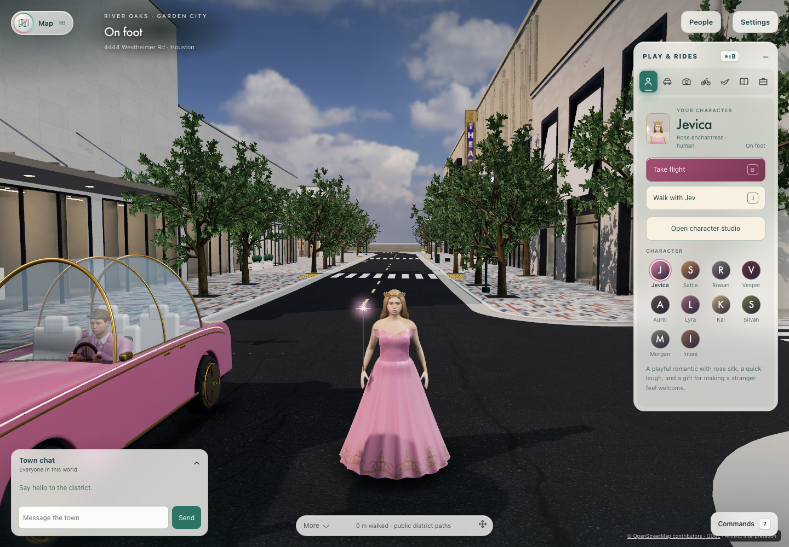
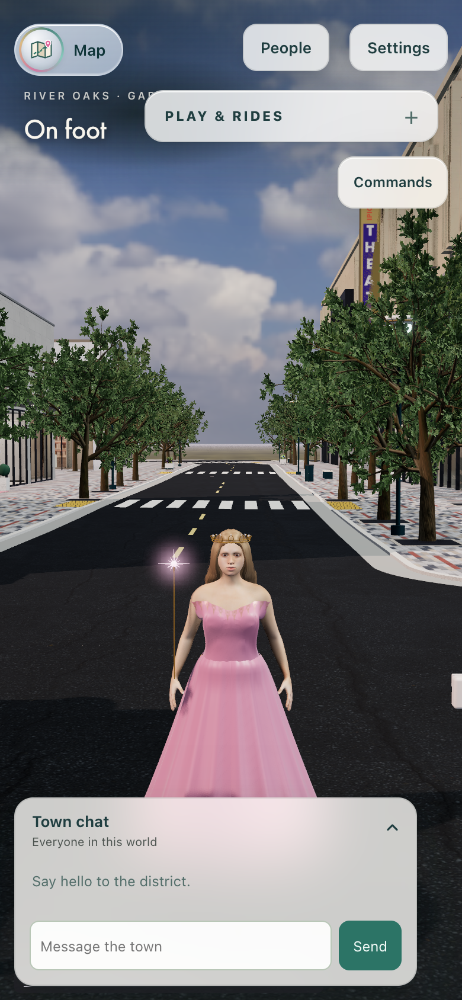

# Phase 1 review: Mac baseline and readiness

The manifest corrections have focused regression coverage, and the measured Mac baseline is reproducible. Phase 1 acceptance remains incomplete. Bounded Phase 2 routing and streaming experiments can use the pinned foundation; a performance-qualified expansion rollout is not yet supported by this evidence.

## Measured source and protocol

Run: 2026-10-23 05:38–05:46 UTC, commit `c2cac2d30247238adbfcf4323a7f328813033427`. Command: `node preview/audit/world-expansion-baseline.js`. The normal shared browser queue granted the run before provenance capture. All 33 reviewed source/configuration hashes were unchanged after measurement. [Raw report](phase1-review-20261023/mac-baseline.json), [reviewed hashes](phase1-review-20261023/reviewed-source-hashes.json), [artifact provenance](phase1-review-20261023/artifact-provenance.json).

Hardware: this Mac, Apple M5 Max, 18 logical CPUs, Chromium 156.0.8078.4 with ANGLE Metal. Gardens revision, Sharp quality, reduced motion, fixed arrival camera, local fixture identities and loopback authority. Each workload has three 30-second samples, each following five seconds of warmup. Two-player workloads render two complete clients on this Mac. All twelve samples, asset checks and reconnect checks passed with zero page errors and zero reconnect position drift. One-minute host load ranged from 13.80 to 42.36; this was not an idle-host capacity benchmark.

## Measurements

Values below are the median of the three sample p95 values, in milliseconds. The phone-sized viewport uses the Mac GPU and does not establish physical iPhone performance; the user explicitly deferred iPhone testing.

| Mac workload | Frame p95 | CPU submission p95 | Earlier frame p95 | Earlier CPU p95 |
| --- | ---: | ---: | ---: | ---: |
| Desktop 1440×1000, DPR 1, one client | 16.7 | 13.9 | 16.7 | 14.3 |
| Desktop 1440×1000, DPR 1, two clients | 50.0 | 17.7 | 33.4 | 14.7 |
| Phone viewport 390×844, DPR 2, one client | 16.8 | 10.5 | 16.7 | 9.9 |
| Phone viewport 390×844, DPR 2, two clients | 33.4 | 12.4 | 33.4 | 13.1 |

The desktop two-client frame median is 49.7% higher and CPU submission 20.4% higher than the earlier audit, exceeding the proposed 10% allowance. This is a measured difference, not a passing performance gate or a proven source regression. Camera, viewport, quality, browser and reduced-motion settings match; host load and thermal state were not controlled across runs. The historical audit hashes eight files shared with the current report; seven match and the manifest validator differs. Six additional current source/harness files lack historical hashes, so this comparison does not establish complete source equivalence. Preserve these results and perform a controlled paired comparison before approving a performance budget. [Comparison and coverage](phase1-review-20261023/comparison.json), [unmodified historical report](phase1-review-20261023/historical-mac-baseline.json).

| Timing/resource | Desktop | Phone viewport on Mac |
| --- | ---: | ---: |
| First-player ready | 3.429 s | 5.432 s |
| Assets ready | 5.555 s | 8.284 s |
| Second-player ready | 13.252 s | 4.422 s |
| Socket reconnect | 1.214 s | 1.268 s |
| Recorded initial transfer | 73,705,985 bytes | 73,706,763 bytes |
| Renderer geometries, one → two clients | 530 → 546 | 523 → 539 |
| Renderer textures, one → two clients | 162 → 166 | 149 → 153 |

Transfer includes Vite development modules and is not a production-download measurement. Heap counters are coarse Chromium observations; geometry/texture counts are not GPU memory bytes. Stationary samples do not prove travel-loop resource cleanup, thermal stability or target-device memory limits.

## Matched arrival images

The fixed-camera desktop and phone-sized images preserve the visible District street, buildings, trees and arrival composition. Dynamic actors and animation differ. This inspection covers these two views, not every District interior or gallery. The phone-sized HUD overlaps the title and obscures much of the scene in both versions; this is not mobile usability or human accessibility acceptance. Images are copied unmodified, with hashes in the provenance file.

| View | Earlier audit | Current review |
| --- | --- | --- |
| Desktop, one client |  |  |
| Phone viewport, two clients on Mac |  |  |

## Foundation and Phase 2 decision

The reviewed source passed 137 manifest, Commons, rollback, real-transport, gallery and flight/path tests with isolated Redis and no skips. Default/Gardens composed data, stable IDs and occupied checkpoints have equality/restoration regressions. An arbitrary translated location registers, serializes and removes through data; authored content uses the existing composition seams without copying District. The coordinate audit retains the source EPSG:32615 east/north origin and NAVD88 height convention; its numerical round trip is not survey validation. [Coordinate receipt](phase1-review-20261023/coordinate-audit.json).

The current source reproduces 46,477.75 m² reachable Gardens ground and 51,962 m² with Commons at a 0.5 m sample grid: +11.80%. Reserved rectangles are not playable ground. With Commons fixed, even hypothetical 100% use of the remaining reserve reaches only 4.094× Gardens; the 5× upper target requires more reserved land or an explicitly approved metric change. [Reachable-area receipt](phase1-review-20261023/reachable-area.json).

Hosted Verify and Desktop passed on evidence checkpoint `56ac2aca` without a retry. On earlier `c2cac2d3`, the office-computer account-switch shard required one retry after a detached-button timeout. An earlier head also retained a Commons return timeout before its single passing retry. These original failures remain in the local review receipts and are described in the [review ledger](../superpowers/plans/2026-10-23-phase1-review.md). Full local verification subsequently passed all 18 phases with isolated Redis (05:46–06:27 UTC). The receipt pins starting head `c2cac2d3`; subsequent commits changed only documentation/evidence, and all 33 reviewed application/configuration hashes remained unchanged. [Full receipt](phase1-review-20261023/local-full.json), [journey summary](phase1-review-20261023/journey-summary.json).

Phase 2 may begin as bounded, reversible engineering against the tested manifest, with explicit work on routing, load/unload failure recovery and repeated-travel cleanup. Performance acceptance remains open because the desktop two-client comparison exceeds the proposed allowance, budgets are unapproved, production-download and GPU-memory evidence is missing, broader visual/human accessibility review is incomplete, and physical iPhone testing is deferred. Neither code merge nor the automatic closure of #580/#581 establishes phase completion.

## Full local verification

Command: `REDIS_URL=redis://127.0.0.1:16391/0 PATH=/opt/homebrew/opt/python@3.12/libexec/bin:$PATH pnpm run verify full`, run under the normal browser queue. Tooling: 201 passed; preview: 3,847 passed and one skipped; server with isolated Redis: 1,022 passed and zero skipped; desktop: 115 passed and three Windows-only PowerShell cases skipped; Python: 149 passed; security browser: two passed. Build, dependency audit, lint/format, offline demo, secret/worktree/history checks and WebGL reflections passed. The preview skip is the existing Vince negative glass-entry approach, already obstructed and explicitly not evidence about that glazing. No skip is counted as coverage.

All 17 experience journeys and 25 shared-world journeys passed. Commons completed normal keyboard travel, shared chess, reconnect and both return routes in 162.145 seconds, with an 814 ms reconnect and no page errors or document reload. IPIC screening passed its two-viewer, host-control, rejection, replacement, caption and teardown checks; its background transition is emulated, not physical-device proof. Raw terminal logs and full journey reports remain under `.runtime/world-manifest/`; their compact published receipts preserve commands, phase results and journey outcomes. Original tracked historical reports were restored only after the new receipts were copied and checked.
