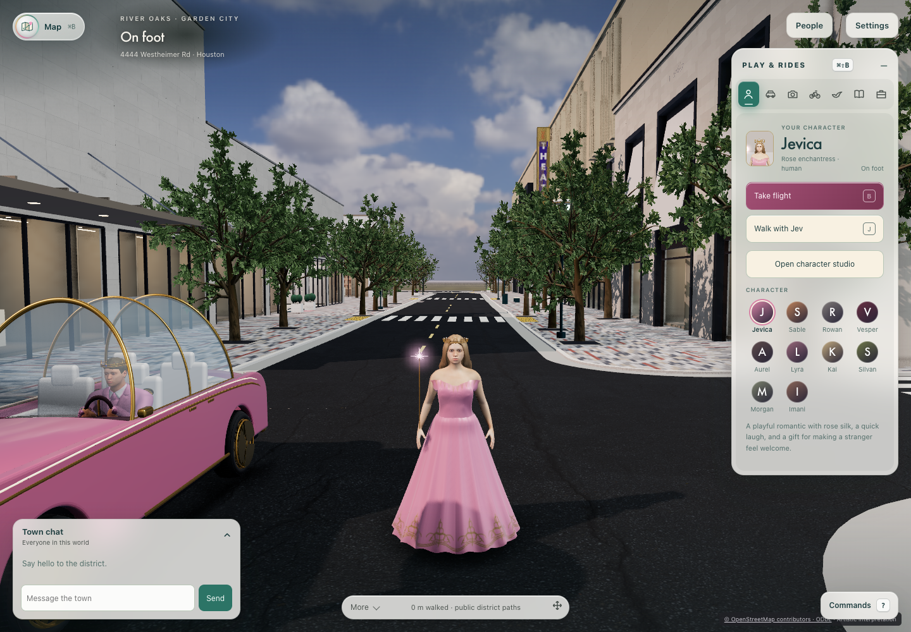
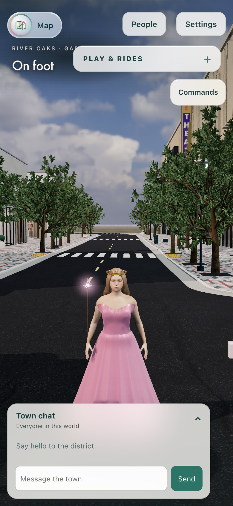

# Two-player performance: paired baseline comparison

Paired on the same Mac and browser, `main` at `98ac7d7b` stays within the provisional engineering budgets against the historical #580 baseline *as measured by the amendment proposed below* (mean frame interval and uncapped frame p95). Frame time, CPU submission and reconnect all pass on that basis, on both desktop and phone-sized profiles. Under the budget's current wording in `docs/world-expansion.md`, which applies to warmed frame p95, the vsync-locked phone two-client p95 reads +49.6% and would be over; whether to adopt the amendment is still a decision. The Phase 1 report's desktop two-client "+49.7% frame p95" and #583's phone two-client "+49.7%" are the same artifact. With vsync on, frame p95 moves in whole 60 Hz refresh steps (16.7 → 33.4 → 50.0 ms), so one step reads as +50%. Unpaired runs taken under different host load decide which step a sample lands on. No source regression was found, so no renderer change was made. The rest of this report proposes a protocol amendment that removes the artifact from future gates.

## Protocol

- **Arms:** base `6ff47ba1` (the revision the historical #580 baseline measured) and candidate `main` at `98ac7d7b`. Each runs from its own worktree with the same extended harness, `preview/audit/world-expansion-baseline.js`; only the measured application source differs. The measured harness is the one recorded in the reports' source hashes (branch commit `ef11a82e`). The later main merge `07ca386d` rewrote `world-expansion-baseline.js` and `baseline-options.js` to keep #584–586's options; that merged harness has passed its unit tests but has not been run end to end.
- **Order:** ABBA, base-1, main-1, main-2, base-2, under one held browser lock (2026-10-24 00:35–01:24 UTC) so that no other local browser run interleaved.
- **Vsync-on runs:** the Phase 1 protocol. Desktop 1440×1000 at DPR 1 and the phone-sized 390×844 viewport at DPR 2, Sharp quality, reduced motion, fixed arrival camera. Three warmed 30-second samples per player count, with 5 seconds of warmup each.
- **Vsync-off runs:** the same protocol with `--vsync=off` (desktop only), which removes the refresh cap so intervals measure frame cost. The CPU profiles were recorded in a separate unmeasured window after the timed samples.
- **Two-client samples:** both clients are timed over the same window. Earlier runs timed only the first player.
- **Source stability:** every report's recorded source hashes match the measured worktrees after the runs.
- **Comparison:** `node preview/audit/baseline-compare.js --base=… --candidate=…`. Each arm's value is the mean of its two reports, and each report contributes the median across its samples.

Hardware: Apple M5 Max (18 logical CPUs), Chromium with ANGLE Metal. Host one-minute load ranged from 7 to 125 across samples. This was not an idle host, which is why the arms were interleaved.

## Results

Budgets (from `docs/world-expansion.md`): 10% for frame and CPU, 20% for reconnect. "Informational" rows are reported but are not budget decisions.

Vsync on (Phase 1 protocol), [compare-vsync-on.json](two-player-perf-20261023/compare-vsync-on.json):

| Workload | Metric | Base | Main | Change | Decision |
| --- | --- | ---: | ---: | ---: | --- |
| Desktop, 1 client | frame mean | 16.84 ms | 16.67 ms | −1.0% | within |
| Desktop, 1 client | CPU submission p95 | 14.90 ms | 11.15 ms | −25.2% | within |
| Desktop, 2 clients | frame mean | 35.06 ms | 33.43 ms | −4.6% | within |
| Desktop, 2 clients | CPU submission p95 | 14.25 ms | 14.70 ms | +3.2% | within |
| Desktop, 2 clients | frame p95 | 50.0 ms | 50.0 ms | 0.0% | informational |
| Desktop | reconnect | 1.197 s | 0.968 s | −19.1% | within |
| Phone viewport, 1 client | frame mean | 16.67 ms | 16.68 ms | 0.0% | within |
| Phone viewport, 1 client | CPU submission p95 | 11.40 ms | 11.55 ms | +1.3% | within |
| Phone viewport, 2 clients | frame mean | 26.87 ms | 26.05 ms | −3.0% | within |
| Phone viewport, 2 clients | CPU submission p95 | 12.65 ms | 11.75 ms | −7.1% | within |
| Phone viewport, 2 clients | frame p95 | 33.4 ms | 49.95 ms | +49.6% | informational |
| Phone viewport | reconnect | 1.077 s | 0.959 s | −11.0% | within |

Every reconnect preserved position exactly (0 m drift).

The phone two-client row reproduces the reported +49.6% frame p95 while mean frame time improved by 3.0% and CPU p95 by 7.1%. Frame p95 lands on 33.4 or 50 ms depending on whether more than 5% of frames missed two refreshes. Across samples of the same source, that share ranged from 0% to 26% on base and from 0% to 17% on main.

Vsync off (frame cost uncapped, desktop), [compare-vsync-off.json](two-player-perf-20261023/compare-vsync-off.json):

| Workload | Metric | Base | Main | Change | Decision |
| --- | --- | ---: | ---: | ---: | --- |
| 1 client | frame mean | 10.86 ms | 10.86 ms | 0.0% | within |
| 1 client | CPU submission p95 | 10.70 ms | 10.85 ms | +1.4% | within |
| 2 clients | frame mean | 23.85 ms | 25.06 ms | +5.1% | within |
| 2 clients | CPU submission p95 | 38.45 ms | 41.30 ms | +7.4% | within |
| 1 client | frame p95 | 13.8 ms | 14.85 ms | +7.6% | informational (within under the amendment) |
| 2 clients | frame p95 | 45.4 ms | 47.85 ms | +5.4% | informational (within under the amendment) |
| reconnect | | 1.469 s | 1.533 s | +4.4% | within |

The committed comparison was produced before the tool budgeted uncapped p95. With that rule (the amendment's item 2), `node preview/audit/baseline-compare.js --base=…/base-off-1.json,…/base-off-2.json --candidate=…/main-off-1.json,…/main-off-2.json` on the same four reports gives identical values and decides both frame p95 rows within budget (2026-10-24, open-PR sweep).

Draw calls (1,629–1,707), triangles, and renderer geometries/textures (530/162 for one client, 546/166 for two) are identical between arms.

## Attribution

**Per-frame phases** (main, two clients, vsync off): the `pipeline` phase (synchronous WebGL submission and post-processing) is 18–20 ms of the frame. `players` is about 2 ms, and every other phase is under 1 ms.

**CPU profiles** ([diff](two-player-perf-20261023/cpu-profile-diff.txt), raw profiles gzipped beside it): inclusive time per application module differs by at most ±4 percentage points between base and main. GTAO occlusion is about 3 points cheaper on main. The new per-frame work since the baseline is crime HUD, world-policy UI, crime rival figures, flight acknowledgment and voice. None of it reaches 1% of main-thread time. Both clients' main threads were more than 99% busy while uncapped.

**What drives two-client cost:** two complete renderers (RenderPass about 49%, GTAO about 21–24%) contend for one GPU process on one host. This is inherent to the harness's two-clients-on-one-Mac workload, and it is common to both arms. It is not a cost introduced since the baseline.

**Crime rivals (#597):** they add two remote avatar rigs to every client, including solo clients. At the arrival camera they are 145–149 m away, beyond the 120 m remote-avatar gate, so they stay suspended and hidden. Renderer geometry/texture counts at arrival are unchanged. Their cost near the rivals' danger zone was not measured here.

**#583 streaming** (read-only review of the streaming owner's receipts on `f4aa1670`): their first matched run's Commons desktop two-client window ran at host load 163.8. Their lower-load repeat measured Commons vs Gardens CPU p95 at 11.9 vs 12.5 ms (desktop, one client), 13.8 vs 14.2 ms (desktop, two clients) and 12.6 vs 12.6 ms (phone, two clients), with identical frame p95. The "+23.7% solo CPU" and "+49.7% phone two-client frame" come from unpaired windows and the refresh-step artifact. They are not streaming costs.

## Matched images

These are fixed-camera arrival images from the second paired round. The District street, trees, buildings, avatar, carriage and HUD match. Only the birds in flight differ (dynamic actors).

| View | Base `6ff47ba1` | Main `98ac7d7b` |
| --- | --- | --- |
| Desktop, one client |  |  |
| Phone viewport, two clients |  |  |

## Proposed budget protocol amendment (for decision)

The budget percentages are unchanged. What changes is how they are measured:

1. **Paired runs:** decide budgets only from paired base/candidate runs (ABBA or longer) taken under one held browser lock. Unpaired historical comparisons are informational.
2. **Frame budget:** apply the 10% frame budget to mean frame interval, and to uncapped (`--vsync=off`) frame p95 when tail behavior matters. Vsync-locked frame p95 stays in reports but is informational, since any change is at least one 16.7 ms step.
3. **CPU and reconnect:** keep the 10% CPU-submission p95 and 20% reconnect budgets.
4. **Host load:** record host load per sample, and rerun a pair when one arm's samples ran above roughly 2× the other's load.

This removes no measurement and lowers no threshold. It replaces a metric that cannot resolve a 10% change with metrics that can.

## Verification

These receipts cover revision `98ac7d7b` plus this branch's working changes. The measured application source is unchanged; the changes add harness options, tests and documentation. [Compact receipt](two-player-perf-20261023/verification.json).

**Focused:** `node --test preview/tests/baseline-options.test.js preview/tests/baseline-compare.test.js`, 8/8 passed with 0 skipped at the measured revision. After the main merge and the uncapped-p95 budget, the same command passes 10/10.

**Core** (`pnpm run verify`, Homebrew Python 3.12 first on PATH): all 11 stages passed. Results: tooling 207/207; preview 3,885 passed with 1 skip (the existing obstructed Vince glazing case); server 824 passed with 218 Redis-dependent skips (core runs without Redis); desktop 115 passed with 3 Windows-only skips; Python 149 passed; build, demo and secrets passed. The first attempt ran under the host's default Python 3.9 and failed 4 tooling tests on `tarfile.extractall(filter=…)`, which needs a newer Python. That failed receipt is preserved locally and is not counted.

**Full** (`pnpm run verify full`): all 18 stages passed (2026-10-24 01:33–04:42 UTC), with an isolated disposable Redis on 127.0.0.1:16473 that was stopped afterwards. Results: server with Redis 1,084/1,084; dependency audit and secret history passed; security browser 2/2; WebGL reflections passed; 17 experience journeys and 27 shared journeys passed; IPIC screening passed. The run rewrote the tracked generated reports `data/reports/experience.json` and `shared-experience.json`. Their summaries and hashes are in the receipt, and the tracked versions were restored.

## Not verified

- Physical iPhone (deferred by the user), production downloads, GPU memory bytes, and hosted performance.
- Thermal state and an idle host.
- Two clients on separate devices, which would remove the shared-GPU contention.
- The rivals' danger zone.
- The vsync-off phone profile.
- Only two ABBA rounds were run, so changes of a few percent, such as the uncapped two-client +5.1%, are within run-to-run variation and should not be read as attributed costs.
