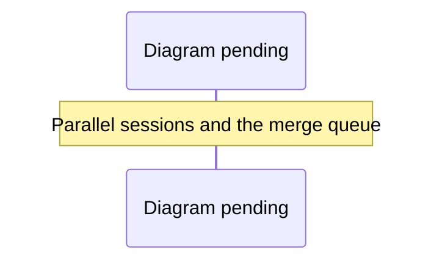

# Coding-agent workflow

Start at [AGENTS.md](../AGENTS.md), then use the [task map](architecture.md).
The executable catalog is `config/agent-workflow.json`; commands below work from
the repository root and use existing suites without external account credentials.

## Bootstrap

Use pnpm 10.34.5 (the only supported JavaScript package manager), Node >=22.12 (CI: Node 24), Python >=3.11 (CI: 3.11/3.13), uv, Git and Gitleaks.

```sh
corepack enable
corepack prepare pnpm@10.34.5 --activate
pnpm install --frozen-lockfile
uv sync --locked
sh scripts/install-hooks.sh
pnpm run agent:doctor
pnpm run agent:list
```

`pnpm install` (its `prepare` step) already installs the shared Git hooks and the
task-register merge driver. `scripts/install-hooks.sh` also checks that Gitleaks
is present. Install Gitleaks before committing; the guard fails closed without it. Bootstrap
downloads locked dependencies. Browser installation is separate and explicit:
`pnpm exec playwright install chromium` (Linux CI uses `--with-deps`). Optional voice,
GIS, native assets and provider keys are not required for the core gate.

Do not load/copy `.env` into test sessions. Use the existing fixture runners for
approved test identities. Normal `pnpm run dev` follows the actual access gate;
it is not an unattended test fixture.

## Choose a gate

| Command | Scope |
| --- | --- |
| `pnpm run verify tooling` | `test:agent`: runner failure/timeout/prerequisite regressions, catalog consistency, the task-register merge driver, project status/inventory/archives/prune/cancel, secret and ref hooks, pnpm policy, skill views and the plans index |
| `pnpm run verify preview` / `server` / `desktop` / `build` | Focused existing suite or build for the owning runtime |
| `pnpm run verify desktop-package` | Desktop unit tests, `desktop:package` for the host platform and arch, then `desktop:package:check`: the fuse wire matches `desktop/fuses.js` and the asar holds exactly the staged files (receipt `.runtime/agent/desktop-package.json`) |
| `pnpm run verify web` | Agent, preview, server, desktop unit tests; production web/landing build |
| `pnpm run verify python` | Ruff, Python tests, offline synthetic pipeline |
| `pnpm run verify` | Web + Python + worktree secret guard; default `core` |
| `pnpm run verify security` | Worktree and full local Git-history secret scan |
| `pnpm run verify browser` | Build, security browser regressions, WebGL reflection, ten experience journeys (player-lifecycle, multiplayer-lifecycle, contextual-first-visit, store-intro, photo-mode, rail-navigation, places-guide, world-studio, spatial-circulation, spatial-streets) and all shared-town journeys |
| `pnpm run verify full` | Core + mandatory Redis server tests + JavaScript dependency audit + history scan + browser journeys |

`pnpm run agent:doctor full` prints JSON prerequisite diagnostics, exits 2 when
something is missing, and does not start services/install packages or read env
files. It checks presence, not service health or dependency freshness. The actual
suite proves connectivity and behavior. `agent:list` prints the task catalog. For JSON-only output, use
`pnpm run --silent agent:list` or `pnpm run --silent agent:doctor`.

For full verification, start a disposable Redis service separately and set
`REDIS_URL` to that isolated test service in the invoking environment. Never point
it at production or run FLUSHDB. Without REDIS_URL, `full` blocks; `core` permits
the existing suite's Redis skips and is explicitly narrower.

On Linux, use the same CPU browser setup as CI:

```sh
RIVER_OAKS_SHARED_SOFTWARE=1 RIVER_OAKS_SECURITY_SOFTWARE=1 RIVER_OAKS_EXPERIENCE_SOFTWARE=1 \
  LIBGL_ALWAYS_SOFTWARE=1 LP_NUM_THREADS=2 \
  xvfb-run -a pnpm run verify browser
```

The shared runner uses temporary identities and owned servers; CPU rendering
proves fixture behavior, not visual quality. On macOS, run the browser profile
directly. The `shared` (30 minutes) and `experience` (20 minutes) tasks have longer deadlines; the others use the 10-minute default. All browser tasks require functioning WebGL2.

For a changed browser interaction, also run its named journey, for example:
`pnpm run test:experience hud-and-quality`. Local browser runs from different
sessions take turns; see [Local browser runs take turns](project-management/workflow.md#local-browser-runs-take-turns). Desktop changes may require
`pnpm run test:desktop:e2e`. The hosted `Desktop` workflow packages and checks the app on Windows, Linux and macOS, uploads unsigned builds, and builds and install-tests the Windows and Linux installers ([desktop](desktop.md#ci-builds-on-windows-linux-and-macos), [installers](desktop.md#installers-for-windows-and-linux)). Native changes require the build and automation
commands in [Unreal setup](unreal.md); source-only hosts can run
`RiverOaks.Contracts` after a native build. These are not silently included in
`full`, which covers the listed local runtime checks. The hosted Python-version matrix,
the Python dependency audit and PR dependency review remain separate CI gates. CI's
experience journeys differ slightly from `verify full`'s list: CI also runs
`destination-minimap` but not `player-lifecycle` or `multiplayer-lifecycle`
(`.github/workflows/verify.yml`, `config/agent-workflow.json`). Live WorkOS, hosted routing, packaged
apps, real voice, human keyboard/VoiceOver and target GPU performance require
separate acceptance evidence appropriate to the change.

## Receipts and failure handling

The runner executes tasks sequentially, stops on the first failure/block, and
writes `.runtime/agent/<profile>.json` before, during, and after the run. Exit codes:
0 passed the selected checks, 1 failed/invalid command, 2 missing executable or
required environment. Each task records its command, expected/actual exit,
duration and status. Remaining tasks are `not_run`. Console output retains
underlying test counts, skips and diagnostics; receipts do not capture output or
credential values. On macOS/Linux, timeouts and handled interruptions stop the owned process group.
Windows process-tree cleanup has not been verified. A forcibly killed runner may leave `status: running`; that is incomplete,
never passing. Do not run the same profile concurrently in one worktree because
the latest receipt replaces the previous one. Receipts include HEAD and dirty
state but do not identify the exact uncommitted diff; hand off the patch too.

The offline demo's expected exit 2 is a tested domain result (missing real-world
acceptance inputs), not a waiver for other tasks. Existing browser reports remain
in `data/reports/` and screenshots in `output/playwright/`; inspect `git status`
after acceptance runs and keep evidence changes separate from source changes.
Local browser runs rewrite the tracked `data/reports/experience.json` and
`data/reports/shared-experience.json`; restore them unless the run is the
evidence you intend to commit (CI writes `ci-experience.json` instead).

A failed gate needs diagnosis at its owning seam. Do not weaken a threshold,
turn off auth, add sleeps, or count skipped checks as a fix. Record unrelated
baseline failures separately and keep their evidence visible.

## Delivery

Maintain a concise task ledger with files owned, required behavior, commands,
results, and remaining work. Review `git diff --check`, `git diff --stat`, and the
actual diff. Verify before any commit. Deliver a handoff with branch/worktree,
changes, tests, proof gaps and next action. Commit/push/merge/deploy require the
user's task authorization; successful local verification alone grants none.

`pnpm-lock.yaml` is the sole JavaScript lockfile. Install and public-script guards reject other package managers and versions; CI uses frozen installs. Electron and esbuild are the only approved dependency build scripts. Historical reports retain the commands actually run at their recorded revision.

## CI, the merge gate and parallel sessions

Hosted CI is described in [testing](testing.md#hosted-ci). The `main` ruleset requires
the aggregate `preview` check. A PR merges only when it is up to date with `main`
and every check is green. `verify.yml` has no `merge_group` trigger, so there is no
GitHub merge queue. A branch that is behind is rebased (or merged with `main`), and
its checks rerun before merging. Commits must be signed.

Several agent sessions often work in one repository at once. Each claims its task
in the primary checkout's live register and works in its own sibling worktree on
its own branch. To merge, run `pnpm run land <pr>` ([landing a pull request](project-management/workflow.md#landing-a-pull-request)).
It queues the PR with every other session on this machine, updates the branch from
`main` on its turn, waits for Verify, reruns failed jobs once, and merges through
the guard. After a merge, the next queued PR updates from the new `main`, so its
CI reruns. Known flaky
journeys (see testing) are rerun once with "rerun failed jobs" before being
treated as regressions.


<details><summary>Diagram prompt: merge-queue</summary>

Draw a sequence diagram of several agent sessions sharing one repository safely. Participants: Session A, Session B, the primary checkout (Val's dev server and the live task register), the local landing queue (common Git directory), GitHub (PRs, Verify CI), and the merge guard (gh-merge-when-green.sh). Steps: each session claims a task in the live register and works in its own sibling worktree on its own branch -> opens a PR -> runs `pnpm run land <pr>`, which queues it in the common Git directory shared by every worktree (`pnpm run land --status` shows the queue) -> on its turn the lander updates the branch from main with GitHub's update-branch (verified commits), waits for Verify, reruns failed jobs once, and merges only through the guard -> if main moves first it updates and goes again; it stops on a conflict, a repeat failure or a guard refusal -> a register sweep PR later commits live-only records -> project:prune retires the delivered worktree and branch. Show the failure branch where a PR merged outside the queue moves main and the queued PR must update and rerun.

See [the diagram index](diagrams.md) for the convention.

</details>

## Project lifecycle

Use [task ownership and retirement](project-management/workflow.md) at session
start, delivery and handoff. `pnpm run --silent project:status --github` compares
local branches/worktrees with the task register and live PRs without changing them.
`project:check` exits nonzero for reconciliation gaps, not application test failures;
orphan checkouts (no task, or a task whose recorded worktree is gone) are gaps too, and
`--allow-orphans` downgrades only those to warnings. `pnpm run project:inventory`
classifies every local branch and worktree (`--remote` adds a report-only list of
merged remote branches), and `pnpm run project:archives` verifies the restore
archives under `~/worktree-backups/river-oaks/`. Both are read-only.
