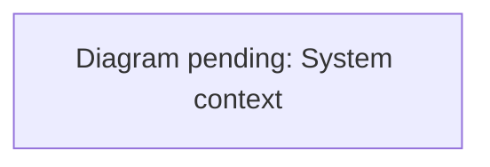
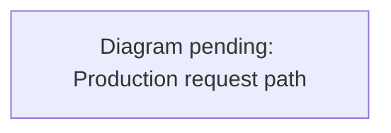

# Repository task map

| Task | Owning seam | Verification and context |
| --- | --- | --- |
| Rendered world, controls, residents, movement | `preview/src/`, `preview/index.html`, `preview/vite.config.js` | `preview/tests/`, `preview/e2e/`; [testing](testing.md), [world direction](world-direction.md) |
| Shared state, accounts, access, world design | `server/`, `api/server.js`, `middleware.js`, `vercel.json` | `server/tests/`; [multiplayer](multiplayer.md), [email access](email-access.md), [security review](security-review.md), [privacy data inventory](privacy-data-inventory.md), [workplace operations](workplace-operations.md), [world events](world-events.md) |
| Decision, speech, GIS and world exports | `src/river_oaks/`, `scripts/*.py`, `config/river-oaks.json` | `tests/`; [data contracts](data.md), [auto mode](auto-mode.md) |
| Native world and contracts | `unreal/Source/RiverOaks/`, `unreal/Config/`, `unreal/Content/Python/` | native automation; [Unreal](unreal.md), [engine acceptance](engine-acceptance.md) |
| Desktop lifecycle, packaging, IPC | `desktop/` | `desktop/tests/`, `desktop/e2e.js`; [desktop](desktop.md) |
| Public landing page | `landing-page/`, `scripts/build_landing_page.js` | `pnpm run build`; [landing page](../landing-page/README.md) |
| Neighborhood kit, assembly and destinations | `shared/city-kit/`, `config/destinations/`, `scripts/destination.mjs`, `preview/src/city-kit/`, `shared/commons-destination.js`, `server/lantern-walk.js` | `preview/tests/city-kit.test.js`, `preview/tests/bayou-market-commons.test.js`, `server/tests/lantern-walk.test.js`; [city kit](city-kit.md), [Bayou Market Commons](level-design/expansion/bayou-market-commons.md) |
| Tooling, checks and agent workflow | `scripts/agent.mjs`, `config/agent-workflow.json`, `.github/workflows/verify.yml` | `pnpm run test:agent`; [workflow](agent-workflow.md) |
| Task register and safe retirement | `docs/project-management/`, `scripts/project-status.mjs`, `project-prune.mjs`, `project-ref-guard.mjs`, `merge-task-register.mjs`, `install-project-hooks.mjs`, `plans-index.mjs`, `.githooks/`, `.gitattributes`, `.agents/skills/` | `scripts/tests/` under `pnpm run test:agent`; [project workflow](project-management/workflow.md), plans index (`docs/superpowers/plans/README.md`) |

Scoped instructions: [desktop](../desktop/AGENTS.md), [server](../server/AGENTS.md), [preview](../preview/AGENTS.md), [Unreal](../unreal/AGENTS.md), [Python bridge](../src/river_oaks/AGENTS.md). Diagrams are tracked in the [diagram index](diagrams.md).

## Runtime boundaries

Diagram prompt: system-context

Draw a C4-style system context flowchart for River Oaks. Show the people (residents in a browser, residents in the Electron desktop app, the owner/admin). Show the deployed pieces: the Vite-built Three.js client served from Vercel, Vercel Edge middleware (asset gate), the single Vercel Node function api/server.js running the Redis-backed world gateway (server/redis-backend.js), Vercel Cron calling /api/workplace-sweep, Redis Cloud (sessions, tickets, rooms, waitlist, invites, workplace), WorkOS (GitHub OAuth and email Magic Auth), Cloudflare Turnstile (email sign-in check), the typesafe.ai Jev provider (paid chauffeur decisions), the local Python decision/voice bridge (development and desktop only, reached as /v1), and the Unreal project (offline, not deployed). Label each arrow with the protocol (HTTPS, WebSocket /multiplayer, Redis, OAuth redirect). Group by trust boundary: browser, Vercel edge, Vercel function, third-party services, local machine.

See [the diagram index](diagrams.md) for the convention.

Diagram prompt: production-request-path

Draw a left-to-right flowchart of how one production HTTPS request is handled, from the visitor to Redis. Steps: Vercel Firewall custom rules (rate limits: 10/hour/IP on /auth/email/start, 600/min/IP on /api and /auth, 600/10min/IP on large /assets binaries; answer 429 before billing) -> Vercel routing (vercel.json rewrites to /api/server?_river_path=...) or static files -> middleware.js asset gate for /assets (signed river_oaks_gate cookie checked locally; otherwise one server check) -> api/server.js -> server/vercel-routing.js -> world router (server/world-router.js) choosing the world -> distributed app (server/distributed-app.js): security headers (CSP), per-address access limit, sign-in limiter, auth.handle, waitlist routes, game routes -> Redis-backed stores. Show the WebSocket upgrade branch for /multiplayer with ticket admission. Mark where each refusal happens (429, 403, 401) in red.

See [the diagram index](diagrams.md) for the convention.

The Vite client renders and accepts input. Shared-world commands cross HTTP and
WebSocket boundaries into the Node service, which owns authorization and shared
state. Redis is the distributed backend. Vercel routing and middleware are part
of that deployment boundary; local identity fixtures do not prove hosted auth.

The Python bridge serves bounded decisions and optional speech to the local
preview/native runtime. World acquisition and export are separate CLI jobs.
External model output never overrides local collision, schedule, or weather
constraints. Missing credentials must retain labeled local fallback behavior.

Electron wraps the web experience and owns native window/IPC behavior. Unreal
is a separate C++ runtime consuming exported data and asynchronous decisions;
a passing web build cannot establish native acceptance.

## Source and evidence

- `config/`, source modules, lockfiles, and authored tests are inputs.
- `preview/public/` contains bundled derivatives/assets: preserve attribution and
  provenance receipts. Some assets are large; inspect filenames before opening.
- `data/raw/`, `data/generated/`, `data/models/`, `dist/`, `.runtime/`, and native
  build directories are local/generated state. Do not commit them.
- `data/reports/` and dated docs contain historical evidence with explicit limits.
  Compare revision and scope before citing them as current.
- `docs/superpowers/plans/` holds task ledgers. Start from the generated
  plans index (`docs/superpowers/plans/README.md`) (`pnpm run plans:index`), which shows
  each plan's register status. Do not assume a checked box proves live delivery.
- The live task register is `river-oaks-tasks.json` in the common Git directory, shared by all worktrees; locate it with `pnpm run --silent register path` and use the register CLI for claims, releases and evidence. `docs/project-management/tasks.json` is a committed snapshot refreshed only by register sweeps; feature PRs must not edit it. See the [project workflow](project-management/workflow.md).
