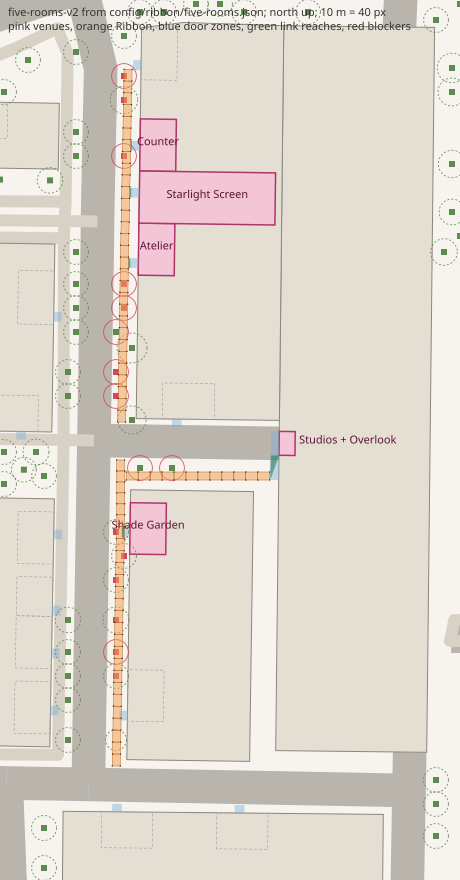

# Five Rooms layout (#838): the measured District and the proposed mapping

Contract: [`config/ribbon/five-rooms.json`](../../../config/ribbon/five-rooms.json) (`five-rooms-v1`),
validator: [`shared/city-kit/five-rooms-layout.js`](../../../shared/city-kit/five-rooms-layout.js),
test: [`preview/tests/five-rooms-layout.test.js`](../../../preview/tests/five-rooms-layout.test.js).
Every number below comes from `node docs/design/five-rooms/measure.mjs` on the live
`preview/public/data/district.json` (plan hash `8e0c37a9f64dddfb`). Units are metres, site-local
x east, y north; floors are district-datum altitudes from `groundSurfaceHeight`.

**Status: proposed.** No retirement here is decided. Each venue carries `retire.status: "proposed"`
and its alternatives; Val chooses (decision 5) and v2 records the choice.

## What the District holds

30 tenants in 9 buildings. Bays come from `storeRoomsFor` (the same rooms the client walks into).
The four bays proposed for retirement (option A) are on the two blocks east of the central lane,
where the #827 spine runs; 26 tenants stay.

| Tenant | Store id | Building | Category | Bay w x d (m) | Area (m2) | Floor (m) | Proposal |
|---|---|---|---|---|---|---|---|
| Saint Bernard | osm-node-8172494973 | osm-way-625330785 | clothes | 13.31 x 9.00 | 119.8 | 18.30 | keep |
| Equinox | osm-node-8172494974 | osm-way-625330785 | wellness | 12.81 x 9.00 | 115.3 | 18.41 | keep |
| Le Colonial | osm-node-8172494976 | osm-way-625330785 | restaurant | 12.81 x 9.00 | 115.3 | 18.42 | keep |
| Harry Winston | osm-node-8172494972 | osm-way-625330792 | jewelry | 12.85 x 9.00 | 115.6 | 18.43 | keep (alternative for Shade Garden) |
| Hermès | osm-node-8172494969 | osm-way-625330792 | clothes | 12.85 x 9.00 | 115.6 | 18.44 | **retire -> Shade Garden** (option A) |
| Cartier | osm-node-8172494965 | osm-way-625330798 | jewelry | 13.01 x 9.00 | 117.1 | 18.48 | keep (alternative for Atelier, Studios + Overlook) |
| Van Cleef & Arpels | osm-node-8172494966 | osm-way-625330798 | fashion_accessories | 13.03 x 9.00 | 117.3 | 18.44 | **retire -> Atelier** (option A) |
| IPIC Theaters | osm-node-8172494964 | osm-way-625330798 | cinema | 13.03 x 34.00 | 443.1 | 18.49 | **retire -> Starlight Screen** (option A) |
| Amorino | osm-node-8172495006 | osm-way-625330798 | ice_cream | 13.03 x 9.00 | 117.3 | 18.51 | **retire -> Counter** (option A) |
| MAD Houston | osm-node-8172494967 | osm-way-625330798 | restaurant | 13.03 x 9.00 | 117.3 | 18.48 | keep (alternative for Counter, Shade Garden) |
| Brunello Cucinelli | osm-node-8172494981 | osm-way-625333006 | clothes | 13.05 x 9.00 | 117.5 | 18.46 | keep |
| Moreau | osm-node-8172494980 | osm-way-625333006 | bag | 13.05 x 9.00 | 117.5 | 18.44 | keep |
| Oliver Peoples | osm-node-8172494979 | osm-way-625333006 | optician | 9.79 x 9.00 | 88.1 | 18.42 | keep |
| Diptyque | osm-node-8172494985 | osm-way-625333006 | clothes | 13.05 x 9.00 | 117.4 | 18.45 | keep |
| Laura Rathe Fine Art | osm-node-8172494977 | osm-way-625333006 | art | 13.05 x 9.00 | 117.5 | 18.46 | keep |
| Dior | osm-node-8172494958 | osm-way-625333008 | clothes | 13.82 x 9.00 | 124.4 | 18.49 | keep |
| Toulouse | osm-node-6374756992 | osm-way-625333008 | restaurant | 13.42 x 9.00 | 120.8 | 18.44 | keep |
| Jo Malone London | osm-node-8172494963 | osm-way-625333008 | perfumery | 13.42 x 9.00 | 120.8 | 18.48 | keep |
| Vilebrequin | osm-node-8172494960 | osm-way-625333008 | clothes | 13.81 x 9.00 | 124.3 | 18.45 | keep |
| Hopdoddy Burger Bar | osm-node-8172494955 | osm-way-625333009 | restaurant | 9.66 x 7.00 | 67.6 | 18.47 | keep |
| Bella Rinova | osm-node-8172494957 | osm-way-625333009 | hairdresser | 12.87 x 9.00 | 115.8 | 18.47 | keep |
| Steak 48 | osm-node-8172494999 | osm-way-878472795 | restaurant | 13.09 x 9.00 | 117.8 | 18.19 | keep |
| Vince | osm-node-8172494987 | osm-way-878472795 | clothes | 14.00 x 9.00 | 126.0 | 18.42 | keep |
| Alice + Olivia | osm-node-8172494989 | osm-way-878472795 | clothes | 13.28 x 9.00 | 119.5 | 18.40 | keep |
| Zadig & Voltaire | osm-node-8172494990 | osm-way-878472795 | clothes | 3.32 x 9.00 | 29.9 | 18.34 | keep |
| Kiton | osm-node-8172494991 | osm-way-878472795 | clothes | 13.28 x 9.00 | 119.5 | 18.36 | keep |
| de Boulle | osm-node-8172494993 | osm-way-878472795 | jewelry | 3.32 x 9.00 | 29.9 | 18.37 | keep |
| Baccarat | osm-node-8172495000 | osm-way-878472795 | jewelry | 13.28 x 9.00 | 119.5 | 18.36 | keep |
| Dolce & Gabbana | osm-node-8172495003 | osm-way-878472797 | clothes | 13.02 x 9.00 | 117.2 | 18.34 | keep |
| Veronica Beard | osm-node-8172495005 | osm-way-878472797 | clothes | 6.34 x 9.00 | 57.1 | 18.38 | keep |

| Building | Kind | Plan area (m2) | Tenants |
|---|---|---|---|
| osm-way-625330785 | retail | 3196.7 | 3 |
| osm-way-625330790 | parking | 6839.0 | 0 |
| osm-way-625330792 | retail | 2071.6 | 2 |
| osm-way-625330798 | retail | 3521.6 | 5 |
| osm-way-625333006 | retail | 1972.7 | 5 |
| osm-way-625333008 | retail | 1460.3 | 4 |
| osm-way-625333009 | retail | 529.7 | 2 |
| osm-way-878472795 | apartments | 9508.8 | 7 |
| osm-way-878472797 | apartments | 5812.4 | 2 |

## Proposed mapping (option A) and the alternatives

| Venue | Option A (in v1) | Alternatives | Why A |
|---|---|---|---|
| Counter | Amorino bay (117 m2) | **B** MAD Houston bay, an end link at the spine's north end | On the spine's east frontage beside the Starlight Screen; a gelato counter already. |
| Atelier | Van Cleef & Arpels bay (117 m2) | **B** Cartier bay (its door faces the side-lane kerb, so a link would cross `osm-way-625330795`; A avoids that) | On the spine; bench-5 stays and the spine keeps spanning it. |
| Starlight Screen | IPIC Theaters bay (13 x 34 m, 443 m2) | none: it is the only deep bay and the only cinema | The one bay deep enough for a screen and seating. |
| Shade Garden | Hermès bay (116 m2) as an open court inside its mapped building | **B** Harry Winston bay beside the REF-HW-01 bed; **C** MAD Houston bay | Faces the south segment; keeps boundary, ID and frontage (needs decision 6). |
| Studios + Overlook | Gardens E2 threshold (P2 opening, 6 m) and the T1/T2/T3 public roof decks; retires nothing | **B** Cartier bay as a studio front room | Uses the Gardens 6/7/6 contract as it stands (layout 3.2) and builds no massing in the parcel. |

Option A retires 4 of 30 tenants: Amorino, Van Cleef & Arpels, IPIC Theaters and Hermès.

| Venue | Kind | Host | Retires | Footprint (m2) | Floor (m) | Entrance (x, y), width | Link | Station (m) |
|---|---|---|---|---|---|---|---|---|
| Counter | bay | osm-way-625330798 | Amorino | 117.3 | 18.54 | -2755.00, -1216.44, 2.4 m | spine (right) | 83.747 |
| Atelier | bay | osm-way-625330798 | Van Cleef & Arpels | 117.3 | 18.47 | -2755.41, -1245.95, 2.4 m | spine (right) | 54.227 |
| Starlight Screen | bay | osm-way-625330798 | IPIC Theaters | 443.1 | 18.55 | -2755.16, -1228.17, 2.4 m | spine (right) | 72.017 |
| Shade Garden | bay | osm-way-625330792 | Hermès | 115.6 | 18.47 | -2757.50, -1313.21, 2.4 m | south (right) | 58.339 |
| Studios + Overlook | threshold | osm-way-625330790 | none | 23.8 | 18.29 | -2720.22, -1290.84, 6 m | link-studios (end) | 35.85 |

Entrances are not the old shop doors: each sits on its bay's frontage midway between two edge posts
of its segment, so no post is left out at a door (`plan.skipped` is empty). Each bay has an interior
floor 0.3 m inside its footprint with 3.6 m clear, and named anchors (threshold, sign, porch light
and one or two role anchors such as counter, display frame, screen, bed or seat cluster).

## The Ribbon

| Segment | Status | Length (m) | Width (m) | Clear (m) | Modules | Posts | Blockers |
|---|---|---|---|---|---|---|---|
| spine | blocked | 102.795 | 2 | 3.6 | 34 | 70 | bench-5-body, road-625330795-7, road-625330795-8, tree-104, tree-127, tree-153, tree-37, tree-77, tree-84, tree-85, tree-pit-103, tree-pit-126, tree-pit-152, tree-pit-27, tree-pit-36, tree-pit-76, tree-pit-83, tree-pit-84 |
| south | blocked | 71.397 | 2 | 3.6 | 24 | 50 | harry-winston-south-bed, tree-108, tree-pit-107, tree-pit-130, tree-pit-16, tree-pit-165, tree-pit-3, tree-pit-96 |
| link-studios | blocked | 35.85 | 2 | 3.6 | 12 | 26 | tree-118, tree-48 |

All three segments are **blocked**, and the contract says so: each blocked record names the zones
that must move, and the validator refuses a record that names a zone the site does not confirm, or
leaves one out. What blocks them:

- **Side-lane mouth.** `osm-way-625330795` meets the central lane at the spine's south end. Spine
  modules 001-004 cross its 8.4 m carriageway and posts 002-004 stand in it. #827's own test
  modelled only the central lane; `ribbon-route-district.test.js` now shows the refusal. Fix: a
  crossing span on posts at both kerbs (a kit rule), or split the spine at the kerbs (new spine IDs,
  v2).
- **Street trees.** The east pavement is lined with trees at 6-10 m spacing. Pits 27, 76, 83, 84,
  103, 126 and 152 are in the spine's walk and pit 36 is under its post 012:l; pits 16, 96, 107,
  130 and 165 are in the south walk and pit 3 is in the walk and under post 012:l.
  Crowns with a lowest branch below the 4.0 m canopy top (3.6 m clear + 0.4 m slab): tree-104 at
  3.19 m, -153 3.53, -84 3.62, -37 3.72, -127 3.79, -77 3.82, -85 3.89, -108 3.78, -118 3.46 and
  -48 3.83. Measured: at the kit's 3.0 m clear height, link-studios clears, the south segment loses
  tree-108 and the spine keeps only tree-104.
- **Van Cleef & Arpels bench body** (`bench-5-body`) under spine modules 018-019.
- **REF-HW-01 bed** under south modules 001-003.

The crown model is data, not the drawn mesh: a crown is a disc of the tree's radius whose
underside is its lowest LiDAR branch end (or 55% of its height). The rendered EZ oak carries leaves
from about 12% of its height, so lifting crowns in data clears the drawn tree only if the renderer
honours `crownBase` (measured by the #840 worker, which also finds tree-28, -124 and -172 over the
spine walk in the drawn mesh). The slab is 0.4 m here; the #828 graybox draws 0.12 m.

Walk width is 2.0 m on every segment (the #827 window); nothing here widens it.

## Decisions for Val

1. **Retirement list (decision 5).** Accept option A (Amorino, Van Cleef & Arpels, IPIC, Hermès;
   Studios + Overlook at the Gardens) or pick an alternative per venue from the table above.
2. **Shade Garden court (decision 6).** Confirm the Hermès bay (or the chosen alternative) may open
   as a court inside its mapped building.
3. **Street trees (decision 2).** Move the 14 pits named above out of the walks and lift the 10
   crowns above 4.0 m (Landscape, #840), or lower the canopy to 3.0 m clear, which leaves only
   tree-104 and the pits.
4. **Side-lane mouth (new).** Allow a ribbon-1 crossing span over `osm-way-625330795` at the spine's
   south end, or split the spine at the kerbs (changes #827's spine IDs).
5. **Bench and bed.** Move the Van Cleef & Arpels bench out of the spine walk (or retire it with the
   Atelier), and move or trim the REF-HW-01 bed clear of the south walk (or end the south segment
   north of it and reach Le Colonial across `osm-way-627662384`).
6. **Door clearance.** The 2.4 x 2 m door zone is still the #827 working value; confirm it or have a
   door measured.

## For Shells, Landscape and Integration

`expandFiveRooms(contract, site)` returns `venues` (footprint, floor, entrances with door zones,
interior, attachments), `segments` (status, blocked record, findings, crowns), `links` (reach
polygons), `cameras`, `exclusions`, the merged Ribbon placements (`modules`, `posts`, `lamps`,
`fans`, `seats`) and a `hash`. Build the site with `siteFromDistrict(world, ...)` as the test does.
IDs are stable: `venue:*`, `entrance:*`, `link:*`, `attach:*`, `camera:*`, `ribbon:<segment>:*`.
A blocked segment's placements are its raw geometry: render it only behind a flag until its
blockers move. Later changes bump `version` (`five-rooms-v2`, ...).
