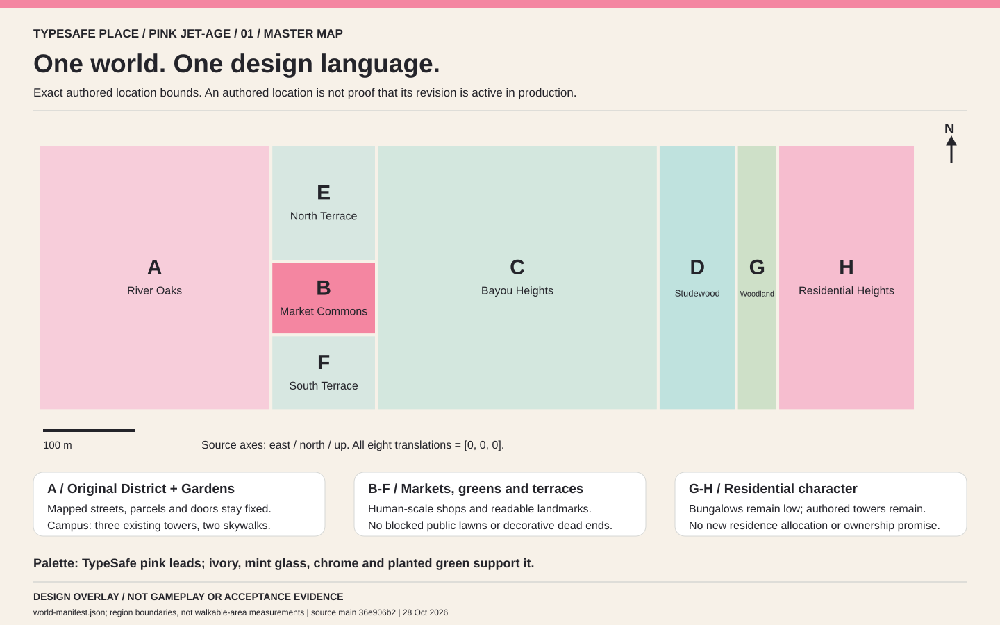

# TypeSafe Place: Pink Jet-Age design package

Prepared 28 October 2026. Start with [redesign epic #738](https://github.com/BunsDev/river-oaks/issues/738).

**This is a design/backlog delivery, not an implemented or deployed game redesign.** The seven SVGs are source-linked map overlays and design schematics. They are not gameplay, complete construction drawings, collision surveys or acceptance evidence.

## Work packages

Every new issue contains an embedded image, source and ownership boundaries, dependencies, acceptance criteria, a long-running goal prompt and a follow-up prompt.

| Package | Issue | Design image | Prerequisite |
|---|---|---|---|
| R0 direction, scope and backlog alignment | [#738](https://github.com/BunsDev/river-oaks/issues/738) | [Atlas](01-world-atlas.svg) | Current source inventory |
| R1 shared materials and architectural vocabulary | [#739](https://github.com/BunsDev/river-oaks/issues/739) | [Vocabulary](06-design-vocabulary.svg) | Starts now; coordinates existing #584/#585 |
| R2 original District streets and facades | [#740](https://github.com/BunsDev/river-oaks/issues/740) | [District footprints](02-original-district.svg) | R1 interfaces |
| R3 Gardens campus, lifts, roofs and two bridges | [#741](https://github.com/BunsDev/river-oaks/issues/741) | [Measured campus](03-gardens-campus.svg) | R1; current campus contracts |
| R4 Commons and Heights social route | [#742](https://github.com/BunsDev/river-oaks/issues/742) | [Program map](04-commons-heights.svg) | R1; existing destination/stream owners |
| R5 terraces and eastern neighborhoods | [#743](https://github.com/BunsDev/river-oaks/issues/743) | [Eastern map](05-east-neighborhoods.svg) | R1; coordinate seams with R4 |
| R6 IPIC, offices and World Studio interiors | [#744](https://github.com/BunsDev/river-oaks/issues/744) | [Interior/interface study](07-interiors-interface.svg) | R1; existing room/interaction owners |
| R7 optional human wardrobe | [#745](https://github.com/BunsDev/river-oaks/issues/745) | [Identity boundaries](07-interiors-interface.svg) | R1 palette; current rig/catalog |
| R8 accessible HUD, wayfinding and devices | [#746](https://github.com/BunsDev/river-oaks/issues/746) | [Interface study](07-interiors-interface.svg) | R1; current action/state contracts |
| R9 qualification and reversible rollout | [#747](https://github.com/BunsDev/river-oaks/issues/747) | [Coverage atlas](01-world-atlas.svg) | Baseline now; qualifies each increment |

R1 publishes stable interfaces before consumer implementation. Regional work can run in parallel with non-overlapping ownership. R9 starts actual baseline capture immediately and qualifies increments, not only the finished world. Do not delay unrelated safety, authentication or packaging fixes for art completion.

**First playable milestone:** an existing District-to-Gardens public route, a coherent facade/entrance family, truthful lift treatment, one existing Floor-4 skywalk and a usable social stop. Follow with the Commons two-player activity route. Aerial beauty alone does not pass.

## Approved direction versus proposals

Primary brand accent: **TypeSafe pink #F486A1**. Optimistic luxury retrofuturism uses ivory shells, rounded canopies, mint glass, restrained chrome, rooftop gardens and readable social spaces. Other hex colors on the vocabulary sheet are proposed supporting roles, not approved replacements for every token. Preserve the approved logo, selected landing direction, existing typography, character identities and saved player choices. The working direction name does not rename the product.

The supplied before/after concept includes aspirational massing/connections. It is aesthetic reference, not geometry authority. Its generated before panel is not a substitute for the user's real screenshot. Full original reference files are retained unchanged in the companion conversation artifact pack; this repository package contains the vector direction sheets.

## Geometry and provenance

Source baseline: `36e906b2ea0cfe0a301eff19eb73ff8e1709361a` on `main`. Immutable image pin used by issues: `59205d5c5f1790d157f7c9ccf97cac8e03f4c945`.

- `preview/public/data/world-manifest.json`: eight authored location bounds. These are registration areas, not measured reachable ground or proof of production activation.
- `preview/public/data/district.json`: nine baseline building polygons. The District sheet shows selected simplified roads and the Gardens overlay; later overlays other than Gardens are omitted.
- `shared/garden-campus-layout.js`: layout 3.2, three towers, paths and two measured bridges. Preserve 6/7/6 floors; B12/B23 23/15 m spans; 4 m overall and 3 m clear widths; public deck +13 m. No new office/IPIC bridge or party-wall opening.
- `docs/level-design/expansion/`: source program extents for neighborhood drawings. Use actual locked recipes for individual buildings and exact joins.
- Source frame is origin-relative EPSG:32615 east/north/up metres, origin longitude/latitude [-95.425, 29.755]. The renderer maps east/up/negative-north. Keep all source IDs and current translation contracts.

Map attribution: © OpenStreetMap contributors; ODbL-1.0. Preserve source attribution/licensing with derivative map use.

## Existing backlog alignment

The following **48 audited pre-existing open issues** received dated scoped alignment addenda with start/resume prompt amendments. Their original bodies, states, labels, assignees, milestones and historical evidence were retained. Closed issues were not reopened.

| Area | Existing issues |
|---|---|
| Workplace | #221 |
| iOS | #284, #285, #286, #287, #288, #289, #290, #291, #292, #293, #294 |
| Office/cinema and desktop | #359, #369, #370, #371, #372, #373 |
| World Studio | #413, #417, #420 |
| Human characters | #441, #442, #443, #444, #517, #518, #637 |
| Computer | #486, #487 |
| Screening | #497, #498, #499, #500, #501, #502 |
| Gardens | #505, #511, #512 |
| Expansion | #582, #583, #584, #585, #586, #587, #638 |
| Optional violence | #599, #640 |

New visual targets supersede conflicting older aesthetic preferences, not security, geometry, saved state, performance, accessibility, media approval or explicit deferrals. Real-likeness intake stays NO-GO; public publishing remains deferred; tenancy remains owner-issued/noncharging. No aircraft, teleportation, real contact, external agent execution, property allocation or production activation is authorized by imagery.

## Verification performed

The companion artifact generator and validation recorded: eight valid non-overlapping registration bounds; nine valid baseline building rings; three tower ground envelopes contained in the source parcel; preserved 23/15 m bridge spans and 4 m widths; seven SVGs parsed/rendered without scripts or external asset dependencies. All seven local SVG Git blob hashes matched the published content hashes. Original screenshot/concept copies were checked byte-for-byte. Successful connector writes returned ten issue numbers and 48 distinct alignment-comment IDs.

**Not run:** game builds, runtime/browser journeys, performance, hosted multiplayer, physical-device, native or human-accessibility acceptance. This branch changes design documentation only. No game code, approved film or production configuration was changed. No merge or deployment is claimed. Future implementers must refresh current source, instructions, ownership and active content selection before editing.
