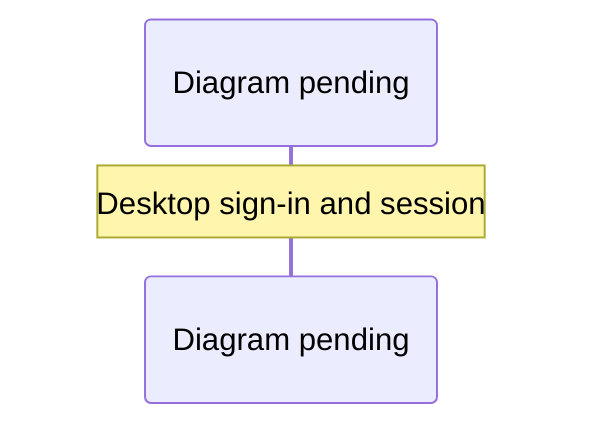

# River Oaks desktop

The desktop application runs River Oaks in Electron. Playing requires an online connection, WorkOS sign-in through GitHub in the system browser, and waitlist approval. The packaged app opens the hosted game at `https://typesafe.place/play`; its browser profile retains the approved session until sign-out or expiry. Email-code sign-in is not offered in the app. Since 0.2.1 the session cookie is encrypted; how strongly depends on the platform (see the cookie-encryption note below).


<details><summary>Diagram prompt: desktop-sign-in</summary>

Draw a sequence diagram of the Electron desktop thin client signing in. Participants: Desktop main process (desktop/main.js, desktop/auth.js), system browser, WorkOS, hosted game (typesafe.place) /auth/desktop/exchange, Electron session cookie store. Show device sign-in in the system browser, the refresh-token exchange at /auth/desktop/exchange (rate-limited per address), the sealed session cookie written to session.defaultSession with an expiry, and the packaged window loading only the hosted https origin. Note the fuses (RunAsNode off, NODE_OPTIONS off, inspect off, asar integrity on, file protocol privileges off) and that cookie encryption is on since 0.2.1.

See [the diagram index](diagrams.md) for the convention.

</details>


## Live development

```sh
pnpm install --frozen-lockfile
pnpm run desktop:dev
```

The command starts a loopback Vite server (port 5174, or the next available port), WorkOS development authentication, the shared town, and the native game window. Configure the Staging WorkOS credentials and enable device authorization for its River Oaks application. Renderer edits hot reload; changes to `desktop/main.js`, `desktop/auth.js`, or `desktop/runtime.js` restart the desktop shell. Closing the game or pressing Ctrl+C stops its owned server. An independently running town is left alone.

For shared-town development, use `pnpm run desktop:dev`; sign-in, approval, and a town connection are required. It reads `.env` and then `.env.local`, so a value in `.env.local` (such as `WORKOS_CLIENT_ID`) takes precedence. To run a second development window beside one that is already open, give it its own profile: `RIVER_OAKS_PROFILE=/tmp/river-oaks-second pnpm run desktop:dev` (Electron allows one window per profile). The development command starts the optional Python bridge for Jev decisions and voices. The packaged app uses the hosted service and its features.

Use **View → Toggle Developer Tools** to inspect the renderer. **Game → Reload game** (⌘R / Ctrl+R) rebuilds the scene. **View → Toggle Full Screen** gives the game the display; **Help → Game controls** lists movement and interaction keys. **View → Debug tools** (F3) shows colliders, the walkable grid, ground triangles, the source map and a polygon inspector; see [debug tools](debug-tools.md).

Use **Commands → Photo mode** to compose and save clean PNG images. The native Save dialog lets you choose a destination. See [photo controls and sharing](photo-mode.md).

Use **Game → World Studio** to open the Three.js region editor at `/studio.html`; **Game → Return to world** returns to the game. Studio uses the same account and approval gate. Save a draft in the current browser profile, or export `world-studio-region.json` through the native JSON Save dialog. Imports use the editor’s file picker. Exporting does not publish a shared world. Leaving with unsaved edits asks **Keep editing** (the default) or **Discard changes**; canceling keeps the editor open. Only user-triggered, same-origin Studio JSON blobs up to 128 KiB and the existing photo PNGs can download; all other downloads remain blocked. The packaged app needs the hosted Studio page deployed before this menu can open it.

Appearance and graphics preferences persist locally. Development and packaged play use separate profiles. Window size, location, maximized state, and fullscreen restore when reopening; a removed display falls back to visible bounds. Closing the window quits the application.

The **Play & rides** dock groups flight, Jev, vehicles, and optional scenarios. **Explore** opens people, places, and settings. See [play controls and rendering evidence](experience-polish.md) for keyboard behavior and the browser acceptance suite.

## Local desktop build

```sh
pnpm run desktop:package
```

On Apple Silicon macOS the application is:

```text
dist/desktop/TypeSafe Place-darwin-arm64/TypeSafe Place.app
```

Open it in Finder. For a quick bundled run without packaging, use `pnpm run build && pnpm run desktop:start`.

Packaging stages the desktop runtime; the packaged window loads the hosted game after device sign-in. Repository files, `.env`, server code, development dependencies, and game assets are excluded. The build is ad-hoc signed; a macOS release is then signed and notarized as described under [Signed macOS release](#signed-macos-release). The packaging command targets its host platform and architecture; the `Desktop` workflow below exercises Windows x64, Linux x64 and macOS arm64.

## Signed macOS release

Since 0.2.1 the macOS release is signed with a Developer ID Application certificate and notarized by Apple. Sign after `desktop:package` and `desktop:package:check`, because flipping the fuses rewrites the binary:

```sh
pnpm run desktop:package && pnpm run desktop:package:check
pnpm run desktop:sign --identity <certificate SHA-1> --notary-profile river-oaks-notary --receipt <file>
ditto -c -k --sequesterRsrc --keepParent "dist/desktop/TypeSafe Place-darwin-arm64/TypeSafe Place.app" TypeSafe-Place-<version>-macOS-arm64.zip
```

`desktop/sign.js` does the following:
- Signs every nested binary and helper with the hardened runtime and a secure timestamp, using `@electron/osx-sign`.
- Gives the app and its plain helper `desktop/entitlements.mac.plist`: JIT for V8, and the microphone for shared voice. Chromium's GPU, renderer and plugin helpers keep Chromium's own entitlements.
- Refuses the result unless all of these hold: `codesign --verify --deep --strict` passes, the first authority is a Developer ID Application certificate, the runtime flag and timestamp are present, and the entitlements read back exactly.
- With `--notary-profile`, zips the app, submits it with `xcrun notarytool submit --wait` and prints Apple's log when it is not accepted. It then staples the ticket, validates the staple, and requires `spctl` to report `source=Notarized Developer ID`.
- Prints a JSON receipt, and writes it to `--receipt` when given.

**Credentials.** They stay in the keychain. `--identity` takes a certificate's exact name or its SHA-1 from `security find-identity -v -p codesigning`. Use the SHA-1 when two certificates share a name, because codesign refuses an ambiguous name. Notarization reads a profile stored once by the release owner:

```sh
xcrun notarytool store-credentials river-oaks-notary --key <AuthKey .p8 path> --key-id <key id> --issuer <issuer id>
```

The script never takes a password, key or issuer. CI does not sign: the `Desktop` workflow holds no secrets.

## CI builds on Windows, Linux and macOS

`.github/workflows/desktop.yml` runs on manual dispatch, on pushes to `main` and on pull requests that touch `desktop/**`, `shared/**`, `scripts/studio-skill-pack.js`, `package.json`, `pnpm-lock.yaml` or the workflow itself. One job per runner (`windows-latest`, `ubuntu-latest`, `macos-latest`, which is arm64) runs the desktop unit tests, `desktop:package`, `desktop:package:check` (the fuse wire must match `desktop/fuses.js` and the asar must hold exactly the staged files; a changed fuse fails the job), the development end-to-end suite with the loopback acceptance fixture, and uploads the results. The Windows and Linux runners have no GPU, so their e2e uses the browser journeys' CPU scene budget (`RIVER_OAKS_DESKTOP_SOFTWARE=1`); it proves behavior, not visual quality or frame rate. On Linux the e2e runs under Xvfb and Mesa with Openbox, so minimize has a window manager. The Linux leg keeps the image's `systemd-coredump` pipe, so the deliberate renderer crash goes through it, as on an Ubuntu desktop that has it installed, and the e2e checks that the renderer was ended rather than waited for (see [Rendering and recovery](#rendering-and-recovery)). Playwright starts that renderer without Chromium's sandbox; the sandboxed case is a row of the acceptance matrix. The uploads are:

- `TypeSafe-Place-<version>-<windows|linux|macos>-<arch>-unsigned`: a zip of the packaged directory with a `SHA256SUMS` file, kept 14 days. Only a build that passed the fuse and asar check is uploaded.
- `desktop-e2e-<runner>`: the e2e receipt `data/reports/desktop-ci-<runner>.json` and `output/playwright/desktop-development*.png`.

The same run builds the Windows and Linux installers and tests them on fresh runners; see [installers](#installers-for-windows-and-linux). A pull request that changes `desktop/` or the workflow gets all three runners and the installers; one that reaches the workflow only through `shared/`, `scripts/studio-skill-pack.js`, `package.json` or the lockfile gets the Linux leg alone, without installers. Pushes to `main`, tags and manual runs always get everything, and a newer push to the same pull request cancels its older run. Pull requests hold no secrets, so their builds are unsigned (ad-hoc on macOS); only the dispatch- and tag-only Windows signing job can sign. It is not a required check: the `preview` aggregate in `verify.yml` still gates `main`. To fetch a build for manual testing:

```sh
gh run list --workflow Desktop --branch main --limit 1
gh run download <run id> -n TypeSafe-Place-<version>-macos-arm64-unsigned -D /tmp/typesafe-place
cd /tmp/typesafe-place && shasum -a 256 -c SHA256SUMS
```

Locally, `pnpm run verify desktop-package` runs the same unit tests, packaging and check for the host platform and writes `.runtime/agent/desktop-package.json`.

### Platform identity

The app's names and IDs live in `desktop/identity.js`; `desktop/package-options.js` turns them into the packager call, and `desktop/tests/package-options.test.js` checks them for all three platforms on any host.

- **Icon.** `desktop/icon/typesafe-place.svg` is the source. `node desktop/icon/build.mjs` rasterises it with `rsvg-convert` (librsvg 2.63 was used for the committed set) into `desktop/icon/png/{16,32,48,64,128,256,512}.png` and writes `typesafe-place.icns` (PNG-bearing `icp4`–`ic09` plus the `@2x` aliases) and `typesafe-place.ico` (16–256, PNG-compressed) in plain Node, so no platform tool is needed for the containers. The packager receives the extension-less base path and completes it per platform; a missing icon fails packaging before the packager runs. Linux reads no icon from the binary; the PNGs are for the desktop entry an installer writes (#372).
- **macOS.** Bundle ID `works.jev.river-oaks`, the adventure-games category and the microphone usage string are unchanged.
- **Windows.** The executable carries `win32metadata` (company Jev Works, product and description TypeSafe Place, internal name TypeSafePlace, original filename `TypeSafe Place.exe`), and the main process calls `app.setAppUserModelId('works.jev.river-oaks')` so the taskbar button, notifications and any future jump list group under one identity. The installer's shortcuts carry the same ID (see [Windows installer](#windows-squirrel)).
- **Linux executable name.** The product name keeps its space (`TypeSafe Place-linux-x64/`), but the binary is `typesafe-place`, so launchers, desktop entries and shell scripts need no quoting. Decided here (#370) pending Val's confirmation; Linux packaging is proven by the CI matrix (#371), not by this machine.

### Studio hosts by platform

The Studio agent (Claude or Codex CLI) and the World Designer (Coven running Codex) are launched only by the main process from executables it resolves itself. On macOS and Linux, `resolveExecutable` searches `PATH` then `~/.local/bin`, `/opt/homebrew/bin` (macOS) and `/usr/local/bin`, and requires the execute bit. On Windows it follows `PATHEXT` but accepts only `.exe` and `.com`: Node spawns them without a shell, whereas npm's `claude.cmd`/`codex.cmd` shims (and `.ps1`) would need `cmd.exe` or PowerShell, which would parse the prompt text. A host with only shims, or a `RIVER_OAKS_AGENT_*`/`RIVER_OAKS_DESIGNER_CODEX` override that points at one, shows the provider as unavailable and the first send explains why and names the `.exe` to install. The Windows search adds `%USERPROFILE%\.local\bin`, where Claude Code's native installer puts `claude.exe`. These rules are covered by unit tests that stub the platform and a synthetic directory, so they run on every host. The Studio host tests stand in for both CLIs with Node fixture scripts; Unix spawns them directly, and on Windows the tests start them with the Node binary, because a spawn without a shell cannot run a script there. Production spawning does not change: it never uses a shell, and on Windows it runs only `.exe` and `.com` files.

## Installers for Windows and Linux

`pnpm run desktop:installers` turns the build `desktop:package` made into installers for the host (#372):

| Host | Files in `dist/installers/` |
| --- | --- |
| Windows x64 | `TypeSafe-Place-<version>-windows-x64-Setup.exe`, plus `TypeSafePlace-<version>-full.nupkg` and `RELEASES` for a later Squirrel updater |
| Linux x64 | `TypeSafe-Place-<version>-linux-x64.AppImage` and `TypeSafe-Place-<version>-linux-x64.deb` |

Each run also writes `SHA256SUMS` over those files and `build-manifest-<platform>-<arch>.json`, which lists every packaged file with its SHA-256 and mode so an installed copy can be compared with the build. There is no macOS installer: macOS ships the signed and notarized zip (see [Signed macOS release](#signed-macos-release)).

`desktop/installers.js` runs the package check first and refuses, with every reason listed, a build whose fuse wire is unflipped or differs from `desktop/fuses.js`, a binary with no Electron fuse wire or built for another platform or architecture, an asar that is not exactly the staged files, or an app whose version is not `package.json`'s. It never repackages: packaging, the fuse flip and the asar stay in `desktop/package.js`. Tools fetched outside pnpm (appimagetool 1.9.1, the AppImage type-2 runtime 20251108 and the Artifact Signing client 1.0.128) are pinned by version and SHA-256 in `TOOLS`; a download with any other hash is deleted and refused, and a cached copy is rehashed before each use.

### Windows (Squirrel)

`Setup.exe` installs per user, without an administrator prompt, into `%LocalAppData%\TypeSafePlace\app-<version>\` with Squirrel's `Update.exe` beside it, and adds a "TypeSafe Place" entry (publisher Jev Works) to Installed apps. Squirrel starts the installed app with `--squirrel-install`, `--squirrel-updated`, `--squirrel-uninstall` or `--squirrel-obsolete` and waits for it to exit. `desktop/main.js` handles those before anything else, without taking the single-instance lock or opening a window, through `desktop/squirrel.js`:

- **Install** creates "TypeSafe Place" shortcuts in the Start menu and on the desktop. They start `Update.exe --processStart "TypeSafe Place.exe"`, so they survive updates, and carry the AppUserModelID `works.jev.river-oaks`, the one the running app sets. Squirrel's own shortcut helper would stamp `com.squirrel.TypeSafePlace.TypeSafePlace`, and a pinned taskbar button would then not match the window.
- **Update** rewrites only shortcuts that still exist and start this install, so a shortcut someone deleted stays deleted. **Obsolete** (the version being replaced) does nothing.
- **Uninstall** removes only this install's shortcuts, then starts a hidden PowerShell cleanup and exits. Squirrel deletes the install in one pass of parallel batches, and a file still held aborts the rest of its batch. On the CI runner that left `squirrel.exe` (held by Squirrel's own scan) and, at random, more app files, up to the 246 MB `TypeSafe Place.exe`; Squirrel then marks the folder `.dead`. The cleanup waits until nothing runs from the folder and `.dead` exists, then removes Squirrel's own names (`app-*`, `packages`, `Update.exe`, `app.ico`, the launcher stub, `SquirrelSetup.log`), and the folder once only `.dead` remains, logging to `%TEMP%\TypeSafePlace-uninstall.log`. It runs only from a real Squirrel install (`%LocalAppData%\TypeSafePlace\app-<version>\`, beside `Update.exe`), does nothing without `.dead`, and never deletes anything else. In CI two uninstalls in a row each left nothing behind.

Uninstalling keeps the profile in `%AppData%\River Oaks` (session cookie and window state); delete that folder to remove them. For scripted tests: `Setup.exe --silent`, then `%LocalAppData%\TypeSafePlace\Update.exe --uninstall -s`.

### Linux (.deb and AppImage)

Chromium never runs here without its sandbox: no launcher, desktop entry or test passes `--no-sandbox`. It sandboxes in one of two ways. It prefers a user namespace. Where unprivileged user namespaces are unavailable, it uses `chrome-sandbox`, a helper that must be owned by root with mode 4755. If neither works, it refuses to start. Ubuntu 23.10 and later (24.04 LTS included) restrict unprivileged user namespaces through AppArmor (`kernel.apparmor_restrict_unprivileged_userns=1`), unless an AppArmor profile grants them to a program.

- **`.deb` (recommended on Ubuntu and Debian).** `sudo apt install ./TypeSafe-Place-<version>-linux-x64.deb` installs the app in `/usr/lib/typesafe-place/`, links `/usr/bin/typesafe-place`, and adds a desktop entry (`typesafe-place.desktop`) and hicolor icons from 16 to 512 px. `chrome-sandbox` is installed owned by root with mode 4755. Where the running AppArmor understands the 4.0 policy ABI (Ubuntu 23.10+), `postinst` also installs `/etc/apparmor.d/typesafe-place`. That profile grants user namespaces to `/usr/lib/typesafe-place/typesafe-place` and nothing else (the program stays unconfined), as Ubuntu's own profiles for Chrome and other Electron apps do. Chromium then uses its namespace sandbox. Without the profile, the setuid helper takes over. `apt remove` unloads and deletes the profile.
- **AppImage.** Make it executable and run it; it needs FUSE 3 (`fusermount3`, present on Ubuntu desktops), not libfuse2. Inside the AppImage's FUSE mount a setuid helper cannot work, so the AppImage needs user namespaces. Where they are allowed it runs with the namespace sandbox. That was measured on Ubuntu 24.04 with the restriction off; Fedora, Debian and Ubuntu 22.04 allow them by default but were not tested. On Ubuntu 23.10 and later it stops at start with "The SUID sandbox helper binary was found, but is not configured correctly". The supported fix there is the `.deb`. Someone who wants the AppImage can keep it at a fixed path and give that path the same permission with a profile of their own, for example `/etc/apparmor.d/typesafe-place-appimage`, then load it with `sudo apparmor_parser -r /etc/apparmor.d/typesafe-place-appimage`:

  ```text
  abi <abi/4.0>,
  include <tunables/global>

  profile typesafe-place-appimage /home/<you>/Applications/TypeSafe-Place-<version>-linux-x64.AppImage flags=(unconfined) {
    userns,
  }
  ```

  Turning the restriction off system-wide (`kernel.apparmor_restrict_unprivileged_userns=0`) also works, but affects every program; prefer the profile or the `.deb`.

The desktop entry's `StartupWMClass` is `TypeSafe Place` (Electron's X11 window class is the app name). The packaged `package.json` sets `desktopName` to `typesafe-place.desktop`, which Electron uses as the Wayland app ID, so docks match the running window to the entry on both display servers.

### Installers in CI

In the `Desktop` workflow the Windows and Linux legs build the installers right after the package check and upload `installers-windows-x64-unsigned` or `installers-linux-x64-unsigned`. Two jobs then install them on fresh runners with `desktop/installer-acceptance.js`: `installers (windows-latest)` and `installers (ubuntu-24.04)`. Ubuntu 24.04 is named because it restricts user namespaces. Each job:

- checks `SHA256SUMS`;
- installs the package and runs the package check on the installed copy, so the fuse wire is read from the installed binary;
- compares every installed file with the build manifest, by bytes and, on Linux, by mode;
- checks the shortcuts, their AppUserModelID and the Installed apps entry (Windows), or the desktop entry with `desktop-file-validate`, the icons, `chrome-sandbox` (root, 4755) and the AppArmor profile (Linux);
- launches the app once with `--proxy-server=127.0.0.1:9`, so it cannot reach the production game or WorkOS and waits on its "could not open" dialog;
- uninstalls and checks that nothing is left.

On Linux each launch reads `/proc` to tell which sandbox the zygote uses (its own user namespace, or the setuid helper's PID namespace) and requires the renderers to run under seccomp-bpf in a nested PID namespace. It launches the `.deb` with and without the AppArmor profile under Ubuntu's restriction, and the AppImage with user namespaces allowed, restricted, and restricted with a profile for its path. The report is uploaded as `installer-acceptance-<windows|linux>`. Finally `installers (SHA256SUMS)` puts `Setup.exe`, the `.nupkg`, `RELEASES`, the AppImage and the `.deb` in one artifact, `TypeSafe-Place-<version>-installers-unsigned` (or `-installers` when Windows was signed), with one `SHA256SUMS` over all of them, checked with `sha256sum -c`:

```sh
gh run download <run id> -n TypeSafe-Place-<version>-installers-unsigned -D /tmp/typesafe-place-installers
cd /tmp/typesafe-place-installers && shasum -a 256 -c SHA256SUMS
```

### Windows signing

Windows signs with [Azure Artifact Signing](https://learn.microsoft.com/azure/artifact-signing/) (called Trusted Signing until its 2025 rename). Squirrel signs every PE file it packs (the app, its DLLs and `Update.exe`) and `Setup.exe` with the Windows SDK's `signtool`, the Artifact Signing client's `Azure.CodeSigning.Dlib.dll` and a `metadata.json` naming the account and certificate profile, timestamped by `http://timestamp.acs.microsoft.com`. The credential is a federated GitHub OIDC token exchanged by `azure/login`. The repository stores no secret, only six identifiers as repository variables:

| Variable | Value |
| --- | --- |
| `AZURE_TENANT_ID` | The Microsoft Entra tenant |
| `AZURE_SUBSCRIPTION_ID` | The subscription that holds the Artifact Signing account |
| `AZURE_CLIENT_ID` | The app registration (or user-assigned managed identity) GitHub signs in as |
| `RIVER_OAKS_SIGNING_ENDPOINT` | The account's regional endpoint, for example `https://eus.codesigning.azure.net` |
| `RIVER_OAKS_SIGNING_ACCOUNT` | The Artifact Signing account name |
| `RIVER_OAKS_SIGNING_PROFILE` | The Public Trust certificate profile name |

**How the workflow uses them.** Pull requests never sign. A manual dispatch or a `v*` tag runs `signing-config`, which checks the six names and prints none of the values. If any is unset, it posts a "Windows signing skipped" notice and step summary, and `sign-windows` is skipped; the run's installers are labelled `-unsigned`. Otherwise `sign-windows` runs in the `desktop-signing` environment: it packages, checks, signs, runs `signtool verify /pa /v` on `Setup.exe` and every packed binary (each must also be timestamped, because Artifact Signing certificates last three days), installs the signed `Setup.exe` and checks the installed copy's signatures, and uploads `installers-windows-x64-signed`. Every Windows build, pull requests included, also rehearses this path with a throwaway self-signed certificate that only its runner trusts. The rehearsal build is deleted, never uploaded.

**Setup (a person with the Azure account; agents cannot do this).**

1. In an Azure subscription, register the `Microsoft.CodeSigning` resource provider and create an Artifact Signing account in a supported region (Basic SKU is enough for this project's volume). Note its endpoint from [the region table](https://learn.microsoft.com/azure/artifact-signing/quickstart).
2. Complete a Public Trust **identity validation** in the portal (it cannot be done from the CLI); your user needs the *Artifact Signing Identity Verifier* role. Check eligibility first: at the time of writing, organizations in the United States, Canada, the EU, the UK and a few other countries qualify, and individual developers only in the United States or Canada (Microsoft's quickstart lists them). Microsoft quotes 1 to 20 business days. The validated name becomes the certificate subject, which Windows shows as the publisher.
3. Create a **Public Trust certificate profile** on that validation; its name is `RIVER_OAKS_SIGNING_PROFILE`.
4. Create a Microsoft Entra app registration (single tenant) and add a **federated credential** for GitHub Actions: organization `BunsDev`, repository `river-oaks`, entity *Environment*, name `desktop-signing` (subject `repo:BunsDev/river-oaks:environment:desktop-signing`, audience `api://AzureADTokenExchange`). Give it no client secret.
5. Assign that app the *Artifact Signing Certificate Profile Signer* role on the certificate profile (or the account). A fresh assignment can take a few minutes before signing stops returning 403.
6. In GitHub, create the `desktop-signing` environment, restrict it to `main` and `v*` tags, and require a reviewer. Then add the six repository variables above (repository level: `signing-config` runs outside the environment).
7. Dispatch `gh workflow run Desktop --ref main`, approve the environment, and record the certificate subject and SHA-1 thumbprint that `signtool verify` prints in `installer-acceptance-windows-signed` (public data) in the release ledger.

**Rotation and revocation.** Artifact Signing issues a new short-lived certificate as it signs, so there is no certificate file or password to rotate, and the OIDC credential has no secret. What can lapse is the identity validation: renew it in the portal before it expires, keeping the same subject, and keep the certificate profile pointed at it. To change the GitHub identity, add a new app registration with the same federated credential and role, then update `AZURE_CLIENT_ID`. If signing is misused, remove the role assignment and, in the portal, revoke the affected certificate by thumbprint (with a revocation time), then dispatch a fresh signed build.

**SmartScreen.** A valid signature does not by itself remove Microsoft Defender SmartScreen's "Windows protected your PC" prompt for a new publisher. Reputation builds over time and downloads. Record what a fresh Windows 11 VM shows during acceptance (#373) rather than promising that the prompt is gone.

## Releases on Windows, Linux and macOS

A release carries one asset set per platform and one `SHA256SUMS` over every asset (#373):

| Platform | Assets | Built by | Signature |
| --- | --- | --- | --- |
| macOS arm64 | `TypeSafe-Place-<version>-macOS-arm64.zip` | A detached worktree on the release owner's Mac, as in [Signed macOS release](#signed-macos-release) | Developer ID, notarized and stapled |
| Windows x64 | `TypeSafe-Place-<version>-windows-x64-Setup.exe`, `TypeSafePlace-<version>-full.nupkg`, `RELEASES` | The `Desktop` workflow's run on the release tag | Authenticode through [Azure Artifact Signing](#windows-signing) |
| Linux x64 | `TypeSafe-Place-<version>-linux-x64.AppImage`, `TypeSafe-Place-<version>-linux-x64.deb` | The same tag run | None; `SHA256SUMS` only |

Windows and Linux come from CI. Only those runners build and install-test the installers, and Windows signs there through OIDC with no stored secret. macOS stays local until Developer ID signing moves to CI, because the workflow holds no Apple credentials. The `.nupkg` and `RELEASES` are what a later Squirrel updater reads; nothing downloads them yet.

### Release steps

The tag run is the release build. People accept the exact files it produced, and those files are what gets published. A candidate that fails acceptance is never published; the fix ships under the next patch version.

1. **Bump.** On a `release/vX.Y.Z` branch, set the version in `package.json`, write `docs/releases/X.Y.Z.md`, and copy [the release ledger template](superpowers/plans/_template-desktop-release.md) to a dated ledger. Commit with `-S`, open the PR and land it with `pnpm run land`.
2. **Build macOS.** In a detached worktree at the merge commit, with its own `pnpm install --frozen-lockfile`, run `pnpm run test:desktop`. Then package, check, sign, notarize and zip as in [Signed macOS release](#signed-macos-release). Record the zip's SHA-256 and the signing receipt.
3. **Tag.** Run `git tag -s vX.Y.Z <merge commit> -m "TypeSafe Place X.Y.Z"`, then `git push origin vX.Y.Z`. The tag push starts the `Desktop` workflow; its path filters do not apply to tags. Approve the `desktop-signing` environment when `sign (windows-latest)` waits for it. Then check two things: `Windows signing configuration` posted no "Windows signing skipped" notice, and the installer artifact is named `TypeSafe-Place-<version>-installers`, not `-installers-unsigned`. An unsigned Windows installer is not a release asset, unless Val records in the ledger that one ships.
4. **Keep the candidate.** Artifacts expire: the installers after 30 days, the per-platform zips after 14. Download them as soon as the run finishes, and check them:

   ```sh
   evidence=~/worktree-backups/river-oaks/release-vX.Y.Z-artifacts
   gh run download <tag run id> -n TypeSafe-Place-<version>-installers -D "$evidence/installers"
   gh run download <tag run id> -n installer-acceptance-windows-signed -D "$evidence/windows-signed"
   gh run download <tag run id> -n installer-acceptance-linux -D "$evidence/linux"
   (cd "$evidence/installers" && shasum -a 256 -c SHA256SUMS)
   ```

   In the ledger, record the run id, the five digests, and the certificate subject and SHA-1 thumbprint from `installer-acceptance-windows-signed`.
5. **Accept.** Run [the acceptance matrix](#acceptance-on-real-machines) on those exact files, on real machines. Each row names the machine, the OS version, the asset and its digest, what was done, and the result. A failed row stops the release: file an issue linked from #373, fix it, and start again at step 1 with the next patch version.
6. **Publish.** Put the macOS zip and the five installer files in one folder. Then:

   ```sh
   shasum -a 256 -- * > SHA256SUMS && shasum -a 256 -c SHA256SUMS
   gh release create vX.Y.Z --verify-tag --draft --title "TypeSafe Place X.Y.Z" --notes-file <release notes> -- *
   gh release view vX.Y.Z --json assets --jq '.assets[] | "\(.digest) \(.name)"'
   ```

   Compare each uploaded digest with `SHA256SUMS`. Then publish the draft with `gh release edit vX.Y.Z --draft=false`. Download the published assets into an empty folder and run `shasum -a 256 -c SHA256SUMS` once more.
7. **Close.** Commit the ledger with its evidence: run ids, digests, matrix rows, signing receipts and the release URL. Reconcile the register task and retire the branch with `pnpm run project:prune` (a dry run, then `--apply`).

### Acceptance on real machines

Use at least:
- one Windows 11 x64 machine;
- one Ubuntu LTS x64 machine, run once in an X11 session and once in a Wayland session;
- one Apple Silicon Mac.

A row passes only on a person's run with the release candidate's files. A CI job, a fixture run or a build on another platform never fills a row. Where a row cannot run (for example, no earlier release exists to upgrade from), write why instead of a result. Record each machine as it is: model or virtual machine, OS version and build, and GPU.

| Row | What to do | Platform notes |
| --- | --- | --- |
| Install and first launch | Install from the release asset and open the app. Check the icon in the taskbar, dock or launcher, and the window title "TypeSafe Place". | **Windows:** run `Setup.exe`, and record any SmartScreen prompt and the publisher it names; check Start menu and desktop shortcuts and the Installed apps entry. **Linux:** `sudo apt install ./TypeSafe-Place-<version>-linux-x64.deb`, then the app from the launcher. Separately, make the AppImage executable and run it: on Ubuntu 23.10 and later it is expected to stop with the sandbox message unless an AppArmor profile is installed ([Linux](#linux-deb-and-appimage)). **macOS:** unzip, move to Applications and open. Gatekeeper must not warn. |
| Device sign-in | From a signed-out profile: the sign-in dialog shows a code, the system browser opens, enter the code, return to the app, and play loads. Quit and relaunch: still signed in. Sign out: back to the sign-in flow. Needs an approved account. | **Linux:** note whether a keyring (for example GNOME Keyring) was unlocked, which decides how the cookie is protected ([security review](security-review.md)). |
| Microphone | Join shared voice and unmute. Deny, or turn the microphone off: the game stays playable. Allow: a peer hears you (a second machine, or this machine plus a browser). | **macOS** asks once. **Windows** and **Linux** show no per-app prompt for a desktop app: record what appears, and for Windows check that turning off *Let desktop apps access your microphone* leaves the game playable. |
| Window state | Resize, move, maximize, enter fullscreen; quit and relaunch after each. Each state restores. With a second display, disconnect the one the window is on: on relaunch the window opens on a visible display. | **Linux:** both X11 and Wayland. |
| Photo and Studio export | **Commands → Photo mode**: save a PNG through the native Save dialog. **Game → World Studio**: export the region JSON through the native Save dialog. No other download prompt appears during the session. | — |
| Renderer crash recovery | End the game's renderer process. The game reloads once by itself. End it again within a minute: the "The game stopped unexpectedly" choice appears, and **Reload game** works. | **Windows:** Task Manager → Details; add the Command line column and end the `TypeSafe Place.exe` with `--type=renderer`. **Linux:** `pgrep -af 'typesafe-place.*--type=renderer'` lists it; `kill <pid>`. That signal writes no core dump, so repeat the row with `kill -SEGV <pid>`, a crash that does, and record `cat /proc/sys/kernel/core_pattern` and the seconds until the game reloads. **macOS:** Activity Monitor → TypeSafe Place Helper (Renderer) → Force Quit. |
| Studio hosts | On a machine with none of `claude`, `codex` or `coven` installed, open World Studio. The agent and the designer show as unavailable, and the first send explains why ([Studio hosts](#studio-hosts-by-platform)). | **Windows:** the message names the `.exe` to install. |
| Upgrade | Install the previous release, sign in and change a preference, then install the new one over it. Record whether the preference and the session survive. | **Windows:** the first signed release has no signed predecessor: upgrade from the previous candidate build and say so. **macOS:** replace the app in Applications. **Linux:** `apt install` the new `.deb` over the old one; replace the AppImage file. |
| GPU and frame timing | From a checkout of the release tag on that machine, run the development end-to-end suite ([Verification](#verification)) and attach `gpu` and the frame fields from `data/reports/desktop-development.json`. | They describe that machine and the development build, not the packaged app or a frame-rate promise. |

`installer-acceptance.js` in CI already proves install, file integrity, the fuse wire, shortcuts or desktop entries, an offline launch and a clean uninstall on fresh runners. The matrix covers what a runner cannot: a GPU, a display, a person signing in, a microphone and an upgrade.

## Rendering and recovery

Hardware acceleration remains enabled. Auto graphics reduces internal scene resolution under sustained load; if minimum resolution still misses the frame budget, it disables the additional ambient-occlusion geometry pass. Detail returns only after sustained headroom. Sharpest and Smoothest remain explicit overrides. The UI stays at native resolution. Hidden/minimized windows stop rendering and reset frame timing before resuming. The shared browser client also pauses on WebGL context loss and shows “Restoring graphics…”. Recovery waits at most 15 seconds of visible time: phones routinely drop a background page's context, so a loss while hidden waits for the page to return, never counts toward the limit and never lowers quality. Three visible losses within two minutes require the player to choose “Reload graphics”. If that deliberate retry also times out, the next “Reload graphics” reloads the page through the same guarded handoff used when the browser offers no restore extension. A bounded failure of a visible loss steps Sharpest → Auto → Smoothest and persists the choice under `river-oaks-graphics`; legacy mode strings still load. If Auto had already reduced resolution further, recovery retains that lower scale rather than increasing GPU load. A later manual graphics selection overrides the recovery tier and scale. The native host's own crash handling is unchanged.

A renderer crash reloads the current app (world or Studio) once automatically. Repeated crashes within a minute show a recovery choice, preventing a crash loop. Reloading preserves preferences and saved Studio drafts, not unsaved Studio edits, the current visit, or transient standalone world state.

On Linux a crash that writes a core dump needs one more step. Where the kernel pipes core dumps to `systemd-coredump` (Ubuntu's `kernel.core_pattern` when it is installed, with `fs.suid_dumpable=2`), the crashed renderer stays alive, its connection to the app open, until the collector has read its whole core, and Electron reports the crash only then: about five minutes for the game's renderer on the CI runner. So the main process reads the game renderer's `/proc/<pid>/status` once a second (`desktop/core-dump-watch.js`). A renderer that reports `CoreDumping: 1` has already crashed; the app ends it with `SIGKILL`, which interrupts the dump, and the recovery above starts within about a second. That crash's core dump is lost. If `/proc` hides other processes' status (`hidepid`), the watch cannot help and logs that once. On the CI runner a 1.2 GB process took 19 s to exit while its core was written and 3 ms after `SIGKILL`.

The renderer has no Node access. A narrow Studio-only preload API exposes designer catalog/setup/request/cancel/disconnect; every call verifies the exact main frame and origin. Native confirmation precedes setup and each provider task. Sandbox, context isolation, navigation restrictions, and device permissions follow [Electron's security guidance](https://www.electronjs.org/docs/latest/tutorial/security): the only permission the window may hold is the microphone, for shared voice, asked by the exact game origin from the main frame and only after the resident chooses to unmute (`desktop/runtime.js` `mediaPermissionAllowed`); video, mixed audio-and-video, other origins and every other permission are refused. The packaged app carries `NSMicrophoneUsageDescription`; the hardened-runtime `com.apple.security.device.audio-input` entitlement belongs to the same release that adds Developer ID signing. WorkOS device sign-in opens in the system browser, and external HTTPS references ask before opening there. The packaged window stays on the exact River Oaks origin.

Packaging also sets the app's [Electron fuses](https://www.electronjs.org/docs/latest/tutorial/fuses) (`desktop/fuses.js`). `ELECTRON_RUN_AS_NODE`, `NODE_OPTIONS` and `--inspect` are ignored, so another local program cannot run code as River Oaks or inherit its macOS permissions, and the app runs only from its integrity-checked `app.asar`. File-protocol privileges are off, and `strictlyRequireAllFuses` makes packaging fail when a new Electron adds a fuse nobody has decided on. `EnableCookieEncryption` is on since 0.2.1. The cookie key lives in a Keychain item the app creates, and macOS lets later builds signed by the same team use it without asking. Ad-hoc builds would have asked on every update, so it waited for Developer ID signing. Cookies saved unencrypted by 0.2.0 still read. A rollback to a build without encryption clears the cookie store, so the user signs in again. The fuse is one setting for all platforms, so the Windows and Linux builds encrypt too, as measured with it on (#372): Windows protects the cookie key with DPAPI, which is tied to the Windows account rather than the signature, so updates do not prompt. Linux uses the Secret Service key when a keyring such as GNOME Keyring is unlocked, and otherwise Chromium's built-in key, which protects nothing; see the [security review](security-review.md). Check a build with `pnpm exec electron-fuses read --app "dist/desktop/TypeSafe Place-darwin-arm64/TypeSafe Place.app"`. Because the inspector is off, Playwright cannot drive a packaged build; `desktop/e2e.js` runs against the development Electron.

## Verification

```sh
pnpm test
pnpm run test:server
pnpm run test:desktop
pnpm run build
RIVER_OAKS_ACCEPTANCE_FIXTURE=1 RIVER_OAKS_DEV_TOWN_PORT=8797 pnpm run test:desktop:e2e --dev
```

The end-to-end command uses a loopback-only acceptance identity and its own town port; it leaves a running development preview alone. Development acceptance returns an offline fixture response for optional decision/speech requests, so it never calls a configured provider. A live packaged-app check requires signing in with an approved WorkOS GitHub account (the Production provider is configured). Electron tests exercise real assets, keyboard movement, shops, dialogue, preference persistence, fullscreen, isolation, blocked external navigation, and deliberate renderer-crash recovery. macOS can drop a fullscreen request made during a Space switch or another app's transition; the fullscreen check then asks once more and records it under `fullscreenRetries` in the report, so a real fullscreen failure still fails. Each run uses a temporary profile and records frame timing, GPU feature status, and asset failures in `data/reports/desktop-*.json`; screenshots go to `output/playwright/desktop-*.png`. Frame measurements describe this machine, scene, window, and workload, not a universal 60 fps guarantee.

Current vehicle and angel-flight integration: `node desktop/vehicles-e2e.js` against the live development URL on port 5174. Provider decisions are mocked in that test; real ElevenLabs playback requires an account key with access to the selected voice.

Run `node desktop/studio-e2e.js` for the Studio native-menu, real JSON export policy, route recovery and renderer isolation checks. It uses the loopback acceptance identity and a temporary worktree-local profile, blocks provider calls, and writes `.runtime/agent/studio-desktop.json`. The test supplies a save destination; it does not prove manual native-dialog interaction, production authentication, or a packaged/signed build.

World Designer setup and verification: [Studio designer](world-studio-designer.md). The package now includes a verified knowledge bundle and launches only the host-configured Coven executable for explicit designer tasks.
