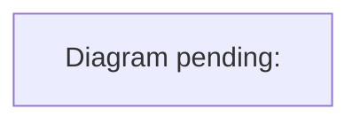

# Diagrams

River Oaks docs use [Mermaid](https://mermaid.js.org/) diagrams, which GitHub renders inline. Each planned diagram has a **placeholder** in its doc: a minimal Mermaid block that renders as "Diagram pending", followed by a collapsible **Diagram prompt** describing exactly what to draw.

## Placeholder convention

````markdown

<details><summary>Diagram prompt: &lt;id&gt;</summary>

<what to draw, which files are the source of truth, and what to label>

</details>
````

To complete one:
1. Read the prompt and the source files it names, so the diagram matches the code, not this index.
2. Replace the placeholder block with the real Mermaid diagram (`%% diagram: <id>` stays as its first line). Keep the prompt so the diagram can be redrawn after the code changes.
3. Check that it renders: GitHub preview, or `npx @mermaid-js/mermaid-cli -i <file>.md`.
4. Update the status below.

## Planned diagrams

| Diagram | Doc | Type | Status |
| --- | --- | --- | --- |
| `system-context`: System context | [architecture.md](architecture.md) | flowchart | Placeholder |
| `production-request-path`: Production request path | [architecture.md](architecture.md) | flowchart | Placeholder |
| `join-sequence`: Joining a world | [multiplayer.md](multiplayer.md) | sequenceDiagram | Placeholder |
| `email-sign-in`: Email sign-in flow | [email-access.md](email-access.md) | sequenceDiagram | Placeholder |
| `defense-layers`: Defense layers by risk | [security-review.md](security-review.md) | flowchart | Placeholder |
| `workplace-task-lifecycle`: Workplace task lifecycle | [workplace-operations.md](workplace-operations.md) | stateDiagram-v2 | Placeholder |
| `workplace-sweep`: Sweeps on a long-lived server and on Vercel | [workplace-operations.md](workplace-operations.md) | sequenceDiagram | Placeholder |
| `places-data-flow`: From district data to the destination explorer | [places.md](places.md) | flowchart | Placeholder |
| `task-lifecycle-and-retirement`: Task lifecycle and safe retirement | [project-management/workflow.md](project-management/workflow.md) | flowchart | Placeholder |
| `ci-pipeline`: Hosted CI and the merge gate | [testing.md](testing.md) | flowchart | Placeholder |
| `desktop-sign-in`: Desktop sign-in and session | [desktop.md](desktop.md) | sequenceDiagram | Placeholder |
| `merge-queue`: Parallel sessions and the merge queue | [agent-workflow.md](agent-workflow.md) | sequenceDiagram | Placeholder |

## Prompts

The same prompts appear next to each placeholder; they are collected here for batch work.

### `system-context`: System context

Target: [architecture.md](architecture.md) · type `flowchart`

Draw a C4-style system context flowchart for River Oaks. Show the people (residents in a browser, residents in the Electron desktop app, the owner/admin). Show the deployed pieces: the Vite-built Three.js client served from Vercel, Vercel Edge middleware (asset gate), the single Vercel Node function api/server.js running the Redis-backed world gateway (server/redis-backend.js), Vercel Cron calling /api/workplace-sweep, Redis Cloud (sessions, tickets, rooms, waitlist, invites, workplace), WorkOS (GitHub OAuth and email Magic Auth), Cloudflare Turnstile (email sign-in check), the typesafe.ai Jev provider (paid chauffeur decisions), the local Python decision/voice bridge (development and desktop only, reached as /v1), and the Unreal project (offline, not deployed). Label each arrow with the protocol (HTTPS, WebSocket /multiplayer, Redis, OAuth redirect). Group by trust boundary: browser, Vercel edge, Vercel function, third-party services, local machine.

### `production-request-path`: Production request path

Target: [architecture.md](architecture.md) · type `flowchart`

Draw a left-to-right flowchart of how one production HTTPS request is handled, from the visitor to Redis. Steps: Vercel Firewall custom rules (rate limits: 10/hour/IP on /auth/email/start, 600/min/IP on /api and /auth, 600/10min/IP on large /assets binaries; answer 429 before billing) -> Vercel routing (vercel.json rewrites to /api/server?_river_path=...) or static files -> middleware.js asset gate for /assets (signed river_oaks_gate cookie checked locally; otherwise one server check) -> api/server.js -> server/vercel-routing.js -> world router (server/world-router.js) choosing the world -> distributed app (server/distributed-app.js): security headers (CSP), per-address access limit, sign-in limiter, auth.handle, waitlist routes, game routes -> Redis-backed stores. Show the WebSocket upgrade branch for /multiplayer with ticket admission. Mark where each refusal happens (429, 403, 401) in red.

### `join-sequence`: Joining a world

Target: [multiplayer.md](multiplayer.md) · type `sequenceDiagram`

Draw a sequence diagram of a signed-in, approved resident joining a world. Participants: Browser client (preview/src/multiplayer-client.js), Vercel function (distributed app), Redis security store, Redis room. Steps: POST /api/multiplayer/ticket?world=<id> with CSRF -> server checks session, ban, waitlist approval, one-world rule -> issues a single-use ticket (live for 15 s, at most 3 live per user; a new one retires the user's oldest) -> client opens wss://<host>/multiplayer?ticket=...&world=...&protocol=2 -> server consumes the ticket atomically and admits the connection -> snapshot sent -> client watchConnection deadlines (12 s to open, 45 s for the first snapshot, late timers restart up to 4 times). Add alt branches: the account joins another world (old socket closed with 4009 'joined another world'; admins exempt), ticket expired (401), room operation failure isolated (three consecutive failures before close).

### `email-sign-in`: Email sign-in flow

Target: [email-access.md](email-access.md) · type `sequenceDiagram`

Draw a sequence diagram of email sign-in with every guard in order. Participants: Visitor's browser (preview/src/access-entry.js), Vercel Firewall, Vercel function (distributed app + server/magic-auth.js), Cloudflare Turnstile siteverify, Redis magic store, WorkOS. Steps: visitor focuses the email field -> Turnstile widget loads and yields a single-use token -> POST /auth/email/start {email, turnstileToken} -> firewall rate limit (10/hour/IP) -> per-address sign-in limiter (20 per 20 min) -> origin, content-type and size checks -> email normalisation -> Turnstile verification (action email_sign_in, hostname must match PUBLIC_ORIGIN; failure = 403 challenge_failed) -> one atomic Redis script: per-email 60 s cooldown (200 sent:false), global daily budget EMAIL_SIGNIN_DAILY_LIMIT (503 email_paused), per-address daily share EMAIL_SIGNIN_DAILY_PER_ADDRESS (429 email_limited), pending-state admission (oldest evicted when full) -> WorkOS createMagicAuth sends the code -> state cookie set -> later POST /auth/email/verify with the 6-digit code (5 attempts) -> WorkOS authenticateWithMagicAuth -> sealed session cookie -> waitlist request created as pending (or approved via invite). Show the error responses as notes.

### `defense-layers`: Defense layers by risk

Target: [security-review.md](security-review.md) · type `flowchart`

Draw a layered flowchart (or block diagram) mapping the three risks Val asked about to their controls, outermost first. Risk 1, owner-billed cost: Vercel Spend Management hard pause (owner setting), Vercel Firewall rate limits, asset Cache-Control and the signed asset gate, global and per-address email budgets, Turnstile, chauffeur daily budget and breaker (CHAUFFEUR_DAILY_LIMIT), Redis noeviction. Risk 2, production interruption and lag: per-address access limit, room operation isolation, transient Redis failure tolerance, per-user ticket cap, one world per account, full tables that evict oldest (sessions, pending sign-ins, waitlist pending requests) instead of refusing everyone, per-owner invite index, client polling backoff. Risk 3, remote code execution and injection: CSP default-src 'self' with explicit sources, no inline scripts, Electron fuses (RunAsNode off, NODE_OPTIONS off, asar integrity), dev bridge loopback guard, pinned base image and pnpm hash, secret scanning hooks. Colour owner-only settings differently from code controls.

### `workplace-task-lifecycle`: Workplace task lifecycle

Target: [workplace-operations.md](workplace-operations.md) · type `stateDiagram-v2`

Draw a Mermaid stateDiagram-v2 of one workplace task, from the owner submitting a brief to the task being gone. Read server/workplace.js and preview/src/workplace-contract.js for the exact states and transitions (for example queued, running, paused, completed, failed, expired, cancelled) and label each transition with its trigger: owner action (submit, pause, resume, cancel, forget), the runner advancing a step, a failed access check, a ban or waitlist revoke (suspend), retention expiry, the periodic due-index sweep, the Vercel Cron drain (/api/workplace-sweep with CRON_SECRET), and erase ({confirm:'erase'}, which removes every stored trace atomically). Note which transitions write the private per-task key and which update the due index.

### `workplace-sweep`: Sweeps on a long-lived server and on Vercel

Target: [workplace-operations.md](workplace-operations.md) · type `sequenceDiagram`

Draw a sequence diagram comparing the two ways orphaned workplace tasks are advanced. Lane A, long-lived Node server: a periodic sweep timer (sweepMs) reads the Redis due index ({ns}:workplace:v1:due) and advances due owners. Lane B, Vercel (no long-lived process): Vercel Cron calls GET /api/workplace-sweep every minute with Authorization: Bearer CRON_SECRET; the route drains due owners within a time budget and returns. Show the compare-and-set owner document save (Lua SAVE script with side ops), the private per-task keys with exact expiry, and that a runner racing an erase cannot bring data back.

### `places-data-flow`: From district data to the destination explorer

Target: [places.md](places.md) · type `flowchart`

Draw a flowchart of how destinations reach the Places UI and how a choice becomes travel. Sources: preview/public/data/district.json (walkSpawn, communityLocations, stores with OpenStreetMap category tags). placesOf() in preview/src/places.js builds arrival + spots + storefronts, deduped by data id, and attaches the store category from store-categories.js (Shopping & culture, Dining, Jewelry & accessories, Beauty & wellness, Homes). setupPlacesUI() renders rows (category icon, name, category, Go, overflow with Link/Remove), the world map (preview/src/world-map.js) and the atlas dialog (preview/src/places-guide.js: tabs, search, category filter chips with counts, empty state). Landmarks come from createAccountLandmarks() via /api/landmarks. Go calls goToPlace() in main.js -> multiplayer.travel({placeId|storeId|position}) -> server-authoritative travel -> 'You're at …' status. Shared links (?place= or ?at=) enter through destinationFromSearch().

### `task-lifecycle-and-retirement`: Task lifecycle and safe retirement

Target: [project-management/workflow.md](project-management/workflow.md) · type `flowchart`

Draw a flowchart of one task from claim to retirement in the task register. States: queued/active (claimed with owner, branch, leaseUntil) -> blocked (optional) -> delivered (exact PR, reviewed head, merge commit, tree, checks as an evidence array) -> retired. Then the retirement path run by `pnpm run project:prune`: owner releases (owner null, no leaseUntil, retirement {head, releasedAt, sessionsReviewedAt} within 2 h, in the PRIMARY checkout's live tasks.json) -> archive ignored evidence and clear regenerable caches -> dry run (blockers: ownership-not-released, dirty, ignored-data, exact-merged-pr-required, merge-not-on-default, aggregate-tree-review-required, active-process) -> --apply: lock, archive tag, bundle, restore into a fresh bare repo, fsck, non-forced worktree removal, expected-SHA ref deletion through the reference-transaction hook permit -> register updated to retired. Show the side path for superseded branches (blocked for aggregate review, archived but kept) and the register merge driver reconciling live and committed copies by task id.

### `ci-pipeline`: Hosted CI and the merge gate

Target: [testing.md](testing.md) · type `flowchart`

Draw the GitHub Actions graph for .github/workflows/verify.yml on a pull request: dependency-review, verify (Python 3.11 and 3.13 matrix: uv sync, ruff, pytest, pip-audit, demo), preview checks (audit, tooling, unit tests, server tests with Redis service, desktop tests, build, security browser e2e, reflections), preview shared shards (required, development, worlds-and-creator) and preview experience shards (streets, places) running in parallel, all feeding the aggregate 'preview' job that fails unless every shard succeeded, plus CodeQL analyses and the Vercel preview check. Then show the merge path: ~/.claude/scripts/gh-merge-when-green.sh waits for statusCheckRollup and mergeStateStatus CLEAN, refuses BEHIND (rebase first) and unsigned commits, and merges. Note the known flaky journeys and the rerun-failed-jobs step.

### `desktop-sign-in`: Desktop sign-in and session

Target: [desktop.md](desktop.md) · type `sequenceDiagram`

Draw a sequence diagram of the Electron desktop thin client signing in. Participants: Desktop main process (desktop/main.js, desktop/auth.js), system browser, WorkOS, hosted game (typesafe.place) /auth/desktop/exchange, Electron session cookie store. Show device sign-in in the system browser, the refresh-token exchange at /auth/desktop/exchange (rate-limited per address), the sealed session cookie written to session.defaultSession with an expiry, and the packaged window loading only the hosted https origin. Note the fuses (RunAsNode off, NODE_OPTIONS off, inspect off, asar integrity on, file protocol privileges off) and that cookie encryption stays off until Developer ID signing ships.

### `merge-queue`: Parallel sessions and the merge queue

Target: [agent-workflow.md](agent-workflow.md) · type `sequenceDiagram`

Draw a sequence diagram of several agent sessions sharing one repository safely. Participants: Session A, Session B, the primary checkout (Val's dev server and the live task register), the local landing queue (common Git directory), GitHub (PRs, Verify CI), and the merge guard (gh-merge-when-green.sh). Steps: each session claims a task in the live register and works in its own sibling worktree on its own branch -> opens a PR -> runs `pnpm run land <pr>`, which queues it in the common Git directory shared by every worktree (`pnpm run land --status` shows the queue) -> on its turn the lander updates the branch from main with GitHub's update-branch (verified commits), waits for Verify, reruns failed jobs once, and merges only through the guard -> if main moves first it updates and goes again; it stops on a conflict, a repeat failure or a guard refusal -> a register sweep PR later commits live-only records -> project:prune retires the delivered worktree and branch. Show the failure branch where a PR merged outside the queue moves main and the queued PR must update and rerun.
