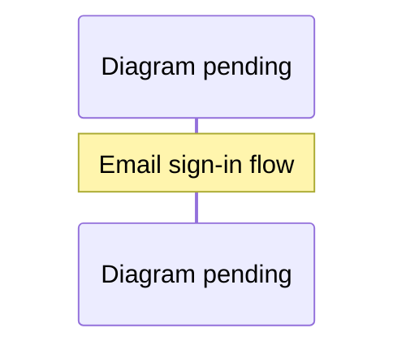

# Email access and invitations

Residents can sign up or sign in from the play screen with GitHub or their email.
The desktop app signs in with GitHub only.
Email uses [WorkOS Magic Auth](https://workos.com/docs/reference/authkit/magic-auth):
a six-digit, single-use code delivered by WorkOS, valid for ten minutes.
Verification proves inbox ownership. It does not grant access to the town.

Verified accounts start pending. An account enters only after a configured
waitlist admin approves it or it redeems a valid invitation. Rejected accounts
must be reconsidered by an admin; another invitation cannot override rejection.
Existing HTTP, asset, and WebSocket approval checks still apply.

The waitlist holds up to 10,000 accounts. When it is full, the oldest *pending*
request gives way to a new one. Approved and rejected accounts are never
removed. Someone whose request gave way simply asks again the next time they
sign in. A list with no pending requests refuses new ones.

## Invitations

- First approval or successful invitation redemption grants exactly two codes.
- Each code expires 30 days after issuance and admits one account.
- Re-approval, signing in again, expiry, and spending codes do not replenish them.
- Existing approved accounts and configured admins are not retroactively granted
  starter codes. Admins can explicitly issue codes to them.
- Accepted residents open **Your invitations** to copy and privately share codes.
- Admins open the same control to create additional codes for an approved owner,
  optionally assign redemption to a registered user, change that assignment,
  or expire a code immediately. A recipient must first sign in to appear in the
  assignment list. Owners and assigned recipients are distinct fields.
- Revoking approval or banning an owner permanently revokes their unused codes.
  Previously accepted invitees are not automatically revoked.

## Authentication and abuse boundaries


<details><summary>Diagram prompt: email-sign-in</summary>

Draw a sequence diagram of email sign-in with every guard in order. Participants: Visitor's browser (preview/src/access-entry.js), Vercel Firewall, Vercel function (distributed app + server/magic-auth.js), Cloudflare Turnstile siteverify, Redis magic store, WorkOS. Steps: visitor focuses the email field -> Turnstile widget loads and yields a single-use token -> POST /auth/email/start {email, turnstileToken} -> firewall rate limit (10/hour/IP) -> per-address sign-in limiter (20 per 20 min) -> origin, content-type and size checks -> email normalisation -> Turnstile verification (action email_sign_in, hostname must match PUBLIC_ORIGIN; failure = 403 challenge_failed) -> one atomic Redis script: per-email 60 s cooldown (200 sent:false), global daily budget EMAIL_SIGNIN_DAILY_LIMIT (503 email_paused), per-address daily share EMAIL_SIGNIN_DAILY_PER_ADDRESS (429 email_limited), pending-state admission (oldest evicted when full) -> WorkOS createMagicAuth sends the code -> state cookie set -> later POST /auth/email/verify with the 6-digit code (5 attempts) -> WorkOS authenticateWithMagicAuth -> sealed session cookie -> waitlist request created as pending (or approved via invite). Show the error responses as notes.

See [the diagram index](diagrams.md) for the convention.

</details>

Email sign-in uses a browser-bound HttpOnly state cookie, a ten-minute pending
state, five verification attempts, and a 60-second cooldown per normalized email.
The cooldown is shared across instances. Requesting from another browser during
cooldown says to use the code in the browser where it was requested, or to wait
a minute and request another. Responses never expose codes, tokens, or whether an
email already has an account.

Every code WorkOS sends costs money and mail reputation, so starts are bounded
before any send:

- **Cloudflare Turnstile.** The page loads the widget when someone first uses the
  email field; GitHub sign-in never loads it. The server verifies the single-use
  token with Cloudflare, checking the action and that the hostname matches
  `PUBLIC_ORIGIN`. A missing, failed, mismatched or slow check gets 403
  `challenge_failed`, with no email sent. It's on in production since 2026-10-12.
- **A per-address share,** `EMAIL_SIGNIN_DAILY_PER_ADDRESS` (default 10 per UTC day).
  An address is an IPv4 address or an IPv6 /64, the same key as the sign-in rate
  limiter. Past the share: 429 `email_limited`.
- **A global daily budget,** `EMAIL_SIGNIN_DAILY_LIMIT` (default 2,000 per UTC day,
  max 100,000). Past it: 503 `email_paused`. GitHub sign-in still works, and the
  screen says so.
- **The cooldown and budgets are spent in one atomic step,** so concurrent starts
  can't exceed them. Redis failures deny access (503 `auth_unavailable`).

State admission, verification reservations, successful consumption, invite
redemption, approval, and starter grants use atomic operations. Redis keys for
each transaction share one hash slot. Local storage serializes changes and
renames a private file containing users, invitations, and the audit together.
Storage errors deny access.

Mutating invitation requests require a verified session, same origin, CSRF token,
bounded JSON body, and server-side role checks. Email and invitation mutation
endpoints share the per-address sign-in limit of 20 starts per 20 minutes. It covers
`/auth/login`, email start and verify, desktop exchange, and invite redeem, issue
and update. Listing invites is limited to 20 per minute per account. Codes contain
192 random bits; request bodies are not logged. Codes are indexed by SHA-256;
the private store also retains the shareable code so the owner/admin can copy it
again. Protect the Redis database and local private volume accordingly.

The two-invite policy permits accepted users to sponsor new accounts, which then
receive their own two invitations. Email verification is not proof that accounts
belong to different humans. Admin assignment and revocation provide control over
this intended referral growth; they do not prevent someone controlling multiple
inboxes from participating in that growth.

## Configuration and operations

Use existing `WORKOS_API_KEY`, `WORKOS_CLIENT_ID`, `WORKOS_COOKIE_PASSWORD`,
`PUBLIC_ORIGIN`, and `WAITLIST_ADMIN_USER_IDS`. Optional:

- `EMAIL_SIGNIN_DAILY_LIMIT` and `EMAIL_SIGNIN_DAILY_PER_ADDRESS`: the budgets above.
- `TURNSTILE_SECRET_KEY` and `VITE_TURNSTILE_SITE_KEY`: set both or neither. A
  secret without the site key refuses every email start and logs a warning. The
  site key is built into the page, so changing it needs a redeploy. Enable Magic Auth and Magic Auth
email delivery in the matching WorkOS environment. The application maintains its
own waitlist and invitation codes; WorkOS organization invitation settings do not
set these codes' lifetime. No additional mail provider is required.

On 2026-10-06, the TypeSafe production environment already enabled Magic Auth
and its emails. On 2026-10-12, Turnstile was enabled in production: both keys were
set and production was redeployed. A start without a token was confirmed to get
403 `challenge_failed`. Magic Auth was enabled in TypeSafe staging for this feature;
staging email delivery was already enabled. No email was sent as part of tests.

The file store migrates existing waitlist files by adding an empty invitations
collection on the next write. Redis adds `:waitlist:invites` beside the existing
approval and audit keys. Since 2026-10-12 it also keeps these keys:

- `:waitlist:invites:owner:<sha256>`: a per-owner invite index, so listing your
  invites doesn't read the whole table;
- `:waitlist:invites:pruned`: an hourly marker for forgetting invites more than
  90 days past expiry when the 50,000 table is full;
- `:waitlist:pending` and `:waitlist:pending-indexed`: the pending-request order
  for eviction.

Revocation and rejection still read the whole invite table, so invites written by
an older server version are never missed. A rollback to pre-index code can leave
invites it issues out of that owner's own listing until the index is rebuilt.
Back up the shared access namespace before deployment. After using invitations,
do not roll back to code that drops the invitations collection or ignores invite
revocation during moderation.

## Verification

Run with an isolated local Redis database:

```sh
REDIS_URL=redis://127.0.0.1:16389 pnpm run test:server
pnpm test
pnpm run build
```

Tests exercise the real WorkOS SDK against a local signed-token fixture and real
Redis transactions. They cover expiry, concurrent redemption, repeat approval,
assignment, unauthorized issuance, CSRF, rejected recipients, banned inviters,
and ban/unban sequencing. Browser walkthroughs cover email to pending to invite
acceptance, member invite visibility, and admin issuance/assignment/expiry at
1440×900, 390×844, and 320×568 using mocked API responses. Actual inbox delivery
and a production deployment are separate acceptance steps.
