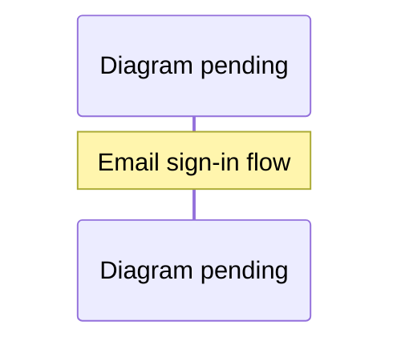

# Email access and invitations

Residents can sign up or sign in from the play screen with GitHub or their email.
The desktop app signs in with GitHub only.
Email uses [WorkOS Magic Auth](https://workos.com/docs/reference/authkit/magic-auth):
a six-digit, single-use code delivered by WorkOS, valid for ten minutes.
Verification proves inbox ownership. It does not grant access to the town.

Verified accounts start pending. An account enters only after a configured
waitlist admin approves it or it redeems a valid invitation. Rejected accounts
must be reconsidered by an admin; another invitation cannot override rejection.
Existing HTTP, asset, and WebSocket approval checks still apply.

## What the gate tells people

Joining is a waitlist, and the gate says so at every step, so nobody signs in again and
again thinking it failed (`preview/src/access-entry.js`).

The sign-in column is up to 460 px wide beside the artwork, and each part has one job:

- **Steps.** A track of three steps in the kicker's place: *Sign in*, *Get approved*,
  *Enter*. Done steps carry a tick (`data-done`), the visitor's own step is filled
  (`aria-current="step"`), and the rest wait in outline. It shows only while signed out
  or waiting. On phones narrower than 400 px only the current step keeps its name on
  screen (the others stay readable to screen readers).
- **Signed out.** *Signing in adds you to the waitlist. Already waiting? Sign in here to
  check.* The column still fits a 1440×900 or 1280×720 screen beside the artwork without
  scrolling.
- **Waiting.** The title reads *You’re on the waitlist*, and the lead says they're signed
  in and their place is saved since the day they joined (`requestedAt` from
  `/api/waitlist/status`; the year shows once it isn't this year). Below it a card,
  *Waiting for approval*, with a quiet pulse (still under reduced motion and software
  rendering), says what happens next: no need to sign in again; leave the page open and
  River Oaks opens by itself once they're approved (the page checks every 15 seconds);
  closing it is fine, their place is kept. It doesn't promise they stay signed in: a
  session lasts 7 days, and signing in again later finds the same request. The lead is
  only rewritten when its text changes, so screen readers don't repeat it. One edge:
  when the list is full (10,000), the oldest pending request gives way, and the next
  check re-requests it with a new date. The column fits 1440×900; at 1280×720 only the
  footer needs a scroll.
- **Your name in River Oaks.** A heading with a person icon, one line on what the name
  is for and its rules, the field with its button beside it, and *Use my GitHub name* /
  *Suggest another* as small secondary buttons. The button reads *Saved* (at rest) while
  the field holds the kept name and *Save* once it changes.
- **Have an invitation code?** A heading with a ticket icon and one line on what a code
  is: a member's one-time code that lets one person in right away, expiring 30 days
  after it's made (signed out: *Sign in first to use one*). *Use code* sits beside the
  field and becomes the pink action once a code is typed. A code that can't be used says
  why it might not work and that the visitor is still on the waitlist.
- **Sign out** is a quiet text button under the sections, available but not suggested.
- **Not approved.** The title reads *Your request wasn’t approved*, with the existing
  contact message, and no steps, kicker, card or code field.
- **A failed check** resets the title and hides the steps, card and username form.

The landing page's waitlist note says the same: sign in with email or GitHub to join, and
a member's invitation code skips the wait.

## Usernames

Every request has a username from its first status check (`server/waitlist.js`,
rules in `preview/src/resident-names.js`).

- **Default.** The resident's verified GitHub login, when it can be chosen as a
  username and nobody holds a name that reads the same; otherwise a generated name
  such as `rosy-heron-42`.
- **Rules.** 2 to 39 letters and digits, joined by single `-`, `_` or `.`. A name
  chosen now, by the resident, an approver or as a default, also needs at least 4
  letters A–Z; digits and separators don't count (`usernameChoiceProblem`). Names
  chosen before that rule are kept, and saving one again unchanged is accepted.
  Two names are the same when they read the same (case, accents and lookalike
  characters folded by `nameSkeleton`). No name may read as Jevica or Resident,
  or start like a `Visitor #` fallback.
- **Held logins.** A GitHub login is held for its owner from their first
  request, so nobody else can choose it.
- **While waiting.** The gate shows the username, with *Use my GitHub name* and
  *Suggest another*. The resident may change it until a decision
  (`POST /api/waitlist/username` with `{ username }`).
- **The approver.** The review lists each request's username. An approver may
  change it while the request is pending or refused, with *Save name*
  (`{ username, userId }`) or by approving with an edited name
  (`POST /api/waitlist/decision` with `{ userId, approved, username }`). A
  refused name refuses the decision. Approvers' changes are audited.
- **After approval** the username is fixed and names the resident everywhere in
  town (`usernameOf` in `server/auth.js` and `server/redis-auth.js`). Jevica's
  accounts are always Jevica. Residents approved before usernames existed keep
  their GitHub or `Visitor #` names.
- **Checks.** Both writes keep the Origin, CSRF, JSON and 1 KB checks. Only an
  approver may name someone else, and nobody may rename an approver.

The waitlist holds up to 10,000 accounts. When it is full, the oldest *pending*
request gives way to a new one. Approved and rejected accounts are never
removed. Someone whose request gave way simply asks again the next time they
sign in. A list with no pending requests refuses new ones.

## Invitations

- First approval from the waitlist grants exactly two codes.
- **Referral decay:** an account that joined by redeeming a code receives no codes of
  its own, then or on a later re-approval. Its record keeps the `inviteId` it joined
  with, and `/api/waitlist/status` reports `invited: true`; its **Your invitations**
  dialog says it joined with a code and has none to share. An admin can still issue it
  codes explicitly. Accounts that joined with a code before this rule (2026-10-15) keep
  any codes they were already given; nothing is revoked.
- Each code expires 30 days after issuance and admits one account.
- Re-approval, signing in again, expiry, and spending codes do not replenish them.
- Existing approved accounts and configured admins are not retroactively granted
  starter codes. Admins can explicitly issue codes to them.
- Accepted residents open **Your invitations** to copy and privately share codes.
- Admins open the same control to create additional codes for an approved owner,
  optionally assign redemption to a registered user, change that assignment,
  or expire a code immediately. A recipient must first sign in to appear in the
  assignment list. Owners and assigned recipients are distinct fields.
- Revoking approval or banning an owner permanently revokes their unused codes.
  Previously accepted invitees are not automatically revoked.

## Authentication and abuse boundaries


<details><summary>Diagram prompt: email-sign-in</summary>

Draw a sequence diagram of email sign-in with every guard in order. Participants: Visitor's browser (preview/src/access-entry.js), Vercel Firewall, Vercel function (distributed app + server/magic-auth.js), Cloudflare Turnstile siteverify, Redis magic store, WorkOS. Steps: visitor focuses the email field -> Turnstile widget loads and yields a single-use token -> POST /auth/email/start {email, turnstileToken} -> firewall rate limit (10/hour/IP) -> per-address sign-in limiter (20 per 20 min) -> origin, content-type and size checks -> email normalisation -> Turnstile verification (action email_sign_in, hostname must match PUBLIC_ORIGIN; failure = 403 challenge_failed) -> one atomic Redis script: per-email 60 s cooldown (200 sent:false), global daily budget EMAIL_SIGNIN_DAILY_LIMIT (503 email_paused), per-address daily share EMAIL_SIGNIN_DAILY_PER_ADDRESS (429 email_limited), pending-state admission (oldest evicted when full) -> WorkOS createMagicAuth sends the code -> state cookie set -> later POST /auth/email/verify with the 6-digit code (5 attempts) -> WorkOS authenticateWithMagicAuth -> sealed session cookie -> waitlist request created as pending (or approved via invite). Show the error responses as notes.

See [the diagram index](diagrams.md) for the convention.

</details>

Email sign-in uses a browser-bound HttpOnly state cookie, a ten-minute pending
state, five verification attempts, and a 60-second cooldown per normalized email.
The cooldown is shared across instances. Requesting from another browser during
cooldown says to use the code in the browser where it was requested, or to wait
a minute and request another. Responses never expose codes, tokens, or whether an
email already has an account.

Every code WorkOS sends costs money and mail reputation, so starts are bounded
before any send:

- **Cloudflare Turnstile.** The page loads the widget when someone first uses the
  email field; GitHub sign-in never loads it. The server verifies the single-use
  token with Cloudflare, checking the action and that the hostname matches
  `PUBLIC_ORIGIN`. A missing, failed, mismatched or slow check gets 403
  `challenge_failed`, with no email sent. It's on in production since 2026-10-12.
- **A per-address share,** `EMAIL_SIGNIN_DAILY_PER_ADDRESS` (default 10 per UTC day).
  An address is an IPv4 address or an IPv6 /64, the same key as the sign-in rate
  limiter. Past the share: 429 `email_limited`.
- **A global daily budget,** `EMAIL_SIGNIN_DAILY_LIMIT` (default 2,000 per UTC day,
  max 100,000). Past it: 503 `email_paused`. GitHub sign-in still works, and the
  screen says so.
- **The cooldown and budgets are spent in one atomic step,** so concurrent starts
  can't exceed them. Redis failures deny access (503 `auth_unavailable`).

State admission, verification reservations, successful consumption, invite
redemption, approval, and starter grants use atomic operations. Redis keys for
each transaction share one hash slot. Local storage serializes changes and
renames a private file containing users, invitations, and the audit together.
Storage errors deny access.

Mutating invitation requests require a verified session, same origin, CSRF token,
bounded JSON body, and server-side role checks. Email and invitation mutation
endpoints share the per-address sign-in limit of 20 starts per 20 minutes. It covers
`/auth/login`, email start and verify, desktop exchange, and invite redeem, issue
and update. Listing invites is limited to 20 per minute per account. Codes contain
192 random bits; request bodies are not logged. Codes are indexed by SHA-256;
the private store also retains the shareable code so the owner/admin can copy it
again. Protect the Redis database and local private volume accordingly.

The two-invite policy lets members approved from the waitlist sponsor up to two new
accounts. Those accounts receive no codes of their own, so referral growth stops one
step from each approval instead of compounding. Email verification is not proof that
accounts belong to different humans. Admin assignment and revocation provide further
control; they do not prevent someone controlling multiple inboxes from redeeming the
codes they were given.

## Configuration and operations

Use existing `WORKOS_API_KEY`, `WORKOS_CLIENT_ID`, `WORKOS_COOKIE_PASSWORD`,
`PUBLIC_ORIGIN`, and `WAITLIST_ADMIN_USER_IDS`. Optional:

- `EMAIL_SIGNIN_DAILY_LIMIT` and `EMAIL_SIGNIN_DAILY_PER_ADDRESS`: the budgets above.
- `TURNSTILE_SECRET_KEY` and `VITE_TURNSTILE_SITE_KEY`: set both or neither. A
  secret without the site key refuses every email start and logs a warning. The
  site key is built into the page, so changing it needs a redeploy. Enable Magic Auth and Magic Auth
email delivery in the matching WorkOS environment. The application maintains its
own waitlist and invitation codes; WorkOS organization invitation settings do not
set these codes' lifetime. No additional mail provider is required.

On 2026-10-06, the TypeSafe production environment already enabled Magic Auth
and its emails. On 2026-10-12, Turnstile was enabled in production: both keys were
set and production was redeployed. A start without a token was confirmed to get
403 `challenge_failed`. Magic Auth was enabled in TypeSafe staging for this feature;
staging email delivery was already enabled. No email was sent as part of tests.

The file store migrates existing waitlist files by adding an empty invitations
collection on the next write. Redis adds `:waitlist:invites` beside the existing
approval and audit keys. Since 2026-10-12 it also keeps these keys:

- `:waitlist:invites:owner:<sha256>`: a per-owner invite index, so listing your
  invites doesn't read the whole table;
- `:waitlist:invites:pruned`: an hourly marker for forgetting invites more than
  90 days past expiry when the 50,000 table is full;
- `:waitlist:pending` and `:waitlist:pending-indexed`: the pending-request order
  for eviction;
- `:waitlist:usernames` (2026-10-13): how each held username or GitHub login
  reads (`usernameKey`), mapped to its account. Claims are checked and written
  atomically in Lua. An evicted request's names are released.

Revocation and rejection still read the whole invite table, so invites written by
an older server version are never missed. A rollback to pre-index code can leave
invites it issues out of that owner's own listing until the index is rebuilt.
Back up the shared access namespace before deployment. After using invitations,
do not roll back to code that drops the invitations collection or ignores invite
revocation during moderation.

## Verification

Run with an isolated local Redis database:

```sh
REDIS_URL=redis://127.0.0.1:16389 pnpm run test:server
pnpm test
pnpm run build
```

Tests exercise the real WorkOS SDK against a local signed-token fixture and real
Redis transactions. They cover expiry, concurrent redemption, repeat approval,
assignment, unauthorized issuance, CSRF, rejected recipients, banned inviters,
and ban/unban sequencing. Browser walkthroughs cover email to pending to invite
acceptance, member invite visibility, and admin issuance/assignment/expiry at
1440×900, 390×844, and 320×568 using mocked API responses. Actual inbox delivery
and a production deployment are separate acceptance steps.
