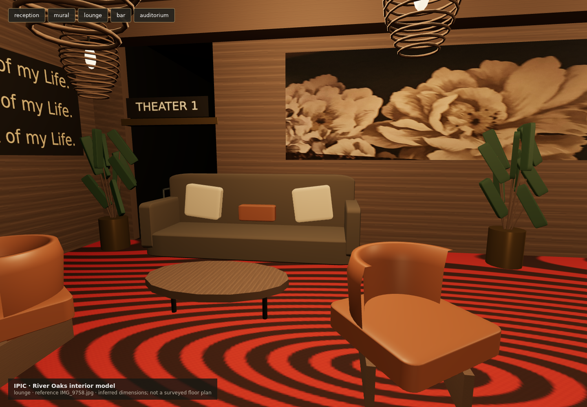

# IPIC River Oaks interior

The IPIC destination now has a connected reception, two escalator runs, mural
landing, upper lounge and Tuck Room bar, cinema entrance and one furnished
auditorium. Enter IPIC from the existing destination controls or street door.
Walk up either clear escalator lane. At the top, the passage along the left
wall leads around the lounge furniture into Theater 1. Choose a nearby recliner
in the seating control, or press Z; Z stands up. Walk back down to the street.

## What is factual and what is inferred

The 44 original user photographs are in `assets/ipic/references/`, with SHA-256
hashes in `manifest.json`. They control the visible color/material direction,
reception desk, bronze lift doors, glass escalator rails, book-spine mural,
red patterned carpet, lounge furniture, hanging pendants, bar, floral artwork
and cognac recliners. Generated concept images were not used as reconstruction
or photogrammetry inputs. No external stock model or paid generation was used.

This is a playable **photo-guided reconstruction**, not a survey or a verified
pixel-perfect match. The 13 m frontage, 34 m interior depth, two 3 m rises and
the nine-seat auditorium wing are authored estimates fitted inside the existing
mapped footprint; the wing's size and rake come from cinema viewing guidance,
not from the photos (see "Auditorium and screen" below). The rooms use a sequential circulation layout to preserve
the current shared movement contract, which has one support height per XY.
The actual venue's stacking, room adjacencies, floor heights, hidden spaces,
seat count and accessibility routes require measured references before a
literal architectural reconstruction. The brass lift doors are visual only;
public traversal currently uses the escalator slopes. Treads are static.

| Zone | Principal photos | Implementation |
| --- | --- | --- |
| Reception and entrance | IMG_9734–9741, 9777–9779 | Marble desk, fluted backing, limestone floor, signage and bronze lift |
| Escalator runs | IMG_9742–9751, 9768–9776 | Two continuous support slopes, steel treads, glass/metal rails and stone |
| Mural landing | IMG_9746–9748, 9771 | Original IMG_9771 texture with authored mesh UV sampling |
| Upper lounge | IMG_9752–9755, 9758 | Sofa, cognac tub chairs, oval table, pendants and script sign |
| Tuck Room bar | IMG_9756–9757 | Counter, leather stools, shelves and hanging greenery |
| Cinema corridor | IMG_9759–9763 | Original IMG_9761 floral wall texture, Express hatch, theater doorway |
| Auditorium | IMG_9765–9767 | Screen, recliners and guide lights; the wing's size, rows and rake follow viewing guidance |

Photographic artwork textures retain the source photos' baked light/perspective
and any visible occlusion. Timber, carpet and marble are procedural material
approximations. The movie screen uses a plain illuminated surface, not a movie
frame. No CC0 license is asserted for third-party artwork or venue marks.

## Source and assets

- `preview/src/ipic-plan.js`: dimensions, support heights, obstacles, seats and
  reference camera targets. Pure JS shared by browser and server.
- `preview/src/ipic-interior.js`: reproducible modular geometry, merged by
  zone/material and indexed to reduce exported size.
- `preview/src/ipic-materials.js`: finishes and original photographic textures.
- `preview/public/assets/ipic/ipic-interior.glb`: reusable metre-scale game mesh.
- `assets/ipic/ipic-interior.blend`: editable packed Blender project, zone groups,
  material nodes, four reference cameras and review lighting.

The live district builds the same authored scene through `buildStoreInteriors`;
it does not download an additional copy of the exported GLB. The GLB is for
external DCC/native import and reuse, with embedded textures capped at 1536 px
for a compact handoff. Original reference photographs remain full resolution.
GLB coordinates: +X across frontage,
+Y up, -Z into venue. Blender imports this as Z up, +Y into venue. Place it at
the existing room facade transform; avoid applying that transform twice.
Blender is an editable handoff generated from the JS master. To make edits
persist in the live game, update the JS master and regenerate; arbitrary manual
Blender edits are not automatically round-tripped into JS.

## Rebuild and review

From the repository root, after the normal locked dependency install:

```sh
node scripts/export-ipic.mjs
blender --background --threads 2 --python scripts/export-ipic-blender.py
node --test preview/tests/ipic-*.test.js server/tests/ipic-*.test.js
REDIS_URL=redis://127.0.0.1:<throwaway port> node --test server/tests/ipic-routes.test.js
node scripts/ipic-review-data.mjs --check
node preview/e2e/ipic-runner.mjs
node preview/e2e/ipic-photo-views.mjs   # runtime T1–T3 on this GPU, see below
pnpm run verify
```

The export/visit runners own authenticated loopback fixture servers and acquire
the repository browser lock. `IPIC_CHROMIUM=/absolute/path/to/browser` can select
an installed compatible Chromium executable if the pinned browser download is
unavailable. Never point these fixture identities at a production server.
The model review page is `/e2e/fixtures/ipic.html` on the local fixture server;
buttons frame the recorded reference views and dragging orbits the model.

Export review images and JSON receipts go to `output/playwright/ipic/`.
The production visit uses the existing software acceptance mode; this proves
controls and server behavior, not material fidelity. Material views are
captured separately with real Three.js materials. This host's software browser
is not evidence of target-device performance, human accessibility or Unreal
integration. Verify the native runtime separately before shipping there.

## Circulation, collision and screen evidence (#364)

`preview/src/ipic-circulation.js` measures how wide a body each trip admits,
against the same walls and boxes the server collides with.
`node scripts/ipic-review-data.mjs` writes the results to
[ipic-review/circulation.json](ipic-review/circulation.json) and
[ipic-review/screen.json](ipic-review/screen.json); `--check` fails if they are stale.

Bodies:

- **Server body.** A 0.35 m disc against square-inflated boxes (`walking.js`).
- **Accepted envelope.** `AVATAR_ENVELOPE`: 1.01 m widest, 0.888 m turning radius.
  Those are bind-pose bounds from 2026-10-11. Posed vertices measured on 2026-10-15
  are at most 0.80 m wide.
- **Seated reach.** From the seat origin, worst over the 22 looks, in the game's
  seat pose: 0.644 m forward (legs), 1.155 m back (beast tails), 0.514 m to the side.
  Data: `docs/superpowers/plans/2026-10-15-ipic-route-evidence/seated-extents.json`.

Results:

| Trip | Width | Accepted body |
| --- | --- | --- |
| Street door to the top of either escalator lane | 1.70 m (the door) | fits; lanes are 1.71 m between glass rails |
| Lane top to inside the auditorium doorway | 1.60 m (until 2026-10-18, 1.055 m between the planter at −5.65, 25.4 and the sofa's west arm) | fits; the sofa now backs onto the west guardrail |
| Lane top to either sofa place's approach (its front corner beside the table), other seats occupied | 1.09 m | fits (0.3 m before the sofa moved) |
| Doorway to each of the 9 recliner approaches (1.4 m in front of the seat, in the legroom), other 10 seats occupied | 0.89 m | the server body fits; the widest accepted body reaches a sit spot within the 3.6 m sit reach for every recliner (1.2–3.09 m away) |
| Legroom in front of a row, with the row in front seated | 0.891 m (footrests to the seated bodies in front) | below 1.01 m, above the widest posed body (0.80 m); accepted by Val, 2026-10-15 |
| Turning circles: reception, landing, lounge, auditorium, every seat occupied | 3.05, 1.32, 2.69, 4.0 m radius | fit (0.888 m needed) |

The server walks these routes in `server/tests/ipic-routes.test.js`. It covers:

- both lanes, up one and down the other;
- every recliner, with the other ten seats held by restored sessions;
- exclusive claims, and release on travel out or disconnect;
- false heights, solid shortcuts, teleports and a "lift" level command;
- seats through the cinema wall;
- one recliner contested by two Redis coordinators.

`preview/tests/ipic-agreement.test.js` checks the rendered meshes against the server:

- floors and landings sit within 1 cm of the server support everywhere a body can stand;
- treads sit 0–10 cm above the continuous ramp the server walks;
- every collision box has drawn geometry in it.

**Fixed here.** Four drawn solids had no collision: the auditorium aisle handrail,
the Tuck Room back shelving, the IPIC Express counter and the lift front. They now
collide; none is on a public route.

**Open defects**, kept as a `todo` test or recorded allowances:

1. ~~**The lounge sofa traps its sitter.**~~ Fixed: each sofa place names where its sitter
   steps out and is approached from (`ipic-plan.js` `stand`, `approach`): since the sofa backs
   onto the west guardrail (2026-10-18), the open floor at its front corner beside the table. The server's `stand()` tries
   that spot, with the usual destination checks, before its radial search, which never
   finds a straight clear path out of the sofa.
2. ~~**The lounge-to-auditorium passage** was 1.005 m against the 1.01 m accepted body.~~
   Fixed (Val, 2026-10-15): the lounge planter moved 5 cm west; the passage is 1.055 m. Since
   the sofa moved (2026-10-18) the route runs along a = −1.4 and is 1.6 m wide.
3. ~~**Recliner footrests and base ends had no collision.**~~ Fixed (Val, 2026-10-15): they
   collide as drawn (`ipic-recliner-base`, `ipic-recliner-footrest` in `ipic-plan.js`).
   Each recliner names a stand spot and approach 1.4 m in front of it, in the legroom
   before the footrest, 0.45 m from it and from the seated bodies in front. With the row
   in front seated the legroom is 0.891 m: the widest accepted body sits from the side
   aisles, within the server's sit reach.
4. ~~**Open sky over the escalator runs.**~~ Fixed: the runs share the ceilings of the
   floors they rise to; a test requires a ceiling above every walkable point. Found by
   the photo review (`docs/ipic-review/photo-review.md`, P1).
5. **Drawn without collision, where a body can stand:**
   - the base under each recliner cushion, the side tables, and the sofa cushions: seat
     zones, whose cushion centres must stay free for the sit protocol;
   - the fluted reception backing and its sign, drawn across the right escalator
     lane's entrance (slats from a = 1.29 m; the lane runs 0.545–2.255 m), so a
     collider there would close the lane: an art fix;
   - pitched escalator glass and stone courses overhanging the lane ends;
   - tub-chair shells, planter foliage, and the screen plane, 0.13 m in front of the
     wall that stops a body.

**Runtime against the photos** (2026-10-15): `docs/ipic-review/photo-review.md` compares
T1–T3 with the photos they are indexed to and lists 18 differences by photo ID, severity
and owner. P1 (open sky), P3, P4 and P6 (the reception), P5 (sign), P7 (reception view), P8,
P9, P10 and P11 (the lounge group), P12 (lounge carpet and bar floor), P13 and P14 (the Tuck
Room's island bar, rack and pothos), P15 and P16 (the auditorium's risers and screen, since
replaced by the 2026-10-19 wing), P17
(auditorium carpet) and P18 (the walled-in landing) are fixed, and P2 (the mural, kept large in
its bay) is resolved as Val chose. All 18 are now fixed or resolved.

## Auditorium and screen (Val, 2026-10-19)

`IPIC_WING`, `IPIC_VIEWING`, `IPIC_AUDITORIUM_ROWS` and `IPIC_SCREEN` in `ipic-plan.js`
feed the renderer, the server and the data; `preview/tests/ipic-viewing-standards.test.js`
holds them to the guidance below.

**Why it changed.** The photographed house put its two rows 5.79 m and 2.79 m from a
12.1 m screen: 92° and 130° of view, where cinema guidance asks for 30–60°. IPIC already
fills the building's depth, so seat distance had to come from its length. The auditorium is
now a wing along the building, behind the shops: a −19.5 to 19.5 by d 26 to 34, three
times the room's 13 m width. The screen is on its north end wall (a −19.35), and the rows
face it. The wing is a second part of the IPIC room (`addRoomParts` in `store-rooms.js`).

**Guidance used.** These are secondary sources; the SMPTE EG-18 text itself was not
available.

- **Horizontal angle** `2·atan(W/2D)`. SMPTE EG-18 asks at least 30° from the farthest
  seat. THX asks at most about 60° in front, about 40° at the ideal seat, and 36° at the
  back row.
- **Vertical angle.** The image's top edge is at most 35° above the eye (EG-18).
- **Sightlines.** Each eye line to the image's bottom edge clears the headrest in front by
  a C-value of 0.12 m (90–120 mm is "good" to "excellent").

Sources:
[cinemaview.in](https://cinemaview.in/en/blog/smpte-viewing-standards),
[frontdesk forum](https://forum.frontdesk.co.in/showthread.php?tid=2377),
[Valencia seating](https://ca.valenciatheaterseating.com/blogs/home-theater-seating/home-theater-viewing-distance),
[Design Collaborative](https://designcollaborative.com/optimizing-sightlines-for-every-seat-enhancing-audience-experience-in-venues/),
[auditorium design notes](https://www.slideshare.net/slideshow/2-auditoriumpptx/257200011).

**Result.** The seated eye is the cushion plus 0.69 m. Seated avatars in front are not
modelled, only recliner headrests.

| Row | Eye to screen | Floor (from the doorway) | Horizontal, centre (end seats) | Up to the image top | End seats off axis |
| --- | --- | --- | --- | --- | --- |
| Back (0) | 12.5 m | 0 | 33.0° (32.3°) | 12.5° | 9.1° |
| Middle (1) | 9.5 m | −0.507 m | 42.6° (41.1°) | 19.0° | 11.9° |
| Front (2) | 6.5 m | −0.907 m | 59.3° (55.9°) | 29.5° | 17.1° |

- **Screen.** 7.4 × 3.10 m, 2.39:1 scope, centred along the end wall at d 30, 0.3 m from
  each long wall. Its bottom edge is 1.8 m over the front row's floor; this is the
  rake's focal point. Films keep their aspect, so the approved 16:9 short is pillarboxed.
- **Rows.** There are three, 3.0 m apart, as in the photographed house. Each has three
  recliners at d 28, 30 and 32, centred on the screen, between 1.35 m aisles along both
  long walls. Four rows at that pitch would need a 9 m screen to stay within 30–60°, which
  is wider than the 8 m wing.
- **Rake.** The back row is level with the doorway, and the rows in front step down
  0.507 m and 0.400 m. In the aisles each step is a ramp 0.45 m either side of the riser,
  with treads and glow nosings. Every eye line clears the headrest in front by 0.12 m, so
  no recliner hides any of the image. `hiddenBottomFraction` is now 0 for every seat; the
  back row used to lose 22 %.
- **Entry.** The cinema doorway (a −4.7, d 26) opens onto a rear foyer behind the back row.
  A cross-aisle along the d-26 wall runs to the side aisle and each row's legroom.
- **Short of THX.** The back row's 33° meets SMPTE's 30° but not THX's 36°. With a 7.4 m
  screen, 36° needs the back row within 4.98 m of the front row (a 2.49 m pitch). That
  leaves less legroom than the widest posed body. The other route is a deeper wing for a
  wider screen.
- The player's captions are a WebVTT track, not burned in.

## Recorded review

The five material views and machine-readable receipts are in [ipic-review/](ipic-review/).
These renders show the authored approximation; compare against the original
photos before accepting architectural fidelity.


