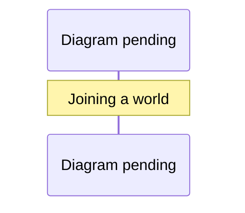

# Deploy the shared town

Groups and open-ended creation controls are disabled by default. Set
`VITE_CREATION_TOOLS=true` before starting development or building to show
Groups, event hosting, Build & decorate (including saved designs), and world
publishing/editing. Only the exact value `true` enables them; restart the dev
server or rebuild after changing the flag. Publishing/editing also requires
`VITE_WORLD_MAP=true` to expose the Worlds section and the existing account
permissions. Event browsing and RSVPs, contacts, chat, profiles, landmarks,
and existing shared creations remain available with creation tools off.

## Develop locally with WorkOS

`pnpm run dev` starts WorkOS authentication and the shared town inside the Vite
dev server. Configure the Staging WorkOS application and enable GitHub
social login and Magic Auth email codes in its dashboard, and register
`http://127.0.0.1:5173/auth/callback`. Both play modes require sign-in and
waitlist approval. Set `WAITLIST_ADMIN_USER_IDS` to the WorkOS user ID of the
first approver. That account is automatically approved and can review requests
from the Waitlist requests control. Verified email sign-in also creates a pending
request; a valid invitation can approve it. See [email access and invitations](email-access.md)
for issuance, assignment, expiration, and security limits. Each player must use a separate WorkOS
account. Players normally appear under their verified GitHub handle. Email-only
accounts, unavailable GitHub lookups, and disallowed names (including Resident)
receive a stable `Visitor #<account ID>` name automatically. The full public
account ID keeps fallbacks unique across accounts and separate from valid GitHub
handles; existing stored names are checked again before being displayed.
The automated acceptance runner uses isolated temporary local identities under `RIVER_OAKS_ACCEPTANCE_FIXTURE=1`.
For a separate checkout while the default ports are in use, run
`RIVER_OAKS_DEV_TOWN_PORT=8797 pnpm run dev --port 5179`. The preview proxies
auth, multiplayer, and landmark traffic to that checkout's own town on the
chosen loopback port.

- Browser and desktop clients always join the town after approval. A valid town
  snapshot is required before gameplay is unlocked. Disconnects show recovery
  controls and never start a local simulation.
- Play-mode flags, saved mode preferences, and `?play=` parameters are retired
  and have no effect. Account appearance and landmarks remain server-owned;
  old device-only gameplay data is not imported into accounts.
- `pnpm run server --dev` runs the town as its own process for a separate
  `pnpm run dev`; the dev server then uses it instead of starting its own.

Development identities exist only for the explicit acceptance fixture on a
loopback `http` origin, outside `NODE_ENV=production`, and never on Vercel.
The Vercel function and Redis backend always require WorkOS and fail closed
without it.

While the town runs, the character panel offers the playable characters, styles,
and human or beast forms. Appearance and beast movement belong to the signed-in
account and follow it between worlds and server instances. Redis retains up to
10,000 account preferences; each town checkpoint also keeps its room copy for
recovery. A new account preference first takes the saved River Oaks appearance
when one exists.
Multiplayer streets show real players and Jevica's companion/chauffeur.
Other street residents are hidden; the NPC directory and nearby interactions
keep building residents. Shop staff, guests, and indoor encounters remain.
The People panel also has contacts and private messages. An invitation can be
sent only to a player currently present in the same world; that player must
accept before either can send a private message. Contacts and the latest 40
messages per pair are stored outside world checkpoints, so they survive travel,
reconnects, and Redis edge replacement. Removing a contact erases the message
history and ends messaging. Contact and message writes are rate limited; each
account can have up to 50 contact relationships, including pending invitations.
An accepted contact can invite the other resident to their current world while
connected. The server records the sender's room as a private message, and the
recipient can choose its world link to travel there. The sender cannot supply
a destination in the request. World invitations share the 40-message history
and write limit; they do not grant building or wish permissions.
An accepted contact can also choose a named public place in their current world
and send a private meeting invitation. The server resolves the place against the
active published region and stores its world and place IDs in the message. The
recipient's link joins that world and travels to the place; a stale place link
can no longer travel if a later region revision removes the place. Place
invitations share the same history and rate limit.
In creator worlds, Jevica can invite an accepted contact into an owner-only
home from that contact's People panel conversation. The invitation applies to
one home and survives reconnects and compatible region revisions. Each home
holds up to 16 invited accounts. A visitor may enter after the client receives
the invitation; revoking access moves an occupant outside. Home entry never
grants building or wish authority. Jevica can revoke any invitation from the
private home guest list even after removing that account from contacts.
Accepted contacts also see whether a resident is online and can follow a link
to their current world without waiting for an invitation. The contact list
exposes the world name and ID, never the resident's exact position. Pending
contacts and other accounts receive no presence data. A newer connection wins
when someone changes worlds; cleanup from an older socket cannot erase it.
Presence is cleared on disconnect and expires after 90 seconds without a
heartbeat, including when a server disappears without a clean disconnect.
The client checks for new invitations and messages every 10 seconds while its
browser tab is visible and connected.
Private messages are visible only to the two participants through authenticated,
origin and CSRF checked requests.

With `VITE_CREATION_TOOLS=true`, residents can create private groups from the
People panel. The owner invites
accepted contacts, and each person accepts or declines before joining. Members
can chat across worlds and reconnects; nonmembers and pending invitees cannot
read the conversation. Owners can cancel invitations, remove members, or disband
the group, and members can leave. Redis keeps group membership and the latest
60 messages outside room checkpoints, so separate server instances see the same
group. Each account can belong to or be invited to at most 12 groups, with up
to 32 members and pending invitations per group. Names, descriptions, and
messages are bounded; writes are rate limited. Group membership never grants
building, world publishing, or wish permissions. The client checks for group
changes every 10 seconds while visible and connected.

The People panel also offers **Wave** and **Bow**. These short gestures are
validated by the shared world and shown on every nearby player's avatar. They
expire after a few seconds, have a brief cooldown, and do not change building
or wish permissions.

When another player is within 2.6 meters, on foot and in sight in the same room,
**Say hello** appears over the world. Choose the person, wave, or invite them to
**Shake hands** or **Dance together**. The recipient chooses **Accept** or
**Decline**; the sender can cancel. Invitations expire after 15 seconds.

An accepted handshake checks clear ground before bringing both people within
arm's reach. Both avatars face each other and use a shared palm target. Dancing
uses a shared rhythm. Handshakes last 4.2 seconds; dancing lasts 14 seconds.
Either participant can choose **Stop**, walk away, or travel to end the activity.
Sitting, watering, changing appearance or movement mode, and leaving also end it.
Seated, riding, flying, and all-fours movement cannot start paired greetings.
The town validates consent, reach, sight lines, alignment and timing; checkpoint
recovery retains the invitation or activity with its original expiration.
Reduced-motion clients retain the invitation controls and activity text without
the gesture animation. These interactions are between signed-in players;
shop-resident conversations keep their existing behavior.

The People panel lets each signed-in resident edit a short profile with a
tagline, bio, pronouns, and up to eight interests. A profile is readable only
by someone currently meeting that resident in a world or by an accepted
contact. Profiles are shared across worlds, versioned across devices, and
persist in Redis outside room checkpoints. Editing a profile does not grant
building or wish permissions.

Town chat has a collapsible dock at the lower left of the game view. Closing
the dock retains a draft; unread messages offer a jump back to the latest
message. People is a separate expandable panel at the upper right. Messages are visible to everyone in
the room, attributed to the signed-in player, and kept as a rolling 40-message
history across reconnects. The server limits messages to 280 characters and
one send per second per account; chat history clears when the town is reset.
The Places panel lists private landmarks across all published worlds in shared
play, with up to 50 per world per account. Their positions come from the
server's current player pose, and each record is labeled with its origin world.
Redis stores them outside town checkpoints so reconnects and new server
instances retain them. Opening a landmark in another world follows a link to
that world and its saved position; arrival still passes the destination
world's outdoor travel check. Old device-only landmarks are ignored and are not
imported into account storage.
The world map shows outdoor players in the same shared room. Selecting one and
choosing **Meet nearby** sends their account ID to the server, which resolves
their current position and searches for an outdoor arrival spot clear of other
players. Indoor players are omitted from the map, and travel to one is refused.
The map does not offer a link to another player's position.
Creator regions can also show up to 32 named land parcels. Jevica assigns an
owner from her account or accepted contacts in the region studio. Ownership is
published with the region, survives compatible revisions, and appears as
**Your parcel** to that account. It grants no build, wish, or home-entry rights.
The Worlds directory shows an aggregate visitor count for each published world
and refreshes while the directory is visible. Redis updates each count in the
same fenced commit as the room; the count expires after 30 seconds if its room
stops updating. Listing worlds reads only these small count keys, not room
checkpoints or player identities.

Only Jevica's two configured WorkOS owner accounts can grant wishes or use
Build & decorate, including saved designs. In shared play, the server checks the
authenticated user ID for every command; a selected Jevica appearance does not
grant authority. Other visitors can see creations and wish effects, meet
residents, chat, travel, and participate in community scenarios. On loopback
development auth, the first issued development identity is the owner fixture.
Jevica can move or remove creations made before the restriction; their previous
owners cannot keep building. Earlier guest design records remain private in the
checkpoint but cannot be used while the restriction is active.
Shared-world authority is enforced by the server. Auto visits, invasion, and
telekinesis are no longer part of browser or desktop play.

With `VITE_CREATION_TOOLS=true`, Build & decorate lets the owner place, move,
turn, and remove up to 24 owned
creations in the shared town. A placed creation can be saved as an account
design, then placed again from **Saved designs** in any published world. Jevica
can keep 48 account designs. The account library is private and stored outside
room checkpoints, so it survives travel, reconnects, world resets, and Redis
edge replacement; placed copies remain visible to everyone in their world.
Designs saved before the account library remain in their original world
checkpoint. **Copy to account** makes one of these older designs available in
every world while retaining the original. Deleting the account copy reveals
the original again in that world.
Each new placement still passes the server's reach, ground, road, collision,
and capacity checks. Deleting a design does not remove copies already placed.
Jevica can also furnish residential creator homes. Placement must stay within
the same home as her avatar and leave the doorway and built-in fixtures clear;
retail interiors remain protected. Guests still cannot build anywhere.

Jevica can open an existing creator region in the World studio, save a private
revision draft, and apply it to the live world. The draft is stored in shared
Redis with the hash of the published region and is available on another
device. Applying validates the old checkpoint, carries forward durable player
state and creations, then atomically publishes the revised catalog and room
checkpoint. A layout that conflicts with an existing creation is rejected.
Connected visitors reload the revised map; active NPC wishes reset. Guests
cannot load, save, discard, or apply drafts. Jevica can select one of the last
eight published versions and load it into her private editor. She must save
that copy as a new revision draft before applying it. Version reads verify the
retained region hash, and applying still checks the current region and existing
creations before changing the live world.

The shared town uses 98 simulated indoor residents.
Every outdoor scenario resident and at least one staff member per shop remains.
The same roster drives the server, browser, room counts, and rendered people.
Old full-population checkpoints migrate into this roster and preserve active
indoor wishes. See the [performance audit](multiplayer-performance-audit.md).

The selected target is **`0xbuns/river-oaks` on Vercel**, serving `https://typesafe.place`. `vercel.json` packages the Vite frontend and `api/server.js` Node WebSocket backend in `iad1`, with a 300-second function limit. The project has Fluid compute enabled. Connections reconnect before the function limit and recover the shared town. See [Vercel WebSockets](https://vercel.com/docs/functions/websockets). `sim.jev.works` permanently redirects to `typesafe.place` (`vercel.json` redirects). `middleware.js` gates game assets with a signed pass (see [the security review](security-review.md#static-asset-gate)). A per-minute Vercel Cron calls `/api/workplace-sweep` (see [workplace operations](workplace-operations.md)).

Run `pnpm run test:shared` for development onboarding and authenticated fixture journeys, including mobile controls and keyboard reconnect/sign-out. See [acceptance commands and scope](experience-polish.md). This does not use live WorkOS accounts.

## Resident names

Every signed-in resident is shown by their GitHub username, everywhere another player can see them: the roster, nameplates, chat, contacts, groups, events, profiles, the map and the waitlist. The free-text name on a GitHub profile is never used. Only Jevica's accounts (`preview/src/jevica-accounts.js`) have a custom name, and that name is **Jevica**.

- **Lookup.** WorkOS records the GitHub account ID behind each sign-in. At sign-in the server asks GitHub's API for that account's current username, using the resident's own GitHub token when WorkOS returns one (**Return GitHub OAuth tokens** in the WorkOS dashboard), then `GITHUB_TOKEN`, then an anonymous request. Each answer is kept per account in Redis, so a GitHub outage never changes a known name; a failed lookup is retried after ten minutes. Until a first lookup succeeds the resident is shown as `github-<account ID>`.
- **Reserved name.** Nobody else is ever shown as Jevica, under any spelling: case, accents, lookalike letters and digits, other scripts, spacing, punctuation, invisible characters, or Jevica inside a longer name (`preview/src/resident-names.js`). A GitHub username that reads as Jevica is shown as `github-<account ID>` instead.
- **Stored copies.** Contacts, messages, groups, events, world chat, builds and waitlist requests keep the name a resident had when they were written. Each is checked against its account on the way out, so an older record that says Jevica is shown as `resident`. A returning player and a waitlist request take the current name.
- **Groups, events and places** have their own titles; those are not resident names and are not restricted.

## Shared storage and coordination


<details><summary>Diagram prompt: join-sequence</summary>

Draw a sequence diagram of a signed-in, approved resident joining a world. Participants: Browser client (preview/src/multiplayer-client.js), Vercel function (distributed app), Redis security store, Redis room. Steps: POST /api/multiplayer/ticket?world=<id> with CSRF -> server checks session, ban, waitlist approval, one-world rule -> issues a single-use ticket (live for 60 s, at most 3 live per user; a new one retires the user's oldest) -> client opens wss://<host>/multiplayer?ticket=...&world=...&protocol=2 -> server consumes the ticket atomically and admits the connection -> snapshot sent -> client watchConnection deadlines (12 s to open, 45 s for the first snapshot, late timers restart up to 4 times). Add alt branches: the account joins another world (old socket closed with 4009 'joined another world'; admins exempt), ticket expired (401), room operation failure isolated (three consecutive failures before close).

See [the diagram index](diagrams.md) for the convention.

</details>


Marketplace Redis **`river-oaks-town`** is connected to Production: 250 MB, persistence enabled, region `iad1`, high availability off, approved at $6/month (plan `26492`). Vercel supplies encrypted `REDIS_URL`. See the [provisioning receipt](../data/reports/redis-provisioning.json). The database is Redis Cloud with the `noeviction` policy (checked 2026-10-12), so a full database refuses writes instead of silently evicting sessions or rate-limit counters. A 70% memory alert in the Redis Cloud console is an owner setting.

The Redis backend stores OAuth state, email verification challenges, Magic Auth sign-in states, cooldowns and daily send counters, sessions, single-use socket tickets, request limits, bans, and the last 10,000 audit records. Session refresh and logout use atomic transactions across instances. Bans persist without an expiry, and banning invalidates outstanding connection tickets. Login requires a verified WorkOS email; new GitHub users complete WorkOS's emailed verification code after OAuth. That verification code completes the GitHub sign-in; it cannot start an email-only session. Email-only sign-in uses Magic Auth (see [email access](email-access.md)). Missing configuration fails closed.

One renewable Redis lease controls simulation writes. A fenced transaction commits the compressed world checkpoint, public snapshot, consumed operation batch, and command acknowledgments together. A replacement instance restores residents, wishes, movement budgets, cooldowns, and conversation holds. An expired lease cannot overwrite the replacement's state. The world pauses without players; it does not simulate all elapsed offline time.

Disconnects have a ten-second reconnect grace. A new tab replaces the account's existing connection without clearing its wishes. An account is in one world at a time: joining another world closes the old socket with code 4009 ("joined another world"). Owner accounts are exempt, so they can edit one world while playing another. Logout and bans remove the player and owned wishes. The backend bounds command queues and coalesces waiting movement updates without reordering travel actions.

Vehicle exits use the server-checked travel command before completing the local
dismount. This keeps the seat-to-ground transition from being rejected as an
ordinary walking-speed violation. A refused exit keeps the rider seated.

Production defaults to Redis namespace `river-oaks:production:v1`. Outside production, `REDIS_NAMESPACE` has no default and must be set. Previews reject any namespace beginning `river-oaks:production:`. `WAITLIST_NAMESPACE` defaults to `river-oaks:production:access:v1` in production and to `<REDIS_NAMESPACE>:access` elsewhere. Share the production namespace across production deployments. District/checkpoint incompatibility fails closed and needs an explicit migration; changing the namespace starts a different town and also separates sessions and bans.

`WORLD_ID` can expose an alternate configured world and defaults to `river-oaks`.
Jevica can publish up to 16 additional worlds on the same origin from Explore;
the Redis world directory and rooms survive process replacement. Other worlds
use `?world=<id>` in the browser URL. The [world boundary](world-boundary.md) documents admission, Redis keys,
checkpoint compatibility, and the current limits of this first extraction.

## Deployment readiness

Local tests cover separate backend instances sharing the real Marketplace database in random test namespaces, session refresh/revocation races, writer replacement, and durable state. The [Redis browser acceptance](../data/reports/redis-multiplayer-e2e.json) verifies peer avatars, shared wish effects, reload recovery, walking, and logout across those instances. `vercel build --prod` successfully packages the function and frontend. The [staged deployment receipt](../data/reports/vercel-multiplayer-staging.json) records hosted frontend HTTP 200, missing-credentials auth HTTP 503, and anonymous ticket/WebSocket HTTP 401. On the protected acceptance alias, two real WorkOS accounts signed in through the dedicated TypeSafe application, joined the same hosted roster, and each rejoined after a reload. Signing out the second account removed it from the first account's roster. A later hosted run kept a wish active while the alias moved to a new deployment: the first account rejoined there with the wish intact, and a temporary ban disconnected the second account and denied a new ticket. Unban restored its access; the wish was undone and both accounts signed out.

The TypeSafe WorkOS project has a dedicated **TypeSafe Place** AuthKit application in Production (`client_01M3ZHFZDKDSTJ2RNSMP5V9SKV`) and a separate development application in Staging (`client_01M40WBV2ST9M3SRBGA8THBXBD`). Keep the local `.env` client ID and API key from the same Staging environment; a removed environment's client ID produces WorkOS's “Invalid client ID” page. Register `http://127.0.0.1:5173/auth/callback` as the Staging callback and `http://127.0.0.1:5173/` as its sign-out return URL. `PUBLIC_ORIGIN`, `WORKOS_COOKIE_PASSWORD`, `WORKOS_CLIENT_ID`, the matching `WORKOS_API_KEY`, `CRON_SECRET`, and the Turnstile keys (`TURNSTILE_SECRET_KEY`, `VITE_TURNSTILE_SITE_KEY`) are configured in Vercel Production. Enable GitHub social login, device authorization, Magic Auth, and Magic Auth email delivery. The server accepts verified `GitHubOAuth` and `MagicAuth` sessions, including sessions exchanged from the desktop device flow; other authentication methods remain unsupported. Preview deployments need their own authorized origin, cookie secret, and Redis namespaces. Do not copy production state into previews.

The local Redis tests exercise cross-instance logout and ban enforcement; the hosted run confirms the ban and unban behavior, but does not identify which Vercel worker handled each browser. The candidate was staged with `--skip-domain` on the protected `river-oaks-acceptance-0xbuns.vercel.app` alias. After promoting a deployment, smoke-check sign-in, session, and anonymous ticket rejection on `typesafe.place`. The original single-process acceptance report is not Vercel acceptance evidence.

## Run the Redis API locally

Use Node 22.12 or newer and configure `REDIS_URL`, `REDIS_NAMESPACE=river-oaks:development:v1`, WorkOS credentials, and a localhost `PUBLIC_ORIGIN` in private `.env`. Run `pnpm run server:redis` and `pnpm run dev` in separate terminals. The Redis server exposes APIs and WebSockets; Vite serves the frontend. The standalone server below remains available for development without Redis.

## Run the current standalone server

The implementation below serves the frontend, WorkOS authentication, and multiplayer WebSocket from one Node.js process. Use Node.js 22.12 or newer. These standalone/container instructions are for local verification or a persistent host, not a Vercel Function deployment.

After configuring the private environment and WorkOS URLs below, run from the repository root:

```sh
pnpm install --frozen-lockfile
pnpm run build
pnpm start
```

`pnpm start` reads `.env` when present and serves `dist/preview` alongside the API on `127.0.0.1:8787`. Your TLS proxy exposes that listener at the public origin. A static-only deployment cannot host the shared town.

## Session verification boundary

Both auth stores use `server/workos-session.js` for issuer syntax and rejection
logging. With the locked WorkOS Node SDK 10.14.0, `Session.authenticate()`
unseals the cookie and verifies the JWT against the remote JWKS selected from
the **configured** application client ID (`/sso/jwks/<clientId>`). It does not
select a key endpoint from the token's `iss` or `client_id`. The SDK does not
check issuer equality unless an issuer option is configured; River Oaks checks
WorkOS issuer syntax and requires the signed `client_id` to equal its configured
application after SDK authentication, alongside subject, session, email and
expiry checks. A matching claim cannot make a foreign signing key trusted.

Keep both `https://api.workos.com` and `https://api.workos.com/`: WorkOS documents
them in its [session token reference](https://workos.com/docs/reference/authkit/session-tokens)
and [session guide](https://workos.com/docs/authkit/sessions). Dedicated application
tokens can instead name the environment in the issuer path, so that path must
not be compared to the dedicated application's client ID. These formats are
compatibility checks, not independent proof of environment membership. The
application-specific key lookup and signed client claim are both required.
Deployments using a custom auth domain need an explicitly reviewed issuer policy.
Preview isolation requires separate client IDs, cookie secrets and Redis namespaces;
sharing production credentials does not create an isolated preview.

`server/tests/workos-sdk-fixture.js` serves a local JWKS and code-exchange endpoint.
The tests keep SDK key selection, HTTP key retrieval, sealing and signature
verification real. Both stores reject a token with a valid foreign-environment
issuer and the correct application claim when a different key signs it (even
with the same key ID). They also reject trusted-key tokens with another client
or an invalid issuer host. Redis cases exercise callback on a second node and
verify rejected tokens leave no durable session or cookie records. Run:

```bash
node --test server/tests/auth.test.js server/tests/workos-session.test.js
REDIS_URL=redis://127.0.0.1:<test-port> node --test server/tests/redis-auth.test.js
```

Every Redis-backed server test skips without `REDIS_URL`. CI's `preview` job runs a
pinned Redis 7.4 service and sets `REDIS_URL` for `pnpm run test:server`, so all of
them run there without skips when Redis is healthy.

These are local cryptographic boundary tests, not proof of WorkOS's hosted key
provisioning or a live sign-in. Repeat the custom-domain smoke checks above after
promotion. On 2026-10-03, the current `sim.jev.works` deployment passed a
native-browser smoke check: Continue with GitHub returned to the game and the
same browser's `/auth/session` reported `authenticated: true`. Separate requests
without cookies returned `{ authenticated: false }` from `/auth/session` (200)
and rejected `POST /api/multiplayer/ticket` (401). This checks the existing live
deployment; it does not attest deployment of this follow-up patch.

Callback rejection logs contain fixed booleans, never token claims, cookies,
authorization codes or user identities.

The 20-minute one-use state lifetime accommodates email-code redirects. Pending
sign-ins are capped at 20,000. On Redis, a full table evicts the oldest pending
sign-in; the standalone server answers `auth_busy` until entries expire.
Successful callbacks consume their state immediately. Sign-in starts are also
limited to 20 per address per 20 minutes, and `/auth` and `/api` to 1,000
requests per address per minute.

## Configure WorkOS and private settings

Configure the WorkOS environment whose credentials you'll use with these exact URLs:

| Setting | Production value |
| --- | --- |
| Redirect URI for the authorization callback | `https://typesafe.place/auth/callback` |
| Sign-in initiation URL | `https://typesafe.place/auth/login` |
| Application home URL | `https://typesafe.place/` |
| Allowed logout return URL | `https://typesafe.place/` |

The callback redirects to `/play` in production with `AUTH_RETURN_PATH=/play` (the local default is `/`). The application signs out through `POST /auth/logout` with its CSRF token, then follows WorkOS's logout URL with the home URL as `returnTo`. Register the home URL as the logout destination, rather than the application's POST endpoint.

Copy `.env.example` to `.env` if you don't already have a private environment file. Preserve your existing sidecar settings. Fill these server settings through your deployment's secret store or private environment file:

| Variable | Value |
| --- | --- |
| `AUTH_RETURN_PATH` | `/play` for the hosted landing page; defaults to `/` locally. Any other value disables auth |
| `PUBLIC_ORIGIN` | `https://typesafe.place`, with no trailing slash or path |
| `WORKOS_API_KEY` | API key from the matching WorkOS environment |
| `WORKOS_CLIENT_ID` | Client ID from that same environment |
| `WORKOS_COOKIE_PASSWORD` | Random secret of at least 32 characters; also keys the hosted asset-gate pass |
| `GITHUB_TOKEN` | Optional. A GitHub token with no scopes, used only to look up public GitHub usernames by account ID. Without it the lookup is anonymous and limited to 60 an hour per server address |
| `HOST` | `127.0.0.1` behind a host proxy, or `0.0.0.0` inside the container |
| `PORT` | `8787` unless your platform requires another port |
| `REDIS_URL` | Marketplace secret for the shared backend |
| `REDIS_NAMESPACE` | Explicit isolated namespace for preview/local Redis; Production defaults to `river-oaks:production:v1` |
| `MODERATION_FILE` | Standalone server only: path on a private writable volume |
| `MODERATOR_USER_IDS` | Comma-separated WorkOS user IDs, or empty for no moderators |
| `WAITLIST_ADMIN_USER_IDS` | Comma-separated WorkOS user IDs that may approve requests; approvers are automatically approved |
| `WAITLIST_FILE` | Standalone server only: private persistent waitlist store |
| `WAITLIST_NAMESPACE` | Separate Redis namespace for durable approval decisions; Production defaults to `river-oaks:production:access:v1` |
| `TRUSTED_PROXY_IPS` | Comma-separated exact IP addresses of your reverse proxies; empty trusts none. Ignored on Vercel, which uses `x-vercel-forwarded-for` |
| `WORLD_ID` | Optional alternate configured world; defaults to `river-oaks` |
| `CRON_SECRET` | Vercel only: bearer secret for the workplace and voice sweep crons |
| `RIVER_OAKS_VOICE`, `LIVEKIT_URL`, `LIVEKIT_API_KEY`, `LIVEKIT_API_SECRET` | Shared voice: `on` mounts `/api/voice/*` and needs all three LiveKit settings, which stay server-side; see [shared voice](#shared-voice) |
| `RIVER_OAKS_VOICE_NAMESPACE`, `VOICE_DAILY_JOINS`, `VOICE_MAX_LEASES` | Optional voice room namespace (defaults to `REDIS_NAMESPACE`, or `river-oaks:local:v1` on the standalone town) and caps (5,000 joins per UTC day, 256 concurrent leases) |
| `EMAIL_SIGNIN_DAILY_LIMIT`, `EMAIL_SIGNIN_DAILY_PER_ADDRESS` | Optional email-code budgets (defaults 2,000 per day and 10 per address per day); see [email access](email-access.md) |
| `TURNSTILE_SECRET_KEY`, `VITE_TURNSTILE_SITE_KEY` | Optional Cloudflare Turnstile on email sign-in; set both or neither |
| `TYPESAFE_API_KEY`, `JEV_AUTO_MODEL`, `CHAUFFEUR_DAILY_LIMIT` | Hosted Jev driving: server-only key, model (default `jev-1.13.0`), and daily decision budget (default 6,000, max 10,000) |
| `RIVER_OAKS_WORKPLACE` | Opt-in flag for the workplace test (with `VITE_WORKPLACE=true` in the client) |

Generate a cookie secret locally:

```sh
node --input-type=module -e 'import { randomBytes } from "node:crypto"; console.log(randomBytes(32).toString("hex"))'
```

Store that output privately. Keep WorkOS credentials and the cookie secret out of Git, build arguments, browser bundles, and `VITE_` variables. HTTPS sessions use `Secure`, `HttpOnly`, and `SameSite=Lax` cookies.

Both play modes require WorkOS authentication through GitHub or an email code, a verified email, and waitlist approval. A signed-in account creates a pending request; an approver uses the in-game Waitlist requests control to approve or decline it. Decisions persist separately from the town checkpoint, and revocation closes active multiplayer connections. Development identities never run on a public origin, in production mode or on Vercel. Missing or invalid authentication configuration makes auth endpoints return `503`; a successful `/health` response alone does not prove authentication is configured.

## Standalone mode: one instance and file moderation

Run exactly one Node process and one replica. World state, active wishes, player positions, authentication sessions, and pending login attempts live in RAM. Restarting resets the town, disconnects everyone, and invalidates local sessions. Players must sign in again. Multiple replicas or cluster workers would create separate towns and break login/session routing. The world clock advances while players are connected.

Mount the entire directory containing `MODERATION_FILE`. The server writes the ban list through a temporary file and atomic rename, and writes reports and moderation actions to adjacent audit files. For example, mount `.runtime` and set:

```dotenv
MODERATION_FILE=/app/.runtime/moderation.json
```

Keep `moderation.json`, `moderation.json.audit.jsonl`, and its rotated `.previous` file private and backed up. The process needs write access to their directory. Mounting just the JSON file prevents the atomic replacement from working reliably.

## Container deployment

The root `Dockerfile` builds the frontend and runs the server as the unprivileged `node` user. It includes the shared simulation source and district data needed at runtime. Build from the repository root:

The Dockerfile builds the town-only frontend and runs `server/start.js`, the
**standalone** town: one instance with file moderation and a file waitlist, and
no Redis. Configure WorkOS for the runtime environment. Clients require
admission and a valid town snapshot before gameplay begins. The base image is
pinned by digest; Dependabot proposes updates.

```sh
docker build -t river-oaks:local .
docker volume create river-oaks-moderation
docker run -d --name river-oaks --restart unless-stopped \
  --env-file .env.production \
  -e HOST=0.0.0.0 \
  -e PUBLIC_ORIGIN=https://typesafe.place \
  -e MODERATION_FILE=/app/.runtime/moderation.json \
  -p 127.0.0.1:8787:8787 \
  -v river-oaks-moderation:/app/.runtime \
  river-oaks:local
```

Create `.env.production` privately with the WorkOS settings above before running the container. The named volume preserves moderation and the waitlist (`.runtime/waitlist.json`, with approvals and invitations) across container replacements; back up both. If you use a bind mount instead, make it writable by the container's `node` user (UID 1000). Run only one container against that volume.

## Configure the TLS proxy

Terminate TLS for your origin (production uses `typesafe.place` on Vercel, not this container path) and forward all paths to the single Node listener. Preserve request cookies, the `Origin` header, and response `Set-Cookie` headers. Forward WebSocket upgrades at `/multiplayer`, including the query string containing the short-lived connection ticket. Use an idle timeout longer than the standalone server's 30-second WebSocket ping, such as 60 seconds. (The hosted Redis backend heartbeats every 5 seconds and renews connections before its 270-second lifetime.)

Route `/auth/*`, `/api/*`, and `/multiplayer` directly to Node without caching or HTML fallback. Exclude WebSocket ticket query strings and authentication callback query strings from access logs. Redirect public HTTP traffic to HTTPS. The Node listener itself speaks HTTP; `PUBLIC_ORIGIN` determines the external authentication URLs and secure-cookie behavior.

Configure `TRUSTED_PROXY_IPS` so visitors behind your proxy receive separate request-limit buckets. For a host-local proxy connecting over IPv4, use `TRUSTED_PROXY_IPS=127.0.0.1`; include `::1` only if it also connects over IPv6. For a container, use the exact proxy or gateway address seen by the Node socket, not an assumed loopback address or a whole private subnet. Keep the Node port private so only your intended proxy can reach it.

At the public edge, overwrite incoming `X-Forwarded-For` with the actual client IP. If you have additional trusted proxy hops, each hop must append its observed peer and you must list those exact proxy IPs. The resolver trusts the header only from a listed direct peer, walks it from right to left, and stops at the nearest untrusted hop. IPv4-mapped IPv6 addresses are normalized. Malformed headers and chains over 16 entries or 1024 characters fall back to the direct peer. Hostnames, CIDR ranges, and wildcard trust entries are rejected.

With an empty trust list, forwarded headers are ignored. Behind a proxy this shares one request-limit bucket across all visitors, so configure and test the trusted proxy addresses before production traffic. Never trust a forwarding header supplied directly by a public client.

Check the Node listener with `curl http://127.0.0.1:8787/health`. Before opening the deployment to players, verify with two real WorkOS accounts that sign-in returns to the town, both clients see the same changes, logout closes the connection, and a persisted ban survives a restart. Live WorkOS sign-in, shared presence, replacement recovery, and ban/unban passed on the protected Vercel alias; repeat the sign-in and API smoke checks after each custom-domain promotion.

## Develop with Vite and the Node server

Use a WorkOS development environment and register `http://127.0.0.1:5173/auth/callback` as its redirect URI, `http://127.0.0.1:5173/auth/login` as the sign-in URL, and `http://127.0.0.1:5173/` as its home and logout return URL. Put its credentials and a cookie secret in your private `.env`.

Start the Vite preview and its local town server:

```sh
pnpm run dev
```

Open `http://127.0.0.1:5173/` consistently. Vite starts the town server on port `8787` and proxies authentication, multiplayer API requests, waitlist requests, moderation requests, and WebSocket connections there. Leave `PUBLIC_ORIGIN` unset for this flow so the callback and cookies use the Vite origin. Vite's `/health` route belongs to the optional sidecar; check town health directly at `http://127.0.0.1:8787/health`. The Vite proxy to the sidecar (`/v1`, `/health`) refuses a non-loopback Host or Origin with 403 `forbidden_host`, keeping the bridge's DNS-rebinding guard intact.

Local HTTP cookies omit `Secure`. Both the standalone server and the default `pnpm run dev` flow use WorkOS. Run the automated server tests with `pnpm run test:server`; they don't replace a live GitHub sign-in check.

On CPU-only Linux CI, run `RIVER_OAKS_SHARED_SOFTWARE=1 LIBGL_ALWAYS_SOFTWARE=1 LP_NUM_THREADS=2 xvfb-run -a pnpm run test:shared` after installing Playwright's Chromium and system dependencies. This opt-in profile uses Mesa/OpenGL and draws the real town geometry and skinned avatars at quarter resolution with surface-normal shading, without HDR preprocessing, MSAA, shadows, ambient occlusion, or reflection captures. Mesa is capped at two worker threads to limit contention with the browser clients and town server. Both multiplayer clients use the same 60-second navigation budget. Navigation waits for document commit followed by explicit game readiness; shared gameplay, avatar loading, keyboard, and recovery assertions remain in place. It is not visual-quality or performance acceptance; the separate reflection WebGL smoke retains the real PCF shadow path. Normal `pnpm run test:shared`, development, and production rendering are unchanged. The profile is disabled in production builds. CI retains the report and failure screenshots for seven days.

## Scheduled gatherings

[World events](world-events.md) give approved residents a shared calendar,
private RSVPs, and outdoor venue links across published worlds. Hosts manage
their own gatherings; Jevica can cancel any event. These account records do
not alter building, wish, home-entry, or publishing permissions.

## Measure browser capacity

Run `pnpm run audit:multiplayer:render` on a machine with hardware WebGL2 after
installing Chromium with `pnpm exec playwright install chromium`. It creates its own
ephemeral loopback town and synthetic guests, exercises dynamic joins, movement,
gestures, reconnects and ordinary departures, then closes its owned services.
The default tests 1/8/16/32 players at fixed Sharpest quality in desktop and
phone-sized viewports. `--quality=auto` exercises the normal adaptive mode.
The phone-sized view still uses the host GPU. See the [performance audit](multiplayer-performance-audit.md)
for measured results, command options, and hosted readiness gates.

## Shared furniture seating

In shared play, placed Garden seats have two independent slots and Lounge chairs
have one, and every storefront bench has two (`bench:<store>`, slots 0 and 1).
Stand near furniture in the same room, choose an available slot in
**Nearby seats**, and select **Sit down**, or press **Z** to sit on the nearest
free one. **Stand up** (or **Z** again) works with keyboard and touch controls. Dragging turns the camera while the body faces the seat front.
Furniture is usable by approved guests; building, saved designs and wish granting
remain restricted to Jevica's verified owner accounts.

Seated at one of the plaza's two chess tables (by Dior and Toulouse), **Play a
table game** or **X** opens a board beside the table. **Chess**, **Checkers**
(American rules: captures are compulsory, and a crowned man stops) and **Connect
Four** (seven columns of six, red first; a click anywhere in a column drops a disc)
switch in the sheet, and each table keeps one game of each. You can play the plaza
regular (a small engine that thinks in a worker) or pass and play, taking either
side. The table's 3D pieces or discs mirror the game; for Connect Four a standing
frame replaces the chess pieces. It is a practice game kept in your
browser, so other visitors still see the chess opening. **Escape** or **X** puts the
board away, and standing up closes it. The rules are in `preview/src/chess-rules.js`
and `checkers-rules.js`, each checked against published perft counts.

At the round café table, **Play dominoes** or **X** opens a dominoes table. It is a
match to 100 with a double-six set against the plaza regulars. With two players
it is the draw game: seven tiles each, and you draw from the boneyard when no tile
fits. With four it is the block game: seven each, and you pass. The holder of the
highest double leads it. A round ends when a hand is played out, or when nobody can
play and the lightest hand wins. The winner scores the pips left in the other
hands. The regulars see only what a player at the table could. The round table
mirrors the line and the hands, and only your own tiles show their pips. Rules:
`preview/src/dominoes-rules.js`.

The café sheet switches between **Dominoes** and **Hearts**, and X reopens whichever
was played last. Hearts is you and three regulars, to 100. Before a hand you pass
three cards left, then right, then across, and every fourth hand you hold them. The
2♣ leads. You follow suit when you can, no points may be played on the first trick,
and hearts cannot be led until one has been played. Each heart scores 1 and the Q♠
13, and taking all 26 shoots the moon. The lowest score wins. The table shows the
trick face up before each player, with the hands and won tricks face down. Rules:
`preview/src/hearts-rules.js`.

The town assigns the position, facing and cushion height. Occupied slots reject
other visitors, and occupied furniture cannot be moved, turned or removed. Stand
searches nearby clear ground in the same room, including the path to the exit
point. If that space is blocked, the visitor keeps the reservation and can use
Places to travel elsewhere. Travel releases the seat. Revoking a private-home
invitation moves the visitor outside and releases their seat.

A connection can recover its seat within the normal ten-second reconnect grace.
After that grace, departure releases it. A compatible region revision keeps
furniture but disconnects players, so it leaves no stale occupancy. Checkpoint
recovery validates slots, unique occupancy and the exact furniture-derived pose.

Private world checkpoints write version 5 and read valid versions 1 (original
district only), 2, 3, 4 and 5. Seat reservations require version 3 or later; custom
assemblies require version 4; paired interactions require version 5. The version-5 coordinator atomically takes over
older leases. Commit fencing prevents an older writer from publishing or
trimming commands. Do not roll back older code against version-5 checkpoints.
Browser protocol 2 is required: version-1 and unversioned clients must refresh
before joining.
This prevents older renderers from applying snapshots with unknown geometry.

Placed creations and storefront benches are interactive; other built-in shop
and park furniture is not yet. Bench places come from the same placement the
browser draws (`preview/src/world-interactions.js`, which the server, browser and
townspeople share), and a bench stands its sitter up in front of it.

**Townspeople** resting at a storefront sit on its bench every other visit when a
place is free and no player holds it, and stand up in front of it before walking
on; a storm stands everyone up. A place a resident holds is occupied for players
too. Their snapshot `life.seat` lets every browser draw them seated. Single
player seats the visitor in the browser and keeps that place from residents.

## Watering planters

Anyone can water a planter: the two by each boutique door, the street planters
(identified by position, so server and browser agree), and the flower planters
Jevica builds. Stand within 2.2 m in the same room or on the same street and
press **Z**. `{type:'water', planterId}` is checked by the server and rate limited
with gestures: it turns the player to the planter and shows the `water` gesture,
with a watering can, for 3.6 s. The body keeps facing the planter while the
camera moves, and walking off ends it. Nobody waters while seated. Watering is an
animation only: planters keep no state.


## Custom creator objects

Jevica can choose **Custom object** in Build & decorate, name the creation, and
assemble up to 16 boxes, spheres, or cylinders. Each part has dimensions, local
position, rotation in degrees, a hex color, and matte, metal, gloss, or glass
material. Edit parts loads a placed creation into builder mode; placement
confirms its geometry and root transform together. Saved designs retain every
part and material for account-wide copying into other worlds.

The server checks the complete assembly before any mutation. Part dimensions
are 0.05–4 meters, the creation stays above ground and within 4 meters high and
2.6 meters horizontal radius, and its assembly data is at most 6 KiB. Placement
uses conservative assembly bounds; walking and flying use conservative oriented
boxes for individual parts, leaving gaps between parts open. Curved primitives
have box collision bounds, not triangle physics. Shared NPC routes and walking
also respect confirmed custom parts. A new obstacle triggers a bounded detour
through the existing planner; empty openings and overhead parts stay traversable.
Placement reserves residents' grounded return paths as well as lifted bodies.
When restoring an older save with an enclosed resident, the server searches up
to 4 meters for nearby level pedestrian-safe ground in the same room, clear of
other people. It preserves the destination and requeues affected volunteer
visits without spending another visit. Recovery fails atomically if no safe
point exists. Ordinary walking does not relocate residents.

Only Jevica's verified accounts can create, edit, remove, or save designs.
Guests receive confirmed geometry without those permissions. Creator requests
with valid assemblies may use an 8 KiB WebSocket frame; other commands retain
the 2 KiB limit, existing queue limits, and rate limits. Old clients are rejected
by the protocol gate. Imported assets and creator scripts remain future work;
shared voice is being built behind `RIVER_OAKS_VOICE` (see [shared voice](#shared-voice)).

## Shared voice

Audio never crosses the game WebSocket. With `RIVER_OAKS_VOICE=on` and the
LiveKit settings configured, a resident's browser asks `POST /api/voice/join`
for a room and receives a one-room, microphone-only LiveKit token for a random
participant identity. The server derives the world and the space (`outdoor` or
a store id; a private home only for those allowed inside) from the player's live
game connection, never from the request. Rooms are named
`<namespace>.<world>.<space>`, with the namespace's colons as dots, so previews,
production and developer machines never share a room in one LiveKit project.

A lease ties the identity to the game connection for 45 s; the browser renews
every 15 s and sends the participant identity with renew and leave, which is
what stops a replaced tab from renewing or releasing its successor's lease.
Revocation has three layers: every kick (ban, approval ended, logout, another
world) revokes at once; the room's lease holder reconciles leases on its 200 ms
tick (a connection or world mismatch revokes immediately, an interior change
after three stable ticks); and a per-minute sweep (`/api/voice-sweep` on Vercel
Cron, a 30 s timer on long-lived servers) removes any participant without a live
lease and deletes empty rooms. With a live lease holder a revoked participant is
removed within about 2 s; the worst case with no instance alive for the world is
the lease TTL plus one cron period plus the sweep budget, about 127 s. Measured
numbers belong in `data/reports/voice-revocation.json` before production
enablement. The CSP allows `*.livekit.cloud` signalling, and `Permissions-Policy`
grants the microphone to this origin only.


### Jev smart rides

Owner accounts can use manual acceleration, reverse, steering, braking and parking, or let Jev drive an authored road route. Pause/resume keeps the route but invalidates old AI decisions; manual directions cancel the route. Losing window focus pauses and stops the ride. All vehicle movement retains road, pedestrian and collision checks.

Development uses the local `/v1/chauffeur` bridge and its Settings key override. Hosted play uses `/api/chauffeur` with server-only `TYPESAFE_API_KEY` and optional `JEV_AUTO_MODEL` (default `jev-1.13.0`). The endpoint requires an approved owner session, canonical Origin and CSRF token. It's limited to 40 decisions per minute per owner and `CHAUFFEUR_DAILY_LIMIT` (default 6,000, max 10,000) per UTC day across owners; three provider failures in a row pause calls for 60 seconds. On Redis these budgets are shared across instances; the standalone server keeps them in memory. Credentials never reach the browser; absent keys, invalid answers and expired decisions hold the vehicle. `src/river_oaks/chauffeur-policy.json` supplies both bridge and hosted action policies.
