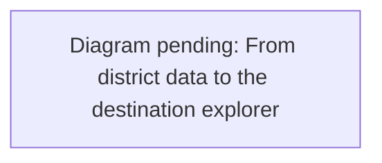

# Places: go anywhere, keep what you find

The **Map** panel (top left; Cmd/Ctrl+B or Alt+2) shows where you are, a live
minimap and an **Explore destinations** launcher. The launcher, or a click or
Enter, Space or arrow key on the minimap, opens the **district atlas** ("Find your
next stop"). The atlas has the full map plus the **Destinations** and **Saved
places** tabs. The map is always available. `VITE_WORLD_MAP=true` now enables
only the **Worlds** directory: restart the dev server or rebuild after changing
the flag.
World publishing and editing additionally require `VITE_CREATION_TOOLS=true`
and the existing account permissions.

When enabled, roads, buildings, named places, and the current location come
from the active world's compiled data, so a newly published region has its own
map without hand-authored artwork.

## What is there

- **Where you are.** A live "You're at" pill names the nearest place within 45 m
  ("You're at Toulouse", "You're near Dior (23 m)"), or says you are out on
  the street. A bright marker follows the player on the map.
- **World map.** In the atlas, click a named marker or any point inside the current world to
  preview a destination, then choose **Go here**. Arrow keys move the selected
  point when the map has focus; Shift moves it one metre at a time. **Copy link**
  shares the selected world and position. Roads and buildings are visual
  context, never permission to enter a private home or pass through a wall:
  travel still uses the server's outdoor arrival check in shared play. Saved
  landmarks appear on the map only in their own world; the account list below
  continues to show landmarks from every world.
- **People in this world.** In shared play, outdoor players in the same world
  appear as live map markers and in a keyboard-accessible list. Choose a player
  and **Meet nearby** to ask the server for a clear spot beside their current
  position. The server resolves the player at the moment of travel, requires
  that they are still in the same room and outdoors, and keeps the arrival clear
  of other players. A peer selection cannot enter a private home or create
  a link to that player's current position. Players who leave or enter an
  interior disappear from this outdoor map.
- **Land parcels.** Creator worlds can show up to 32 named plots as map
  boundaries and in a keyboard-accessible list. Selecting one reports its area
  and whether it belongs to your signed-in account. Parcel selection does not
  teleport into a building; the ordinary map point and travel checks still
  govern movement. Ownership is recorded by Jevica in the region studio and
  does not grant building or wish powers.
- **Destinations.** Every named place in the district, once each: the arrival
  point, the community meeting spots, and any storefront that is not already a
  meeting spot. In the shipped district the 30 spots *are* the 30 storefronts,
  so the list is 31 long.
  - **Categories.** Each storefront or spot carries its store's category
    (`store-categories.js`, grouped from OpenStreetMap tags): Shopping & culture
    (15), Dining (6), Jewelry & accessories (5), Beauty & wellness (4), Homes (0,
    hidden). Arrival appears only under All.
  - **Rows.** Each row has the category icon in its colour, the name (a button
    that shows the place on the map), the category, and a **Go** pill that
    teleports beside it. The "•••" menu holds **Link**, which copies a URL that
    brings someone else there.
  - **Search and filters.** Search matches names, and its placeholder shows the
    live count ("Search 31 places"). Filter chips per category, with counts,
    appear when there are at least two categories. A status line reads
    "6 of 31 destinations", and an empty result offers **Show all places**.
- **Events.** The client's events panel has been removed. The `/api/events`
  service and its rewrites remain; see [events](world-events.md).
- **Your landmarks.** Stand somewhere, name it, **Save here**. A landmark keeps
  the exact position, the way you were facing, and its world. In shared play,
  the **Saved places** tab lists your private landmarks from every published world. **Go**
  opens the saved world when needed; **Link** shares that world and position.
  The server saves the player's current pose, and landmarks remain private
  across devices and server instances. Existing landmarks stay in their
  original worlds and appear in the combined list without migration. Each
  world allows up to 50 landmarks per account. Old device-only landmarks
  are ignored and are not imported into account storage.
- **Shared links.** `?place=spot:<id>` or `?place=shop:<id>` lands a visitor
  beside a named place after the district loads; `?at=<x>,<north>[,<yaw>]`
  restores an exact position inside the district. A link outside the district
  is ignored; a link into a building is refused, never nudged through a wall.
  Copied links include the current `world` ID, so a place
  in a published creator world opens that same shared world for the recipient.

The atlas's tabs show count badges, the close button is labelled "Close map", and
Esc returns focus to where you were. On phones (700 px wide or less), the map is
capped at 30% of the screen height and the legend and filters scroll in one row,
so the destinations show on the first screen.

Diagram prompt: places-data-flow

Draw a flowchart of how destinations reach the Places UI and how a choice becomes travel. Sources: preview/public/data/district.json (walkSpawn, communityLocations, stores with OpenStreetMap category tags). placesOf() in preview/src/places.js builds arrival + spots + storefronts, deduped by data id, and attaches the store category from store-categories.js (Shopping & culture, Dining, Jewelry & accessories, Beauty & wellness, Homes). setupPlacesUI() renders rows (category icon, name, category, Go, overflow with Link/Remove), the world map (preview/src/world-map.js) and the atlas dialog (preview/src/places-guide.js: tabs, search, category filter chips with counts, empty state). Landmarks come from createAccountLandmarks() via /api/landmarks. Go calls goToPlace() in main.js -> multiplayer.travel({placeId|storeId|position}) -> server-authoritative travel -> 'You're at …' status. Shared links (?place= or ?at=) enter through destinationFromSearch().

See [the diagram index](diagrams.md) for the convention.

## How a teleport lands

Nobody is ever placed inside a wall or a room. A spot is reached at the
nearest clear outdoor point within 4 m of it; a landmark or link within 1.2 m,
otherwise the request is refused with a message. The server owns the decision: `travel` now accepts `placeId` (a community
location) and `position` (`[x, north]` inside `bounds_m`) alongside residents
and stores, applies the usual one-second cooldown, and keeps the traveller's
own facing for a bare position.

## Files

- `preview/src/places.js`: the place list (with store categories), nearest-place search, landmark
  store, link formatting and parsing, open-spot search. Pure, unit tested.
- `preview/src/places-ui.js`: the rows' DOM, the "You're at" pill and the status line.
- `preview/src/places-guide.js` and `places-guide.css`: the atlas dialog (tabs,
  search, category filters, empty state), the rail launcher and the panel styling.
- `preview/src/store-categories.js`: the five store categories, shared with the
  legacy storefront directory.
- `preview/src/sidebar.js`: the Map and People panels and the Settings dialog.
- `preview/src/world-map.js`: map projection, geometry, selection, and live
  player marker.
- `preview/src/main.js`: `goToPlace` (server-confirmed travel), the deep link on load.
- `server/world.js`: `travel` destinations `placeId`, `position`, and `peerId`.
- `server/landmarks.js`: private per-world account landmark storage; Redis
  persists shared play across edge instances.
- `server/world-landmarks.js`: combines the bounded per-world lists for the
  account and tags each location with its origin world.

## Next

Owner-managed parcel permissions and an economy remain future work. Jevica
continues to control all shared building and wish granting.
