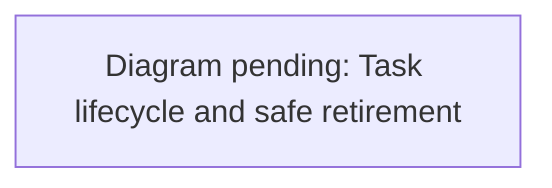

# Task ownership and retirement

`tasks.json` is the task register. The primary checkout's uncommitted copy is the live
register; claims, releases and `project:prune` use it, and a branch's copy can be
stale (see [register sweeps](#register-sweeps)). Dated ledgers under
`docs/superpowers/plans/` retain implementation and verification history. GitHub
is authoritative for PR state; local Git is authoritative for files and refs.
A register entry records the next action, not a substitute for either source.

## Start or resume work

1. Run `git status --short`, `git worktree list` and
   `pnpm run --silent project:status --github --output .runtime/project-status.json`.
   It reads the register in the checkout you run it from. From a feature
   worktree, pass `--tasks <primary>/docs/project-management/tasks.json` to check
   the live register.
   Create `.runtime` first when absent. This command reads Git and GitHub; it never
   fetches, checks out, edits tasks, deletes refs, or removes worktrees. Refresh
   `origin` explicitly before delivery or retirement decisions.
2. Find the existing task by branch or objective. Reuse its worktree when you own
   it and its state is understood. Do not create a second integration checkout for
   the same pending PR. Unknown ownership, dirty state or an unfinished merge means
   inspect and coordinate; it does not mean abandoned.
3. Update the register before editing: stable `id`, concrete `title`, exact
   `branches`, `owner` (session identifier), `leaseUntil`, `updatedAt`, `nextAction`,
   `ledger`, `requiredChecks`, and `filesOwned`, with `status` (`queued`, `active`,
   `blocked`, `delivered` or `retired`). Keep one task owner per branch. Status and
   prune find a task's PR only through `pr` (a number). Delivered and retired tasks
   need `evidence`, an array of `{pr, reviewedHead, merge, tree, checks}`. Retired
   tasks also need `archive`. `deliveryPr` is informational.
   An active claim is a coordination record, not a lock enforced by the tool.
   Inspect the diff again before saving because other agents may update the file.
4. Use `active` only with a named owner and a bounded lease (normally two hours).
   Renew during sustained work. An expired lease requires reconciliation; it never
   authorizes taking another session's changes. Record a handoff before transferring.

## State and evidence

| State | Meaning | Required next action |
| --- | --- | --- |
| queued | Scoped work without an active claim | Name the first concrete investigation or implementation step |
| active | Owned work in progress | Name the next check or change and renew the lease |
| blocked | Work cannot safely proceed in its current state | Record the blocker, owner needed, and exit condition |
| delivered | Requested change landed, with exact proof | Reconcile leftover worktree files before retirement |
| retired | Local branch/worktree removed after delivery proof | Keep restoration location and original SHA |

`evidence` contains PR URL/number, reviewed head, merge SHA and verification
references. A PR merely closed, a green test, branch age, a missing upstream, or
`git cherry` alone is insufficient delivery proof. A merged task with leftover
untracked evidence remains delivered but its checkout is preserved until that
material is reviewed and retained. Cancelling distinct unfinished work requires
specific discard authorization and a recorded reason; do not label it delivered.

Maintain `nextAction`, `updatedAt` and the ledger at each meaningful boundary:
claim, reproduced defect, verification, PR creation/head change, merge, handoff,
and retirement. Do not overwrite historical reports with new timestamps.

## Landing a pull request

`main` requires an up-to-date branch, so merges are serial. GitHub's merge queue
needs an organization-owned repository, so sessions on this machine share a local
queue instead:

```sh
pnpm run land <pr> [--owner <name>]   # take a turn, update, verify, merge
pnpm run land --status                # who is queued
```

- **The queue:** the queue and its lock live in the common Git directory, so every
  worktree shares them. An entry whose process has died is dropped.
- **On its turn:** the lander updates the branch from `main` with GitHub's
  update-branch, whose commits are verified, and waits for Verify. If Verify fails
  it reruns the failed jobs once; if they fail again, it stops. Then it hands the
  merge to `~/.claude/scripts/gh-merge-when-green.sh`, or the path in
  `RIVER_OAKS_MERGE_GUARD`, and refuses if the guard is missing.
- **When main moves first:** the lander updates the branch and goes again.
- **It stops on:** a conflict with `main`, or any other refusal by the guard.

The queue only orders sessions that use it. Landing still needs the same merge
authorization as any other merge.

## Local browser runs take turns

Browser journeys from several sessions at once starve this machine. On 2026-10-11,
load averages of 285 to 384 made journeys fail with dropped town connections and
timeouts that looked like code bugs. The shared town and experience runners, and the
security, reflections and trees scripts, now take turns through a queue in the
common Git directory (`scripts/browser-lock.mjs`):

- **While another run holds the lock,** a run prints who holds it and waits.
- **Released on any exit,** including a failure or an interrupt. An entry left by a
  process that died is dropped.
- **Nested runs pass straight through:** a run started by a run that holds the lock
  doesn't wait on it.
- **Hosted CI skips the lock** (`CI=true`), as does `RIVER_OAKS_BROWSER_LOCK=off`
  for a deliberate exception.
- **Wrap any other heavy command** with
  `node scripts/browser-lock.mjs <name> -- <command>`.

## Register merges and stashes

The primary checkout's `tasks.json` is the live register, an uncommitted edit that
branches also change. `.gitattributes` routes it through a merge driver that
`pnpm install` installs with the other shared hooks (`install-project-hooks.mjs`).
Branch merges, rebases and stash pops then merge the register by task id:

- An entry changed on one side takes that side, including a deletion.
- An entry changed on both sides takes the newer `updatedAt`.
- A deletion never discards an edit made on the other side.

Without the driver, for example in a fresh clone before `pnpm install`, Git falls
back to its line merge.

A GUI client's pull can stash the live register and leave it stashed. `project:check`
reports any stash that holds register edits. To recover, merge that stash's
register into the live one by task id, keeping the newer `updatedAt` and every
id. Write the result atomically, refusing if the file changed, then drop the stash.
If the register contains conflict markers, `project:status` fails validation and
exits 2. Find them with `grep -n '^<<<<<<<' docs/project-management/tasks.json`
and resolve them the same way.

## Daily reconciliation and handoff

Run `pnpm run --silent project:check --github` at session start and handoff.
Exit 0 means the register passed validation and no tracked reconciliation gaps
were found. 1 means reconciliation gaps:

- unregistered branches or mismatched PR heads;
- expired ownership;
- delivered tasks that still have local branches;
- resurrected retired refs;
- a stash that holds register edits;
- a recorded PR that can't be found;
- a delivered task whose PR isn't merged, or a merged PR whose task isn't delivered;
- an unqueued, unretired task with no local branch.

2 means an input or tool failure, including a register that fails validation.
None of these exit codes proves that the project is complete or safe to delete.
Without `--github`, remote delivery is explicitly unknown. Process CWDs are only
positive activity evidence; absence is not proof that no agent owns a task.

Address gaps by inspecting live facts, then update the register. Never suppress a
mismatch by declaring work done. For local/remote divergence, compare full changes
before choosing a revision. For multiple overlapping worktrees, designate one
integration owner and record source branches, pending merge state and validation.
Do not abort another owner's merge or cherry-pick their partial work implicitly.

At handoff report before/after worktree and branch counts, exact delivered PRs,
checks/skips, preserved tasks and their next actions. Refresh after cleanup: other
agents can create worktrees during the same round. This workflow adds no scheduler
or external PM service; run it at these explicit lifecycle boundaries.

## Safe retirement

Use the `worktree-retirement` project skill (`.agents/skills/worktree-retirement/SKILL.md`). Retirement is a separate decision
from delivery. Recheck clean tracked/untracked state, locks, active processes and
sessions, open PRs, exact refs and ignored data immediately before mutation.
Preserve primary/default, dirty, active, open-PR, missing-proof and uncertain work.

Prefer ancestry proof. For squash/rebase/supersession, compare the entire aggregate
patch against the actual merged commit, including every changed path. Preserve the
exact original ref in an archive tag and self-contained bundle outside removal
paths; restore every ref in a new bare repository and run `git fsck --full`.
Keep ignored reports/private local evidence in a restricted archive and verify its
contents. Do not print credential values or copy private state into another runtime.
Only explicitly identified regenerable dependencies/caches are disposable.

Use `project:prune` below for local removal. It performs non-forced worktree removal
and exact-SHA ref deletion only after its executable checks pass. Never bypass the
reference hook, use `branch -D`, recursively delete a worktree, or fabricate merge
ancestry. A failed safety check is a skip requiring reconciliation.

Remote branch deletion and discarding distinct unfinished work need explicit scope
approval. Local cleanup does not imply either. Preserve archive tags, bundles,
evidence and the restoration manifest; do not prune them as part of the same round.

## Restore

Read the task's `archive` manifest first. Verify its checksum, then fetch the
recorded tag from the bundle into a **new** recovery branch. Create a separate
worktree from that branch. Restore local evidence from its verified archive after
inspection; never apply private state to a live service automatically.

The 2026-10-11 rounds are recorded in `retirement-20261011.json`,
`retirement-20261011-round2.json`, `retirement-20261011-final.json`,
`retirement-delivered-sources-20261011.json` and
`retirement-dependencies-20261011.json`. Their bundles and local artifacts live
under `~/worktree-backups/` (`river-oaks-20261011*`,
`river-oaks-dependencies-20261011`). Later `project:prune` runs write a
`manifest.json` next to each bundle under their archive root (default
`~/worktree-backups/river-oaks/`). The register captures
known unfinished work rather than treating this round as global task completion.

## Enforced local retirement

`project:check` exits nonzero while a delivered task retains a non-protected local branch.
Primary/default branches are excluded from retirement debt.
A blocked cleanup stays visible until its evidence is reconciled; do not relabel
the task active or retired to hide the gap.

Use `pnpm run project:prune --branch <branch> --expected-head <full-sha>` to
refresh GitHub/Git evidence and report blockers. It fetches `origin` and calls the
GitHub API, so it needs network access and `gh` authentication. Exit 0 means
eligible (or retired with `--apply`), 1 means a dry run found blockers, and 2 means
an error, including a blocked `--apply`. Add `--apply` to retire that exact
local branch and its worktree. There is no bulk, force, remote-delete or age-based
mode. The command reads the **primary checkout's** task register so stale copies in
feature worktrees cannot release another owner's work.

Before applying, the task owner must release the delivered task (`owner: null`,
remove `leaseUntil`) and record `retirement: { head, releasedAt, sessionsReviewedAt }`.
Both timestamps must be within two hours. `sessionsReviewedAt` attests that the
owner actually checked running agent sessions; an expired lease or no process CWD
is not sufficient. These are coordination attestations, not authenticated locks.

The command requires the exact merged PR head, its merge on the fetched default
branch, and identical candidate/merge trees. A source branch alias is accepted only
when its full tip SHA exactly matches that merged PR head. Other squash/rebase/supersession cases
remain blocked for aggregate review. It refuses:

- dirty, untracked or ignored material;
- index flags (assume-unchanged or skip-worktree) and submodules;
- locks, operations in progress, active process CWDs and unknown activity;
- protected or primary branches;
- a changed head, or a previously retired branch reappearing;
- open PRs and missing proof.

`node_modules`, `.venv`, `dist` and other caches count as ignored data, so archive
evidence such as `.runtime` and `output/playwright` first, then remove the caches. Retain ignored evidence separately first; this tool
never deletes cache directories or private files to make a checkout removable.

Apply takes a common-Git-directory lock, preserves the exact tip in a unique
archive tag, creates a self-contained bundle outside all worktrees, fetches it into
a fresh bare repository, compares the SHA and runs `git fsck --full`. It then
rechecks ownership, GitHub, activity, worktree registrations and clean state before
non-forced removal and expected-SHA ref deletion. The external manifest records
partial progress as well as success. The primary task register is updated only
after deletion postconditions pass. A multi-branch task remains delivered until
all its recorded branches have been retired.

Backups default to `~/worktree-backups/river-oaks/`; `--archive-root` must point
outside every checkout. Preserve its manifest, bundle, checksum and restore-tested
bare repository. A crash may leave `river-oaks-retirement.lock` in the common Git
directory: inspect its owner activity and external receipts before manually
reconciling it; the tool never steals a lock.

`pnpm install` (prepare) and `sh scripts/install-hooks.sh` install a shared
reference-transaction hook alongside the secret guard in the common Git directory.
All existing worktrees use that absolute hook path, independent of their revision.
Custom hook paths are preserved and require manual integration. It rejects direct local branch deletion inside any ref transaction (including `branch -D`, and by the same rule `branch -m`; `main` and `master` can never be deleted, even with a permit) and
`update-ref -d`) and deletion of archive tags. The guarded command grants a short
exact-ref/SHA permit only after verification. Normal commits, fetches and pushes
are unaffected. Git offers no hook for `git worktree remove` or registration pruning: use this command as
the supported removal path. Hooks are an accidental-deletion guard, not a security
boundary; an explicit hooks override (including an older bootstrap resetting hooksPath) can
bypass them. This command does not install a background cleanup scheduler.

## Register sweeps

Branches commit their own register entries, but `project:prune` writes retirement
records only to the primary's live file. Releases and other sessions' updates also
land there first. So the live register runs ahead of `main`.

When it has drifted, open a docs-only register sweep PR from current `main`, on a
`docs/register-sweep-<date>` branch:

1. Copy the live entries exactly as written: only your own, or the whole live file
   when the owners agree. Confirm first that no committed entry is newer than its
   live counterpart.
2. Claim the sweep as its own task.
3. Validate with `project:status`, and merge.

The merge driver keeps later live edits on the next fast-forward of the primary.
The sweep's own retirement record is live-only until the next sweep.
Examples: #255, #269, and the docs refresh of 2026-10-12.


<details><summary>Diagram prompt: task-lifecycle-and-retirement</summary>

Draw a flowchart of one task from claim to retirement in the task register. States: queued/active (claimed with owner, branch, leaseUntil) -> blocked (optional) -> delivered (exact PR, reviewed head, merge commit, tree, checks as an evidence array) -> retired. Then the retirement path run by `pnpm run project:prune`: owner releases (owner null, no leaseUntil, retirement {head, releasedAt, sessionsReviewedAt} within 2 h, in the PRIMARY checkout's live tasks.json) -> archive ignored evidence and clear regenerable caches -> dry run (blockers: ownership-not-released, dirty, ignored-data, exact-merged-pr-required, merge-not-on-default, aggregate-tree-review-required, active-process) -> --apply: lock, archive tag, bundle, restore into a fresh bare repo, fsck, non-forced worktree removal, expected-SHA ref deletion through the reference-transaction hook permit -> register updated to retired. Show the side path for superseded branches (blocked for aggregate review, archived but kept) and the register merge driver reconciling live and committed copies by task id.

See [the diagram index](../diagrams.md) for the convention.

</details>
