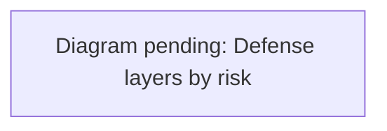

# Security review and recurring verification

Reviewed 2026-10-06, with hardening added on 2026-10-11 and 2026-10-12 (below). Scope: application source, locked dependencies, local HTTP,
real Redis transactions, desktop trust boundaries, local Python bridge, and
browser tests. This is a bounded engineering review, not a claim that all
possible attacks have been eliminated or a deployed penetration test.

## Changes

- Reports and support contact (#292, 2026-10-24). No new route or permission. A saved
  report now answers "Report saved." on both backends, instead of claiming it was
  sent to moderators. `VITE_SUPPORT_CONTACT`, public and set at build time, shows a
  plain ASCII email address or an https link to a named host in Settings → Account.
  Anything else, including mailto fields, direction overrides and bare IP addresses,
  shows nothing. Open gaps: content filtering, a moderator reports view, and the
  Block button, which isn't wired in yet; see `docs/app-review-292.md`.
- In-app account deletion (#292, 2026-10-24), off unless `RIVER_OAKS_ACCOUNT_DELETION=1`
  and `WORKOS_WEBHOOK_SECRET` is set (the loopback fixture needs only the flag).
  A new route, `POST /api/account/delete`, on both backends. It needs a signed-in
  session, the same origin and the CSRF token, at most 3 attempts an hour, the exact
  phrase `delete my account`, and a sign-in within ten minutes. Sessions now record
  `signedInAt`, which survives refreshes. Approval and bans aren't checked. WorkOS
  deletes the user first; any failure other than 404 erases nothing. Then the session
  cookie is cleared and account erasure runs twice. The `GET` form reports only
  whether deletion is available and whether the sign-in is recent. The route is added
  to `vercel.json`, `server/vercel-routing.js` and the Vite proxy, and
  `account_deletion` to the Redis rate-limit scopes. See `docs/account-deletion.md`.
- Player blocking (#292, 2026-10-24). New routes: `POST /api/blocks/list`, `/add` and
  `/remove`, on both backends. They have the same authentication, approval, ban,
  origin and CSRF checks as other mutations, plus a 12-a-minute write limit. A
  resident can be blocked only if they are in the world or a contact; any other id
  gets 404. A block filters town chat and gestures per viewer, and ends the contact.
  It refuses contact requests, messages, invitations, greetings, darts and axe
  invitations, travel to the other resident and profile views either way. Those
  requests are answered by asking the usual checks about a resident who is never
  present, so even a crafted request gets the absent resident's answer. Hidden
  residents' greetings and game invitations are dropped from each viewer's frames. A
  new `separate` room operation, which takes exactly two distinct user ids, ends a
  greeting or game invitation between them. It also ends a resident's office and home
  invitations when they or Jevica block the other, in every loaded or stored world.
  The routes are added to `vercel.json`, `server/vercel-routing.js` and the Vite proxy.
  The standalone town keeps blocks in `BLOCKS_FILE` (mode 0600). See
  `docs/player-blocking.md`.
- Account erasure (#292, 2026-10-24). The signed WorkOS `user.deleted` webhook now
  runs `server/account-erasure.js` in both backends. It sets the character tombstone
  first, so the account cannot start a new session, then revokes every session and
  closes every socket. It then erases each per-user store and makes every world in
  the catalog forget the account. On Redis this goes through the room's one writer,
  as a new `forget` room operation that takes only a user id. If any step fails, the
  webhook answers 503 and WorkOS retries; nothing is reported as done early. The
  failure log names the failed steps, never the account or a store's error text.
  Concurrent runs for one account share one run. No new route or input is exposed.
  The webhook keeps its signature, size, time and pending-delivery limits.
  `docs/privacy-data-inventory.md` lists what is kept, and why: the hashed character
  tombstone, the moderation and security audit, and room replies that lapse within
  15 s.
- Both server backends now protect published region data with authenticated,
  approved, non-banned access, matching the existing static district-data gate.
  Normal authenticated GET requests require no new token or extra interaction.
- Debug room labels render as text, including imported names containing markup.
- Hosted and Node responses send one Content-Security-Policy (`server/security-headers.js`, kept identical to `vercel.json` by `server/tests/hardening2-security-headers.test.js`). It defaults to `default-src 'self'`. The exceptions are:
  - Cloudflare Turnstile for script and frame;
  - Google Fonts for the landing page;
  - inline styles;
  - `data:`/`blob:` for images, media and connections, and `blob:` workers.

  It also sets `object-src 'none'`, `base-uri 'self'`, `form-action 'self'` and `frame-ancestors 'none'`. The email-verification response keeps its stricter page-specific policy. The voice bridge is reached only through the same-origin `/v1` path.
- Patched the locked `source-map-js` build dependency from 1.2.1 to 1.2.2.
- Added browser email/invite/revocation and debug-content regressions, and
  weekly/manual runs of the complete existing verification workflow.

## Hardening, 2026-10-11 and 2026-10-12

Two passes, #244 and #264, plus the fix in #259, addressed production interruption, lag, code execution and owner-billed cost. Details and evidence are in the ledgers `docs/superpowers/plans/2026-10-11-server-hardening.md` and `2026-10-12-server-hardening-followups.md`.


<details><summary>Diagram prompt: defense-layers</summary>

Draw a layered flowchart (or block diagram) mapping the three risks Val asked about to their controls, outermost first. Risk 1, owner-billed cost: Vercel Spend Management hard pause (owner setting), Vercel Firewall rate limits, asset Cache-Control and the signed asset gate, global and per-address email budgets, Turnstile, chauffeur daily budget and breaker (CHAUFFEUR_DAILY_LIMIT), Redis noeviction. Risk 2, production interruption and lag: per-address access limit, room operation isolation, transient Redis failure tolerance, per-user ticket cap, one world per account, full tables that evict oldest (sessions, pending sign-ins, waitlist pending requests) instead of refusing everyone, per-owner invite index, client polling backoff. Risk 3, remote code execution and injection: CSP default-src 'self' with explicit sources, no inline scripts, Electron fuses (RunAsNode off, NODE_OPTIONS off, asar integrity), dev bridge loopback guard, pinned base image and pnpm hash, secret scanning hooks. Colour owner-only settings differently from code controls.

See [the diagram index](diagrams.md) for the convention.

</details>

### Abuse and spend limits

| Limit | Value | When exceeded |
| --- | --- | --- |
| Requests per address on `/auth` and `/api` | 1,000 per minute | 429 |
| Sign-in starts per address (login, email start/verify, desktop exchange, invite redeem/issue/update) | 20 per 20 minutes | 429 |
| Email codes per address (`EMAIL_SIGNIN_DAILY_PER_ADDRESS`) | 10 per UTC day; an address is an IPv4 address or an IPv6 /64 | 429 `email_limited` |
| Email codes in total (`EMAIL_SIGNIN_DAILY_LIMIT`) | 2,000 per UTC day (max 100,000) | 503 `email_paused`; GitHub sign-in still works |
| Cloudflare Turnstile on email start (on in production since 2026-10-12) | action `email_sign_in`, hostname must equal `PUBLIC_ORIGIN`'s | 403 `challenge_failed` |
| Email code cooldown and attempts | 60 s per address; 5 verify attempts | `sent:false` / 429 |
| Pending sign-ins | 20,000 | oldest pending sign-in is evicted |
| Sessions | 10,000; 10 per account | oldest session is signed out |
| Waitlist | 10,000 | oldest *pending* request gives way; approved and refused residents are never removed |
| Invites | 50,000 | invites more than 90 days past expiry are forgotten (at most one scan an hour); otherwise refused |
| Invite listing per account | 20 per minute | 429 |
| Join tickets | 60 s, single use, 3 live per user on both servers (a new one retires the oldest), 10 per minute; 4,096 total with Redis, 512 in a single process | refused (503 when the single-process table is full) |
| Worlds per account | one at a time (owner accounts exempt) | old socket closes with 4009 |
| Paid chauffeur decisions (`CHAUFFEUR_DAILY_LIMIT`) | 40 per minute per owner; 6,000 per UTC day across owners (max 10,000); three provider failures pause calls for 60 s | `budget_exhausted` / `provider_paused`, local driving continues |

### Static asset gate

On Vercel, `middleware.js` checks a signed `river_oaks_gate` cookie locally (`server/asset-gate.js`). The cookie is keyed from `WORKOS_COOKIE_PASSWORD`, bound to the session, and valid for 30 minutes. It's issued by `/api/waitlist/status` to approved residents. Without a valid pass, the middleware makes one server check.

- **What's gated:** game JS/CSS chunks, `/data/*` and `/studio`.
- **What's public:** models, HDR and images, served with `max-age=3600`, so revisits don't re-download them.
- **Revocation lag:** a revoked resident can keep the static bundle for up to 30 minutes. Live services (tickets, sockets, APIs) check access themselves.

## Surface inventory

| Surface | Controls reviewed / evidence | Remaining boundary |
| --- | --- | --- |
| Identity and sessions | Real WorkOS SDK signed-token fixtures; issuer/client/method checks; sealed HttpOnly cookies; browser-bound email state, expiry, cooldown and attempt limits; daily email budget with per-address shares; Turnstile; full tables evict oldest (see limits above) | Actual inbox delivery, provider configuration drift and live token revocation need staging acceptance |
| Waitlist and invitations | Manual/invite-only approval; atomic redemption and starter grants; assignment, replay, expiry, rejection, ban and revocation tests with file and Redis stores; full waitlist evicts oldest pending; per-owner invite index (revocation still reads the whole table) | Two-invite referral growth intentionally permits multiple accounts; email is not proof of a unique human |
| HTTP authorization | Mutations enforce identity, approval, ban, Origin and CSRF; reads now gate private region data; public world directory remains intentional | Verify deployed reverse-proxy and CDN behavior after routing changes |
| Multiplayer | Short-lived single-use tickets (3 live per user), one world per account, origin checks, session/world binding, server-authoritative movement and creation, room fencing, isolated room operations, bounded payloads and backpressure | Distributed volumetric denial of service needs provider limits and capacity monitoring; local tests cannot establish global capacity |
| Creator and imported data | Strict bounded primitive assemblies and region validation; admin-only publishing; imported labels rendered as text | Jevica should review third-party content; no arbitrary remote mesh importer is enabled by this patch |
| User content | Access/invite controls use text nodes; debug label browser regression; same-origin script policy | New HTML sinks or same-origin executable upload features require a fresh review |
| Static assets | Canonical path, traversal/symlink and waitlist tests; signed 30-minute asset pass checked in middleware; private no-store cache policy for protected assets; public models/images cached for an hour | CDN normalization and cache isolation require deployed acceptance |
| Desktop | Sandbox, context isolation, no Node integration, exact-origin navigation, denied permissions/downloads, external-link confirmation, packaged fuse tests. Installers (#372) refuse an unflipped, drifted, unknown or mismatched build; CI installs each on a fresh runner, reads the fuse wire from the installed binary, compares every installed file with the build, launches it offline and uninstalls it. On Linux it requires the Chromium sandbox: the `.deb`'s root-owned 4755 `chrome-sandbox` and AppArmor `userns` profile, renderers under seccomp-bpf, never `--no-sandbox`. Windows signing runs only from a dispatch or `v*` tag, through OIDC with no stored secret; every Windows build rehearses it with a throwaway certificate and `signtool verify /pa` | Since 0.2.1 the macOS release is Developer ID signed with the hardened runtime, has only the JIT and microphone entitlements, and is notarized (`desktop/sign.js`). Release gates: Windows Authenticode through Azure Artifact Signing (needs the human setup in [desktop](desktop.md#windows-signing), and a new publisher may still see SmartScreen prompts until it has reputation); Linux packages are unsigned (no repository or GPG signature yet), and on Ubuntu 23.10+ the AppImage needs the `.deb` or a user-installed AppArmor profile; live packaged sign-in; human acceptance on real Windows 11, Ubuntu LTS and macOS machines (#373). `EnableCookieEncryption` is on, and the fuse is one setting for every platform. On macOS the session cookie is encrypted with a key in the Keychain. Measured with the fuse on a throwaway Electron 44.7.0 (#372 diag run 38687439195): Windows stores the cookie only encrypted (`v10`) under a DPAPI-protected key in `Local State`. DPAPI is bound to the Windows account, not to the app's signature, so updates do not prompt, but any process of the same user can unwrap it. Linux with an unlocked GNOME Keyring uses a Secret Service key (`v11`), readable by the user's other session apps. Linux without a keyring falls back to Chromium's built-in key (`v10`), which is obfuscation, not protection |
| Local voice / decision bridge | Host checks, also enforced at the Vite dev proxy (non-loopback Host or Origin gets 403 `forbidden_host`); JSON request validation; bounded voice requests/concurrency/cache/timeouts; model integrity checks | Local processes and machine administrators are trusted; protect API keys and do not expose the loopback bridge publicly |
| Dependencies and delivery | pnpm audit, Python locked-runtime audit, dependency review, SHA-pinned Actions, secret scans, CodeQL (GitHub default setup), weekly Dependabot updates (npm, uv, Actions, Docker); Docker base image pinned by digest; `packageManager` pinned by sha512 | Advisory databases have unknowns; native libraries need separate release review |

## Verification cadence

On each PR and main push, and Monday 08:23 UTC, Verify runs the existing shared
town journeys alongside server, preview, desktop, Python and security browser
tests. Its Redis service ensures storage tests do not silently skip in CI.
It audits npm dependencies at moderate severity or higher and the exported
locked Python runtime and optional-extra requirements. Dependency review checks PR additions.
Secret scanning covers both the worktree and Git history. Manual workflow
dispatch runs the same suite. Maintainers must investigate scheduled failures;
the schedule is not an autonomous incident-response service.

Local commands (use an isolated Redis database and a supported Node runtime):

```sh
pnpm install --frozen-lockfile
pnpm exec playwright install chromium
REDIS_URL=redis://127.0.0.1:16389 pnpm run test:server
pnpm test
pnpm run test:desktop
pnpm run build
pnpm run test:security:e2e
pnpm run test:shared
pnpm audit --audit-level=moderate
uv export --frozen --all-extras --no-hashes --no-dev --no-emit-project --format requirements-txt --output-file /tmp/river-requirements-audit.txt
uvx pip-audit==2.10.1 --no-deps --disable-pip -r /tmp/river-requirements-audit.txt
python3 scripts/check_secrets.py --all
```

The email browser test uses the built UI, actual application routes, local
waitlist persistence and the real WorkOS SDK with a local identity-provider
fixture. It tests phone/desktop entry layouts, pending denial, CSRF/admin denial,
invite redemption/replay, member controls, script policy and revoked access.
No live email is sent. Shared gameplay journeys separately exercise exploration,
social features, seating, travel, and creator flows so security changes do not
silently break play.

## Deployment and release acceptance

1. Confirm the exact merged commit passes CI and the intended deployment serves it.
2. With authorized staging accounts, check email delivery, invite acceptance,
   manual approval/revocation, logout and reconnect across two browser sessions.
3. Check anonymous/pending/banned access, protected assets and response headers
   through the real CDN, not only the origin server. Confirm trusted-proxy IP
   configuration; do not trust arbitrary forwarded headers.
4. Exercise representative browser/mobile/desktop play and inspect CSP violations.
5. Before raising world capacity, run isolated load and Redis-failure tests;
   monitor latency, failed authorization, reconnect rate, memory and queue depth.
6. Keep the production owner settings below in place.
7. For a desktop release, follow [Releases on Windows, Linux and macOS](desktop.md#releases-on-windows-linux-and-macos). Before the draft is published, every row of its acceptance matrix must hold a person's result from a real Windows 11, Ubuntu LTS (X11 and Wayland) or macOS machine, and the signatures must check:
   - **Tag.** `vX.Y.Z` is signed, and GitHub reports it verified.
   - **macOS.** The app unzipped from the release zip passes `codesign --verify --deep --strict` and `xcrun stapler validate`, and `spctl` accepts it as "Notarized Developer ID".
   - **Windows.** The tag run's `signtool verify /pa /v` passed on `Setup.exe` and every packed binary, each with a timestamp, and the signed `Setup.exe` was installed and checked. The ledger records the certificate subject and SHA-1 thumbprint.
   - **Linux.** The `.deb` and AppImage carry no signature. The release's `SHA256SUMS` is their only integrity check, so the release notes say so.

## Production owner settings (outside this repo)

These are account-level controls that code can't provide, because a function has already been billed by the time code runs.

| Setting | State (2026-10-12) |
| --- | --- |
| Vercel Firewall rate limits | **On.** Three rules, all per IP and answering 429 before any function runs: <br>• 10 per hour on `/auth/email/start` <br>• 600 per minute on `/api` and `/auth` <br>• 600 per 10 minutes on `/assets/*.(glb\|hdr\|mp4)` |
| Vercel Git fork protection | **On** |
| Preview deployment protection | **On** (Vercel sign-in for all but custom domains) |
| Cloudflare Turnstile keys (`TURNSTILE_SECRET_KEY`, `VITE_TURNSTILE_SITE_KEY`) | **On** in Production. Set both or neither: a secret without the site key refuses every email start (the server logs a warning). The site key is built in, so changing it needs a redeploy. To switch the check off without a code change, remove the secret and redeploy. |
| Redis eviction policy | **`noeviction`** (Redis Cloud via the Vercel Marketplace integration) |
| Vercel Spend Management hard pause | **On** (set by Val, 2026-10-12): a $60 on-demand budget for team 0xBuns with Pause on, so production deployments pause when it is reached. Alerts fire at 50%, 75% and 100%; the webhook is off. The budget resets each billing period. |
| Redis memory alert at 70% | **Not available** (checked by Val, 2026-10-12). The Redis Cloud console that `vercel integration open redis` opens shows no alert controls for `river-oaks-town`, on the database or on the subscription. Production used 4.3 MB of its 250 MB on 2026-10-12. Under `noeviction` a full database refuses writes, so sign-ins and joins would fail; nothing is dropped. Check usage in that console now and then. |
| WorkOS | GitHub OAuth and Magic Auth on the Production environment |

Preserve the two-invite/30-day policy, existing player movement budgets, and
normal gameplay rates. Add friction only in response to measured abuse, with
specific regression tests and an explicit product decision. Never weaken a
security assertion or bypass a failing gate to make the suite green.
