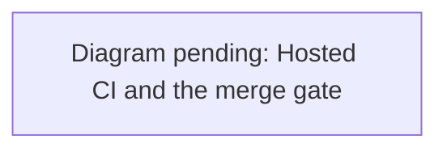

# Tests that protect behavior

Run `uv run pytest -q` for deterministic local checks. Tests use synthetic geometry, in-process HTTP transports, and temporary repositories. They do not download live GIS, call paid Jev inference, or require a GPU.

Run `pnpm test` for simulation and UI contracts, `pnpm run test:server` for authentication, shared state, transport, and abuse controls, `pnpm run test:desktop` for native contracts, and `pnpm run build` for the production bundle. `pnpm run dev` requires sign-in (GitHub or an email code) and waitlist approval, then joins the shared town. `pnpm run test:security:e2e` runs the email-access browser test, which serves the built app with the real CSP, against a local WorkOS fixture. Browser acceptance uses explicit loopback fixtures with temporary identities; it does not establish live WorkOS acceptance.

Run `pnpm run test:experience` for the shared-runtime experience suite, including loading, graphics persistence, responsive controls, and movement/vehicle journeys. Run `pnpm run test:shared` for the shared-town journeys. It runs five modes (`development`, `development-world`, `development-publish`, `required`, `creator`) with about 19 journeys, including onboarding, authenticated two-player play, travel, publishing, seating and keyboard recovery. Pass mode names to run some (`pnpm run test:shared development-publish`), or set `RIVER_OAKS_SHARED_JOURNEY=<name>` for one journey. These runners start and stop their own servers; see [commands, port requirements, and acceptance limits](experience-polish.md). The [earlier shared receipt](../data/reports/shared-experience.json) records its original revision; removal verification is tracked in the [execution ledger](superpowers/plans/2026-10-06-remove-single-player.md).

For an interactive two-player check, run `node server/tests/browser-fixture.js`, then:

```sh
pnpm --package=@playwright/cli dlx playwright-cli -s=multiplayer open 'http://127.0.0.1:5180/?motion-debug=1' --headed
pnpm --package=@playwright/cli dlx playwright-cli -s=multiplayer run-code --filename preview/e2e/multiplayer.js
pnpm --package=@playwright/cli dlx playwright-cli -s=multiplayer run-code --filename preview/e2e/multiplayer-gate.js
```

This loopback fixture injects test identities in isolated browser contexts and uses the real WebSocket transport, world simulation, and rendered game. It checks peer avatars, shared wish consequences and undo, reconnect, movement, mobile layout, duplicate-account replacement, and logout. The [local acceptance report](../data/reports/multiplayer-e2e.json) records the checked scope. It does not establish live WorkOS sign-in, container deployment, or production proxy behavior. The fixture is excluded from the container image; production has no test login route. See [deployment acceptance](multiplayer.md).

The [September 28 controls check](../data/reports/multiplayer-controls.json) reruns `multiplayer.js` with the current Explore-panel labels and shared vehicle controls. It covers two players, wishes, reload, movement, mobile layout and logout; identities remain test fixtures.

For the Redis backend, put a test database URL in a private env file and run:

```sh
node --env-file=.env.redis-test --test server/tests/*.test.js
node --env-file=.env.redis-test server/tests/redis-browser-fixture.js
```

Run the same browser scripts against the Redis fixture. The [Redis browser receipt](../data/reports/redis-multiplayer-e2e.json) records the separate-instance acceptance run. Alice and Bob connect to separate backend servers; HTTP tickets may come from a different server than the socket. Redis tests use random `river-oaks:test` namespaces and delete only their own keys. They skip when `REDIS_URL` is absent; a skipped run is not Redis verification. Never use `FLUSHDB` for cleanup. The fixture uses test identities, so live WorkOS login and hosted Vercel routing remain separate acceptance checks.

| Risk | Test evidence |
| --- | --- |
| Wrong units or handedness | Python projection round trip in meters; separate UE coordinate tests |
| Partial GIS download | Missing object IDs reject the page; long-ID queries use POST |
| Corrupted generated geography | Shifted/missing roads, invalid bounds, and houses outside setbacks fail verification |
| Fabricated canopy accuracy | Missing/same-source reference blocks; equal coverage in a different location fails |
| LiDAR subset loses observations or invents ground | Additive EPT traversal includes ancestors; missing/cyclic hierarchies and excessive counts fail; vegetation needs nearby class-2 ground; vertical offsets preserve relative height |
| Canopy rendering uses stale geometry or loses map regions at LOD | Runtime frame/source hashes and return accounting are checked; every voxel belongs to exactly one spatial batch |
| Inference stalls or misbehaves | 500-agent deadline/cancellation, concurrency cap, invalid actions, partial answers, and local collision override |
| Service changes schedules | Night and midday jogger pauses persist with the service connected |
| Unbounded service queue | Concurrent request returns 503 while the first is active |
| Resident identities lose continuity or become misleading | Separate sourced public-figure portrayals, independent per-scene encounter memory, distinct voice assignment, bounded role context reaching the mocked Jev transport |
| Speech continues after mute or exhausts resources | Cancellation fences late audio and pending retries; explicit busy responses recover within bounded retries; missing models fail immediately; playback rejection frees URLs; timeout keeps the one-worker gate; WAV validation and cache bounds use injected synthesis |
| Walking or a mission has no real effect | Source-footprint collision, frame-rate-independent movement, finite resources, delayed visit completion, and achievable/failing community outcomes |
| Rapid arrival talks to the previous resident | Browser arrival, close and E occur in one task, before the HUD can refresh; the current nearby resident must respond |
| Resident motion crosses geometry or stalls the render thread | Bounded routes avoid footprints/trunks; actual browser navigation runs in a worker; speed caps, passing pedestrians, pause and conversation holds preserve positions |
| Old routes or reactions override a new situation | Weather, scene generation, request tick/age and current action fence late work; expired shelter reactions release residents |
| A visit awards support without anyone arriving | District work requires the assigned helper within 1.5 m; real routes go around footprints; pause and storms hold visits; inaccessible paths return unused capacity once; reset discards late routes |
| Street furniture leaves the mapped streets or blocks a junction | Kerb strips sit at their own lane edge and clear joining lanes; lamps, planters and bins stay beside a lane, outside footprints and off inner bends; window rows fit under every mapped parapet |
| Time of day only rotates shadows | Dusk lowers sun, sky, environment and exposure together and warms the light; every hour and weather stays finite and continuous |
| Secret accidentally committed | Index scan catches a synthetic token despite a clean unstaged replacement; `.env` force-add is rejected; missing scanner fails closed; actual Git commit is blocked in a temporary repository |

There is no arbitrary test-count or coverage-percentage target. Add a regression that reproduces a risk or failure before fixing it. Avoid snapshotting implementation details, mocking your own helpers, host-sensitive timing assertions, and tests that only assert source strings exist.

The 500-agent timing script records measurements without enforcing host-dependent pass thresholds. It measures local Python classification only. Full inference latency must include serialization, networking, provider time, batch deadlines, fallback rates, and all-agent update age. UE acceptance needs a frame-time trace recording resolution, upscaling, GPU/driver, scene, population, weather, and engine version.

Unreal Editor/Game builds and native automation have run on UE 5.8.2. See [native resident validation](native-residents.md#animation-and-verification) and [engine acceptance](engine-acceptance.md) for measured results. Source-only hosts can run `RiverOaks.Contracts`; the full `RiverOaks` group additionally requires the imported resident assets. These checks do not establish packaging, complete collision integration or target performance.

Run `node preview/e2e/experience-runner.js <name>` for an authenticated town fixture. The browser scripts `preview/e2e/district.js`, `sidebar.js`, `personas-voice.js`, and `visual-fidelity.js` operate real controls and record UHD/mobile screenshots. The voice script additionally needs the optional model and tests actual local synthesis/playback, alongside the hermetic unit tests. It does not run in dependency-only CI. None of these browser checks establishes target-GPU 60 fps or photographic accuracy.

`preview/e2e/jev-voice-picker.js` drives **Settings → ElevenLabs → Jev's voice** with the bridge's voice endpoints stubbed: it checks the named voices are offered, that choosing one sends its ID to the bridge, that the custom-ID path validates before sending, and that a reload shows whatever voice the bridge reports. `preview/e2e/jev-settings.js` needs the real bridge on 8765 (`uv run river-oaks serve`) with no keys configured.

`preview/e2e/places.js` drives the **Places** tab in the shared town: the arrival label, one row per named place, a teleport beside a community spot, saving, reloading, returning to and removing a landmark, and the `?place=` and `?at=` links, including a link outside the district (ignored) and one into a building (refused).

`preview/e2e/bird-cams.js` rides along with a bird Jev is flying: three birds listed and watching something, the camera at the bird's eyes and in the air, Jev still flying, a flight key taking the controls without moving the walker, T handing back, N switching birds, and Esc landing back in the walking view.

`preview/e2e/birds-visible.js` stands on the street at the default view for 60 s and samples Jev's birds twice a second: a companion bird is assigned throughout, and a bird is inside the frame, unobstructed by buildings, with a wingspan of at least 24 px in at least 30% of samples. `window.__riverBirds()` (dev only) reports each bird's `inFrame`, `visible`, `wingspanPx` and `screen`. A frame with a bird in view is saved as `output/playwright/birds-visible.png`.

`preview/e2e/flight-refusal.js` presses B inside a shop and checks that the refusal is announced where the player is looking: a notice centred just above the walking console that names the reason (indoors, in a ride, or no room overhead), keeps Jevica on the ground, and dismisses itself.

`preview/e2e/debug-tools.js` opens the [debug tools](debug-tools.md) with F3 and checks every overlay against the district data: 9 colliders, 39 roads, 30 rooms, the walkable grid and ground triangles. It also checks the cursor readout, the polygon inspector (without starting a conversation), wireframe restore and the desktop menu event. Run it with `pnpm run test:experience debug-tools`, which uses its own fixture server and needs no sign-in.

For pointer regressions, use the authenticated loopback runner:

```sh
node preview/e2e/experience-runner.js pointer-gestures
```

`pointer-gestures.js` meets whichever resident is reachable, rejects secondary
clicks and camera drags that return to their starting point, then steps back
within reach of that resident and verifies primary selection.

`preview/e2e/resident-faces.js` checks each resident's baked face
(`resident-face.js`) on all six rigs through the Jevica fixture, which takes
`&face=none` to keep a rig's authored face. Per rig it renders the same resident
with and without their face and compares portrait pixels: the bake must be
visible (over 0.3% of the portrait), confined above the clavicles (the throat may
move with the chin; the chest and clothes never), and pixel-identical when baked
again. It then confirms the face morphs are stripped, the eyelids still close over
the baked eyes (ray probes through both eye centres), and the gaze pivots moved
with the eyeballs (the pivot-to-eye offset is unchanged, to 0.3 mm). A strip per
rig (neutral, baked, changed pixels with the shoulder line) is saved under
`output/playwright/resident-faces-<rig>.png`. Finally it loads the district with
`?motion-debug=1` and, through the dev-only `window.__riverFaces()` hook, checks
that every shop staff member and guest has a face recipe, that the recipes are
distinct, and that no figure keeps unbaked face morphs.

`preview/e2e/reaction-transitions.js` runs all six shipped rigs through resting,
reaction, greeting and interrupted gestures. It measures actual bone rotations and
wrist displacement each frame, rejecting one-frame pose changes above 0.15 radians
or 6 cm at 60 Hz. Run it through the same Playwright CLI after starting dev. The
fixture uses deterministic frames and does not establish facial expression quality,
continuous collision, target-GPU performance or native Unreal parity.

## Hosted CI

`.github/workflows/verify.yml` runs on every PR and push to `main`, on Mondays at 08:23 UTC, and on manual dispatch:

- **`dependency-review`:** PRs only.
- **`verify`:** a Python 3.11 and 3.13 matrix: locked `uv sync`, Ruff, pytest, pip-audit of the locked runtime, the secret scan, and the offline demo (whose exit 2 is expected).
- **`preview checks`:** pnpm audit, tooling, unit, server (with a Redis service) and desktop tests, the build, the security browser e2e and WebGL reflections.
- **`preview shared (required | development | worlds-and-creator)`:** the shared-town journeys, in three parallel shards.
- **`preview experience (streets | places)`:** the experience journeys, in two parallel shards.
- **`preview`:** an aggregate job that fails unless every shard succeeded. This is the check the `main` ruleset requires.

A separate `Desktop` workflow (`.github/workflows/desktop.yml`) packages the Electron shell on Windows, Linux and macOS, checks fuses and asar contents, runs the development desktop e2e and uploads unsigned builds; it is not a required check ([desktop](desktop.md#ci-builds-on-windows-linux-and-macos)). GitHub's default CodeQL setup and the Vercel preview add their own checks. On failure, shards upload screenshots as artifacts named by shard, for example `shared-town-failure-<shard>`, `experience-failure-<shard>` and `security-browser-failure`.

Known intermittent journeys, all of which have passed on rerun:

- `spatial-streets`: "Hermès: stalled". Since #270 its Dior check waits for the server snapshot to converge.
- `multiplayer-dev`: the landmark-teleport step.
- `contextual-first-visit`: a 60 s `waitFor`.
- `email access`: waiting for the connected roster. The client connect deadline (#260) and interior render cost (#268) addressed it.
- `creator-objects`: #271.

Rerun only the failed jobs (`gh run rerun <id> --failed`) and confirm a second pass before treating one as a regression.


<details><summary>Diagram prompt: ci-pipeline</summary>

Draw the GitHub Actions graph for .github/workflows/verify.yml on a pull request: dependency-review, verify (Python 3.11 and 3.13 matrix: uv sync, ruff, pytest, pip-audit, demo), preview checks (audit, tooling, unit tests, server tests with Redis service, desktop tests, build, security browser e2e, reflections), preview shared shards (required, development, worlds-and-creator) and preview experience shards (streets, places) running in parallel, all feeding the aggregate 'preview' job that fails unless every shard succeeded, plus CodeQL analyses and the Vercel preview check. Then show the merge path: ~/.claude/scripts/gh-merge-when-green.sh waits for statusCheckRollup and mergeStateStatus CLEAN, refuses BEHIND (rebase first) and unsigned commits, and merges. Note the known flaky journeys and the rerun-failed-jobs step.

See [the diagram index](diagrams.md) for the convention.

</details>

## Frame budget and HUD

`preview/tests/frame-budget.test.js` checks that each skeleton uploads once per
composed frame, that every shipped rig renders from one shared skeleton, and
that the AO pass hides excluded objects immediately while preserving hidden subtrees.
`render-quality.test.js` covers the Auto resolution controller: it steps down
when a 60 Hz display misses refreshes, recovers gradually, settles on a
borderline GPU and ignores tab switches. `asset-progress.test.js` covers the
streaming count and the capped wait for surface textures.

`pnpm run test:experience hud-and-quality` starts its own authenticated town fixture. It waits for the
progress pill to count every file and step aside, switches Settings > Graphics
between Auto, Smoothest and Sharpest while the canvas keeps native size,
reloads to check the choice persists, and toggles Clear view with H and the
chip. `render-budget.js` pins Sharpest, since it measures the full-quality
budget. Frame times on a shared GPU vary with load, so compare against an
unmodified checkout in interleaved runs before claiming a change.

`pnpm install` installs the secret hook once in the shared Git directory, so it applies to every worktree of the clone. CI scans the worktree and complete fetched history. The `main` ruleset requires the aggregate `preview` check (see below). Scanners cannot detect every secret format, and local hooks can be bypassed. Tests verify the configured guard's behavior rather than claiming absolute prevention.

## Manual Jev key override

Run `uv run pytest -q tests/test_jev_settings.py` to verify credential selection
for both inference engines, replacement, restoration, validation, and responses
that omit keys. These tests use a mocked provider.

The browser regression in `preview/e2e/jev-settings.js` expects the preview at
`http://127.0.0.1:5181` and a local bridge with no configured key. It submits only
fixture keys and intercepts inference requests so they never reach Jev. It checks
masked input, key clearing, browser storage, reload, replacement, reset, bridge
failure, and a save that succeeds on the bridge but loses its response.
Successful settings acceptance does not establish that a supplied key is valid
with the provider. Jev validates it on the next inference request.

## Jevica wishes

Run `pnpm run test:shared required` for shared wish grants, consequences,
undo, and owner/visitor permissions through the real town transport. Earlier
[solo wish receipts](../data/reports/jevica-wishes-e2e.json) are historical
and do not establish current multiplayer acceptance.

Run Playwright CLI from the repository root: speech and facial comparison scripts
load generated candidates from `data/raw/` relative to that directory. Generate
those optional candidates before running the comparison scripts. The shared NPC directory covers the 98 indoor residents.
Older dated reports with outdoor residents and the carriage encounter describe
retired browser simulation behavior.

`pnpm run test:experience contextual-first-visit rail-navigation photo-mode
connection-required sit-and-water` checks contextual actions, player-oriented
commands, retained photos, fixture recovery and server-owned seat actions.
The first-visit journey repeats destination search, arrival, entry, conversation,
photo and walking at desktop and touch-enabled 390×844; it also exercises a real
Chromium touch press/release. This is automated interaction evidence, not human
keyboard/VoiceOver or physical-device acceptance.
