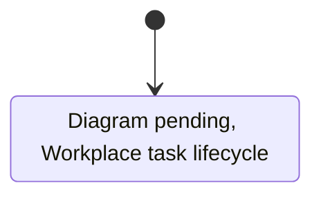
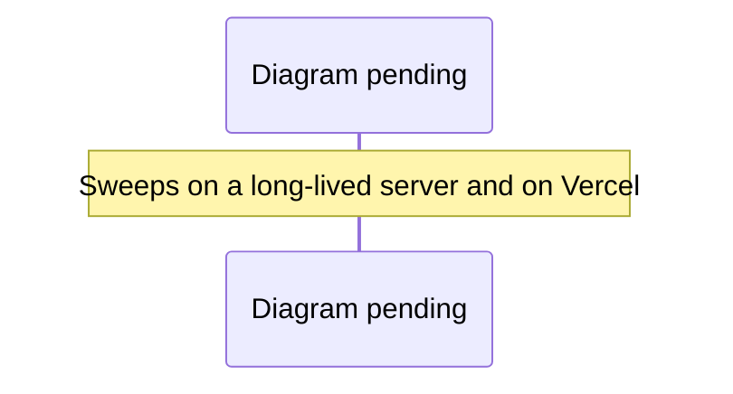

# Workplace: flags, kill switch, rollback and retention

This covers operating the first workplace slice (#214): one fixture companion, one `event_plan` grant and a draft-only plan. The code lives in `server/workplace.js`, `server/workplace-api.js` and `preview/src/workplace-*.js`. `workplace-office.js` and `workplace-room.js` are a coworking-studio fixture used only by tests and e2e: its desks are logical leases on two stations, and nothing is placed in the district. Statements cite the test that shows them where one exists. Statements marked *(code)* come from reading the code and have no dedicated test.

## Flags

| Flag | Where | Default | Effect |
| --- | --- | --- | --- |
| `RIVER_OAKS_WORKPLACE=1` | Service environment (town and Redis gateway) | off | Builds the workplace service and mounts `/api/workplace/<action>`. When off, every action returns 404. |
| `VITE_WORKPLACE=true` | Client build | off | Mounts the panel in the People roster. Vite reads it at build time, so changing it needs a rebuild. |

**The server flag is the kill switch.** The client flag only hides the panel and grants nothing: when the server flag is on, an authenticated, approved session can call the API directly. Both flags are listed, off, in `.env.example`, alongside `CRON_SECRET` for the Vercel sweep.

## Turning it off

1. Unset `RIVER_OAKS_WORKPLACE` (or set any value other than `1`) and redeploy or restart the service. A process started without the flag returns 404 for every `/api/workplace/*` action (`two live gateways racing one task …` in `server/tests/adversarial-workplace.test.js`). It builds no workplace service, so it creates no timer and advances no task *(code)*.
   - During a rolling deploy, instances still running with the flag on keep serving and keep their timers until they stop. The switch takes effect only when the last such instance is gone.
   - Switching off while a task is mid-flight is not tested.
2. Optionally rebuild the client with `VITE_WORKPLACE` unset to remove the panel.

Stored data is left in place, but each key's expiry keeps counting down while the flag is off. Turning the flag back on restores each owner's saved draft and finished tasks (same test). A task that was running when the flag went off resumes from its last checkpoint once the flag is back on: on a long-lived service, the sweep picks it up within 5 s (see **Unattended recovery** below); on Vercel, it resumes on the per-minute cron drain (when `CRON_SECRET` is set) or on the owner's next read. The time it was off doesn't count against its deadline. A gap longer than the 10 s step lease counts as one recovery, however long it lasts. A task fails with `worker_lost` only after a fourth such gap (`a reader returning after a long absence …` and `a lost runner recovers …` in `server/tests/workplace.test.js`).

## Rolling back the code

Reverting the workplace PR removes the routes; the Redis keys stay. A later re-deploy of the same storage version (`v1`) reads them again. If a rollback must also discard data, delete the keys described below in the target namespace only. Do this as a deliberate operator action, never from a test or a cleanup script.

## What is stored, and for how long

Diagram prompt: workplace-task-lifecycle

Draw a Mermaid stateDiagram-v2 of one workplace task, from the owner submitting a brief to the task being gone. Read server/workplace.js and preview/src/workplace-contract.js for the exact states and transitions (for example queued, running, paused, completed, failed, expired, cancelled) and label each transition with its trigger: owner action (submit, pause, resume, cancel, forget), the runner advancing a step, a failed access check, a ban or waitlist revoke (suspend), retention expiry, the periodic due-index sweep, the Vercel Cron drain (/api/workplace-sweep with CRON_SECRET), and erase ({confirm:'erase'}, which removes every stored trace atomically). Note which transitions write the private per-task key and which update the due index.

See [the diagram index](diagrams.md) for the convention.

Everything lives under the deployment's Redis namespace, `{REDIS_NAMESPACE}`. In local town mode it lives in process memory and is lost when the process restarts.

| Key | Holds | Lifetime |
| --- | --- | --- |
| `{ns}:workplace:v1:owner:<sha256(userId)>` | One owner's companion, grant, task and draft metadata (status, steps, ids, the public places captured for the task), notices and recent request ids. No brief, draft or receipt text. | Each write resets the key's expiry to the full retention period (30 days). An owner who stops writing loses the whole key 30 days after their last write. |
| `{ns}:workplace:v1:work:<sha256(userId)>:<taskId>` | One task's private text: the brief, plus the draft and receipt once it completes | Exact. Unfinished: 30 days from submission. Finished: 30 days from when it finished. Deleted with the task. An unrelated write never extends it (`server/tests/retention-workplace.test.js`). |
| `{ns}:workplace:v1:stations` | Which station is held, by a hashed owner, until when | Station leases last 30 minutes and renew on reads; the key expires after 60 minutes without a write *(code)*. The public view is exactly `{id, occupied, mine}` (`the public occupancy view carries exactly …`). The key spans the whole namespace, so every world shares the two stations. |

Inside an owner's document:

- A **draft** is deleted from storage 30 days after it was created. Deleting it also removes the task, brief, notice and request id that produced it (`deleting a draft forgets its brief …`).
- A **finished task** (completed, failed or cancelled) keeps its brief for 30 days after it finished, and at most 8 finished tasks are kept, oldest removed first *(code)*.
- **Forget:** the owner can delete any finished task with the `forget` action ("Forget" in the panel). It removes the brief, any draft and receipt, the notice and the request id in one save.
- **Exact at rest.** Private text is stored in the per-task key, and that key's expiry is set from the task's own times, never from the owner's latest write. A draft created on day 0 is gone from storage on day 30, even if the owner wrote on day 29 and never visits again. Its metadata stays in the owner document until the next read or write tidies it; the metadata holds no private text.
- **An unfinished brief** expires 30 days after submission too. A task paused past that point fails with `brief_expired` when resumed, and drafts nothing.
- **Earlier documents:** a document written before per-task keys keeps its briefs inline until it expires. The workplace has never been enabled on a hosted deployment, so this affects only local development data.
- An **active task** (queued, running or paused) stays until it finishes. The owner can cancel it, revoking cancels it, and a lapsed grant cancels it on the next read or re-grant.
- At most 3 drafts of at most 256 KiB each. At most 8 notices *(code)*.

The 30-day retention, 7-day grant and the other limits are `WORKPLACE_LIMITS` in `preview/src/workplace-contract.js`. They can only be changed in code: `town.js` and `world-gateway.js` pass no overrides. **The 30-day default needs Val's decision before hosted enablement.**

**Erase my workplace.** The `erase` action (body `{"confirm": "erase"}`, and a two-step control in the panel) removes every stored trace of the owner in one atomic save: the owner document (companion, grant, task metadata, notices, request ids), every `work:` key (briefs, drafts, receipts) and the due-index entry. Then it releases any desk and cancels any local timer. A runner racing the erase loses its compare-and-set and finds nothing to write. Another account's data is untouched, and the owner can start over (`server/tests/erase-workplace.test.js`). An owner can also forget a single finished task or delete a single draft.

## Access changes during work

Every request passes the town's session, waitlist, ban, origin and CSRF gates. Work stops when access ends in two ways:

- **When access ends.** A ban through the moderation route, or a waitlist decision that ends approval, revokes the grant at once and cancels queued, running and paused work with reason `access_revoked`. An idle grant is revoked too. This happens on both servers (`a ban or an ended waitlist approval stops paused work and idle grants …`, and the Redis case `… mid-task stops unattended work …`).
- **At each unattended step.** The service timer has no request behind it, so before each step it asks whether the owner is still approved and not banned. This catches a ban written to the moderation store some other way. Every sweep runs this check for each overdue owner it picks up: the 5 s timer on a long-lived service and the cron drain on Vercel. If the check itself fails, for example because the moderation store is unreachable, the step doesn't run (`server/tests/workplace.test.js`).
- **Restoring access** doesn't revive the grant or the cancelled work. The owner must grant again and submit again.

On a serverless host with no timer, steps advance on the owner's authorized reads, where the request gate already refuses banned or unapproved owners, and on the cron drain, which runs the same access check.

## Unattended recovery

Every save of an owner document also updates a due index, `{ns}:workplace:v1:due`. It's a sorted set of owners whose task is queued or running, scored by when the next step is due. The update happens in the same atomic script as the save. Pausing, finishing or cancelling removes the owner, so a paused task is never swept.

A **long-lived** gateway (`server/redis-start.js`, any deployment where `VERCEL` isn't `1`) sweeps every 5 s. It takes up to 50 overdue owners and, for each one, checks access (approved and not banned), then runs the next step. That step goes through the same compare-and-set as every other runner, so several instances sweeping the same task still land each step once.
- A task orphaned by an instance that died finishes on another instance, with nobody reading (`a live Redis gateway finishes a task orphaned by another gateway …` in `server/tests/sweep-workplace.test.js`).
- An owner who lost access has their work stopped (`access_revoked`).
- An index entry for a document that expired or was deleted is removed, but only if nobody re-scored it in the meantime.

On **Vercel**, a function invocation can't keep a timer. Instead, Vercel Cron calls `GET /api/workplace-sweep` once a minute (`crons` in `vercel.json`; the team is on Pro, which allows that rate), and the route **drains**: it steps every overdue task to completion, all owners in parallel, within a 20 s budget. The minute-long gap before the call counts as one lost-runner recovery, and the drain then keeps within the lease. Each sweep takes at most 50 due owners per call. A task the budget doesn't finish stays in the index for the next call (`server/tests/cron-workplace.test.js`).

Diagram prompt: workplace-sweep

Draw a sequence diagram comparing the two ways orphaned workplace tasks are advanced. Lane A, long-lived Node server: a periodic sweep timer (sweepMs) reads the Redis due index ({ns}:workplace:v1:due) and advances due owners. Lane B, Vercel (no long-lived process): Vercel Cron calls GET /api/workplace-sweep every minute with Authorization: Bearer CRON_SECRET; the route drains due owners within a time budget and returns. Show the compare-and-set owner document save (Lua SAVE script with side ops), the private per-task keys with exact expiry, and that a runner racing an erase cannot bring data back.

See [the diagram index](diagrams.md) for the convention.

- The route exists only with the workplace on and `CRON_SECRET` set. Without the secret it returns 404, and with a wrong or missing `Authorization: Bearer <CRON_SECRET>` header it returns 401. The comparison is constant-time.
- With `RIVER_OAKS_WORKPLACE` off, the Vercel entry answers the cron with 404 before it starts the backend, so the per-minute call costs almost nothing.
- **Before enabling on Vercel:** set `CRON_SECRET` in the project's environment variables. Vercel sends it on cron calls. Without it, tasks advance only on owner reads. The in-memory town keeps everything in one process, so a restart loses its data, and it has no sweep either.

The due index holds raw user ids, because the access check needs them. The waitlist and moderation stores already hold user ids server-side, and the index is never exposed through any route.

## Your companion panel

The panel, titled "Your companion", mounts after groups and social when both flags are on (`preview/src/workplace-ui.js`):

- **Polling:** every 2 s while a task is queued or running, otherwise every 15 s.
- **When disconnected:** while the town connection is lost or the tab is hidden, it stops polling and shows "Connection lost — progress unknown" rather than a stale state (`preview/src/workplace-contract.js`).
- **Controls:**
  - Go to a desk / Walk with me / Take a break
  - Allow drafting for 7 days / Revoke
  - Pause / Resume / Cancel / Forget
  - Open / Delete for drafts
  - **Erase my workplace…**, which confirms with **Erase everything** or **Keep my workplace**

## Not covered

- Live WorkOS sessions, hosted Redis under production load, and multi-region behavior.
- The art pass, uncoached player sessions and device performance budgets (#221, owned by Val).
- The Vercel cron route on a real deployment: tested locally against a live Redis gateway, not on Vercel itself.
- Any external effect. The fixture adapter writes nothing outside the owner's document, and each receipt records `externalWrites: 0` and `paidCalls: 0`.
